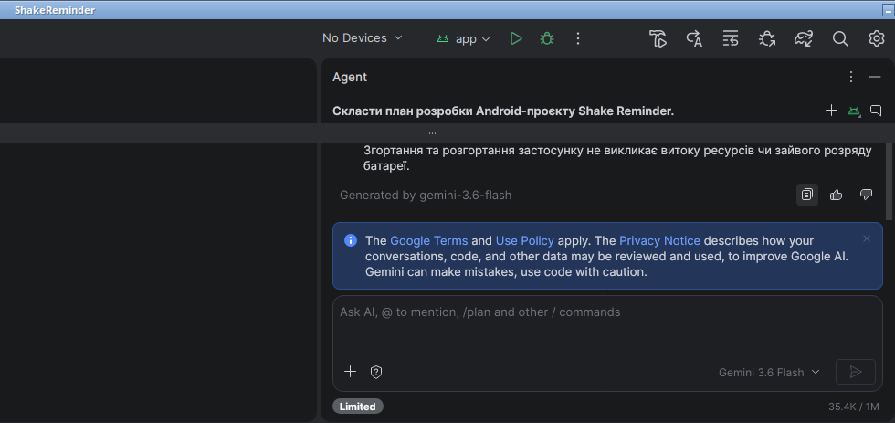
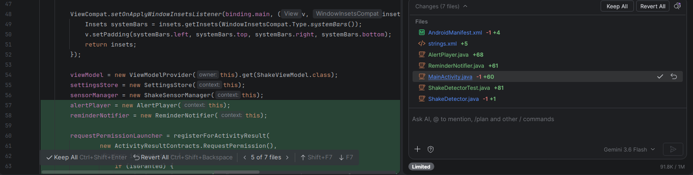
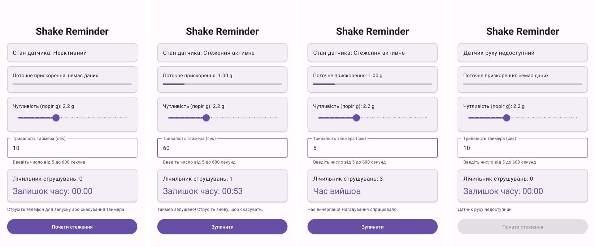
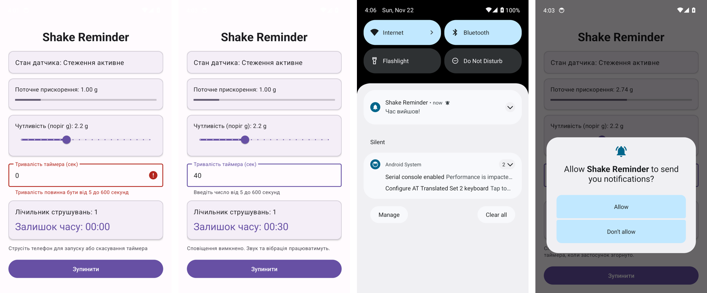
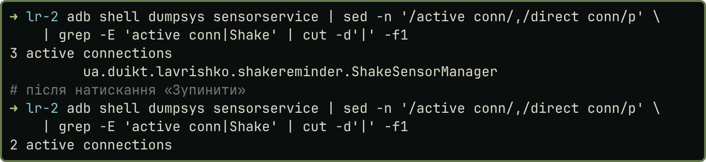

# 1. Мета, варіант і технічне завдання

Мета: створити Android-застосунок за допомогою агента Gemini в Android Studio, керувати ним поетапними промптами, перевіряти кожну його зміну та результат на емуляторі.

Варіант: Shake Reminder (акселерометр), окремий застосунок: його створює майстер Studio, як вимагає методичка, а агентові дістається невеликий проєкт. Код і журнали: [тека роботи](https://github.com/brizzinck/krinzhrepoduta/tree/main/mobile_dev/lr-2).

Власне технічне завдання:

1. Екран: назва, стан датчика, прискорення в g, кнопка «Почати стеження / Зупинити», тривалість таймера, повзунок чутливості, лічильник струшувань, залишок часу, підказка.
2. «Почати стеження» реєструє слухача акселерометра, «Зупинити» знімає його й скасовує таймер.
3. Струшування: 3 поштовхи за 1 с (поштовх це перетин порога знизу вгору, наступний можливий після спаду на 0,3 g нижче порога), далі пауза 1,5 с; одиночний поштовх ігнорується.
4. Струшування запускає таймер на 5-600 с, струшування під час відліку скасовує його.
5. Час вийшов: звук, вібрація, текст «Час вийшов», сповіщення, якщо застосунок згорнуто.
6. Помилки: немає акселерометра (повідомлення, кнопка неактивна); тривалість поза 5-600 (помилка поля, таймер не стартує); відмова в дозволі на сповіщення (пояснення, таймер і звук працюють).
7. Слухач знімається при згортанні й повертається; поворот не скидає стан; налаштування в `SharedPreferences`; без `INTERNET` і фонових сервісів.

# 2. Середовище

| Параметр | Значення |
|----------------|--------------------------------------------------------|
| Android Studio | Rabbit 2, 2026.2.2 Patch 2 (збірка AI-262.10968.63.2622.16975389) |
| Gemini | панель Agent, рівень Individual, модель Gemini 3.6 Flash, схвалення змін вручну |
| Проєкт | майстер New Project, Empty Views Activity, Java, minSdk 24, compileSdk і targetSdk 37, AGP 9.5.2, Gradle 9.6.0 |
| Емулятор | Pixel 6, Android 14 (API 34), Google APIs x86_64 |

{width=13cm}

# 3. Хід роботи з Gemini

Повні тексти промптів: [prompts.md](https://github.com/brizzinck/krinzhrepoduta/blob/main/mobile_dev/lr-2/prompts.md).

| № | Суть запиту | Що створив або змінив агент | Що перевірив або виправив студент |
|---|------------------|------------------------------|---------------------|
| 1 | А. План без змін коду | Прочитав 7 файлів, план з 5 етапів | Звірив план із ТЗ (нижче) |
| 2 | Б. Розмітка, рядки, View Binding | 4 файли (+218, -14), сам виправив текст без @string | Звірив id і межі 5-600, 1,5-3,5; прийняв |
| 3 | В1. Датчик, таймер, ViewModel, Log.d | 7 файлів (+578, -8) | Прочитав diff. Поріг 2,7 g, а в плані агента 2,2 g; числа в промпті не було |
| 4 | В2. Сигнал, сповіщення, 5 тестів | 7 файлів (+280, -3). Тест із мітками від 1000 мс упав, бо пауза блокувала перше струшування; агент сам знайшов причину й виправив | Переглянув diff (рис. 2), прийняв |
| 5 | Г. Sync і збірка | Усе успішне, змін немає; застосунок не запускав | Повторив збірку в консолі |
| 6 | Д. Емулятор і Logcat | Запустив, натиснув «Почати» і «Зупинити», у Logcat register і unregister; решту віддав мені | Решту виконав сам (розділ 6) |
| 7 | Е. Аудит, поради без змін | Порадив обмежити оновлення UI і SENSOR_DELAY_UI; не запропонував зняти слухача таймера в onDestroy | Перше прийняв, друге відхилив: поштовх 80 мс, режим UI дає 16 Гц |
| 8 | Правки: UI 100 мс, поріг 2,2 g, «Час вийшов», setListener(null) | 6 файлів (+19, -8), збірка і 6 тестів успішні | Прочитав diff, прийняв; обнулення лише захисне, витоку я не бачив |
| 9 | Виправлення: onResume() стирає tvHint | MainActivity.java (+4, -1) | Помилку знайшов у N3, перевірив повторним прогоном |

{width=15cm}

Порівняння плану з ТЗ. Агент планував `ShakeDetector` слухачем датчика, але такий клас залежить від Android і не тестується модульно, тому в промпті 3 я вимагав чистий Java-клас, а слухача виніс у `ShakeSensorManager`. Ризик: `CountDownTimer` і стан у `MainActivity` скидає поворот, тож вони живуть у `ShakeViewModel`. Таймер 15-30 с і піки через 200-500 мс із плану в ТЗ замінено на 5-600 с і вікно 1 с; промпти 2-7 це враховували.

Вручну після сесії з Gemini я доробив те, чого агент не зробив, тож код розділу 7 відрізняється від його відповідей: показ `tvGForce`, підказку й «Час вийшов» після повороту, гістерезис із трьома тестами, рядки Logcat про звук, коментарі українською.

# 4. Структура файлів

| Файл | Призначення |
|--------------------|----------------------------------------------------|
| ShakeDetector | чиста Java: g, поштовхи, 3 за 1 с, пауза 1,5 с |
| ShakeSensorManager | обгортка над SensorManager: start(), stop(), повідомляє про g і струшування |
| ShakeViewModel | таймер, лічильник, прапорець стеження, підказка; поворот нічого не скидає |
| MainActivity | View Binding, кнопка, перевірка тривалості, дозвіл, onPause() і onResume() |
| AlertPlayer, ReminderNotifier | звук, вібрація, сповіщення «Час вийшов!» |
| AndroidManifest.xml | VIBRATE і POST_NOTIFICATIONS, без INTERNET, акселерометр не обовʼязковий |


# 5. Скриншоти

{width=13.5cm}

{width=13.5cm}

# 6. Тестування

Прогін `run_tests.py` (`results/test_run.txt`), N1 на AVD без акселерометра (`results/test_run_n1.txt`); струшування вводила консоль емулятора. Звук і вібрацію (F4, N3) на слух не перевіряв, доказ лише Logcat.

| Умови | Очікуваний результат | Фактичний результат | Висновок |
|------------------|----------------|----------------------------|----------|
| B1. gradlew assembleDebug testDebugUnitTest | без помилок | BUILD SUCCESSFUL, тести 8 з 8 і 1 з 1 | пройдено |
| F1. 60 с, 4 поштовхи | «Стеження активне», 1,00 g, лічильник 1 | до старту «немає даних», потім 1.00 g; 1, 00:53 | пройдено |
| F2. один поштовх | лічильник і таймер без змін | лічильник 1 до і після | пройдено |
| F3. струшування під час відліку | таймер скасовано, лічильник 2 | 2, 00:00, Timer cancelled | пройдено |
| F4. 5 с, струшування | «Час вийшов», виклик звуку | так (рис. 3), Alert tone started і Alert vibration started | пройдено |
| N1. AVD без акселерометра | повідомлення, кнопка неактивна | «Датчик руху недоступний», кнопка неактивна, crash порожній | пройдено |
| N2. тривалість 0, 700, порожньо | помилка поля, таймер не стартує | «Тривалість повинна бути від 5 до 600 секунд», Timer start failed | пройдено |
| N3. чистий запуск, «Don’t allow» | пояснення, таймер завершується без падіння | пояснення показано, через 40 с Timer finished, Alert tone started і Alert vibration started | пройдено |
| L1. Home і повернення | у фоні слухача немає | підключень 1, 0, 1 | пройдено |
| L2. ландшафт і назад | таймер не скинуто | 00:57, 00:46, 00:35, лічильник 4 | пройдено |
| L3. 10 натискань кнопки з інтервалом 0,3 с | без збою, слухач один | підключень 1, crash порожній | пройдено |
| L4. відмова, повороти, «Час вийшов» | пояснення і «Час вийшов» не стираються | пояснення на місці (00:04), «Час вийшов» після двох поворотів | пройдено |
| R1. «Зупинити» під час відліку | слухача немає, таймер скасовано | наших підключень 1 і 0 (усіх 3 і 2, рис. 5), Timer cancelled | пройдено |
| R2. 10 с, Home, 12 с | сповіщення «Час вийшов!» | є в dumpsys notification (рис. 4) | пройдено |

{width=12cm}

# 7. Пояснення коду

Метод `ShakeDetector.onSample` (скорочено):

```java
float g = toG(x, y, z);                  // sqrt(x²+y²+z²) / 9,81
if (g < thresholdG - 0.3f) armed = true; // спад: новий поштовх можливий
if (lastShakeTimestampMs > 0 && timestampMs - lastShakeTimestampMs < 1500)
    return false;                        // пауза після спрацювання
if (armed && g >= thresholdG) {          // поштовх
    armed = false; joltTimestamps.add(timestampMs);
}
// ... видаляємо поштовхи старші за 1000 мс
if (joltTimestamps.size() >= 3) {        // струшування
    lastShakeTimestampMs = timestampMs;
    joltTimestamps.clear(); return true;
}
```

Один удар дає кілька відліків вище порога, але це один поштовх: наступний можливий після спаду на 0,3 g нижче порога (тести: плато з 6 відліків, дрижання).

`MainActivity.onResume()` і `onPause()` (скорочено):

```java
protected void onResume() {
    super.onResume();                    // ... і далі
    if (sensorManager.isAvailable() && viewModel.isTracking())
        sensorManager.start();           // слухач повертається
}
protected void onPause() {
    super.onPause();
    if (sensorManager.isListening()) sensorManager.stop();  // unregister
}
```

Дозволи: акселерометру не потрібен жоден, `VIBRATE` звичайний, `POST_NOTIFICATIONS` запитується при першому запуску таймера, без нього таймер завершується, а звук і вібрація викликаються; `aapt2 dump permissions` показує лише ці два. Ресурси: слухач знімається в `stop()` і `onPause()`, таймер скасовується в `cancel()` і `onCleared()`, `ToneGenerator` звільняється в `onDestroy()`.

# 8. Контрольні питання

1. Agent Mode і відповідь у чаті. Чат дає текст, який переношу я; агент сам читає проєкт, змінює файли й запускає збірку, а я приймаю зміни.
2. Файли агента. Усе з розділу 4 і `build.gradle.kts`; без розмітки й маніфесту застосунок не запуститься.
3. Збірка без працюючої функції. Збірка доводить лише компіляцію: вона пройшла, а екран показував шаблон «%.2f g».
4. Де дивитися помилки. Logcat (тег `ShakeReminder`), `adb logcat -b crash -d`, вкладка Build.
5. Маніфест і дозволи. Маніфест оголошує потрібне застосунку; дозвіл на сповіщення можна відхилити, тож застосунок працює й без нього: у N3 `Timer finished` без помилок. Звук і вібрацію на слух не перевіряв.
6. Ресурс після «Зупинити». Слухач, що лишився, розряджає батарею. Наших підключень було 1, стало 0, усіх активних 3 і 2 (рис. 5).
7. Найкращий промпт. Промпт 3: класи, сигнатури, формула g, 3 поштовхи за 1000 мс, пауза 1500 мс, життєвий цикл, заборона зайвих дозволів. Поріг числом не задав, тож агент обрав 2,7 g замість 2,2 g зі свого плану; у промпті 8 задав явно.
8. Помилка агента. Після відмови в дозволі `onResume()` стирав пояснення в `tvHint`; збірка, тести й аудит цього не бачили, знайшов N3, виправлено промптом 9.
9. Автоматична перевірка і телефон. Тести перевіряють алгоритм без Android, але не датчик, дозволи, повороти й сповіщення. Живе струшування на телефоні не перевіряв.

# 9. Висновки

Gemini за дев'ять промптів створив інтерфейс, логіку датчика, таймер, сигнал, сповіщення і п'ять тестів; я читав кожну зміну. Агент поставив поріг 2,7 g замість 2,2 g зі свого плану, бо числа в промпті не було; стирання пояснення після відмови в дозволі виявив лише емулятор. Вручну я доробив те, чого агент не зробив (розділ 3): показ прискорення («немає даних» замість «%.2f g» і хибного 1.00 g), підказку й «Час вийшов» після повороту, додав гістерезис 0,3 g із трьома тестами та рядки Logcat про звук. Збірка і 9 тестів проходять, 13 сценаріїв на Android 14 пройдено, crash немає. Обмеження: звук і вібрацію не прослухано, перевірено лише виклик у Logcat; телефон, живе струшування й інші версії Android не перевірялися; таймер не є будильником (`AlarmManager` не використано): у фоні система може запізнити сповіщення (перевірено лише 10 с), а вбитий процес втрачає таймер.
