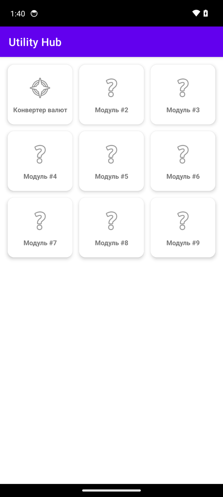
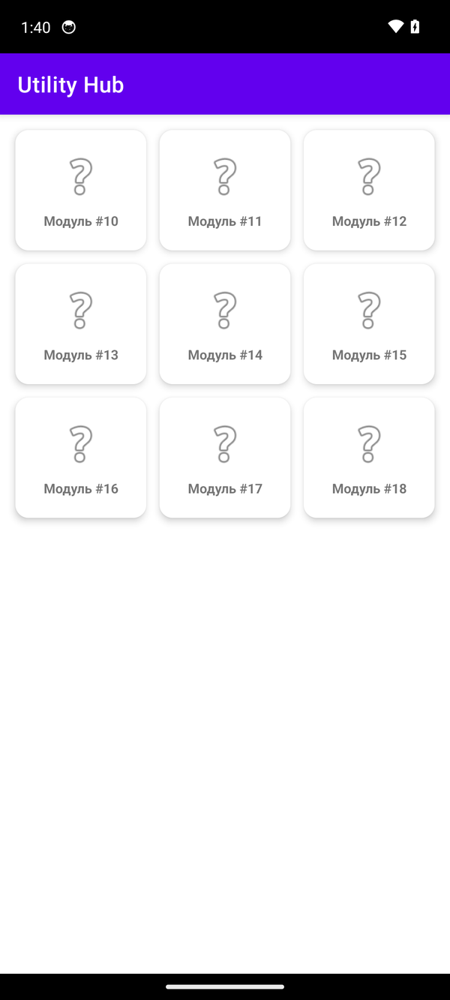
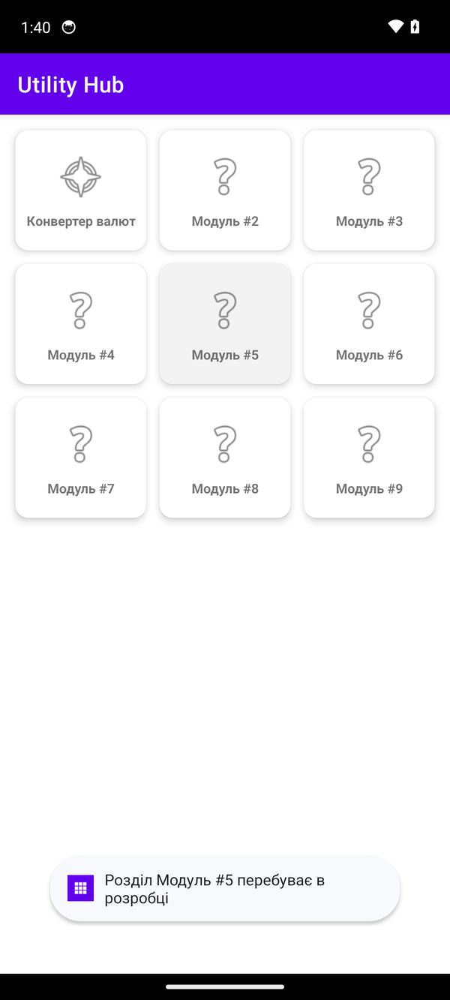
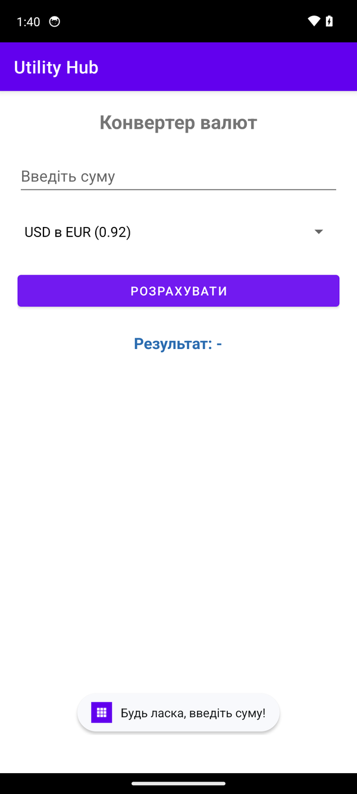
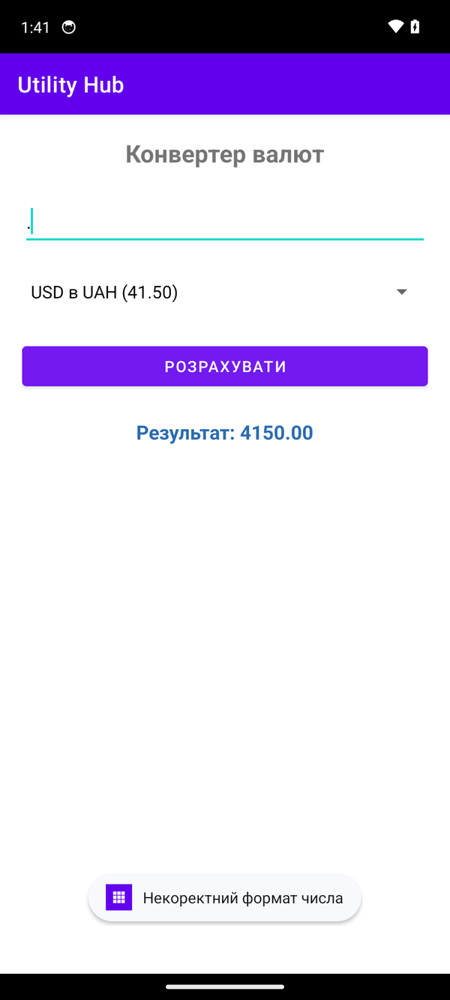

# 1. Мета роботи

Освоїти сітки з `RecyclerView`, `CardView` і `GridLayoutManager`, гортання сторінок через `ViewPager2`, перехід між екранами через `Intent` і створити екран «Конвертер валют» із перевіркою введення. Усі кроки методички виконано, додаток зібрано й запущено на емуляторі Android 14 (API 34, Pixel 6).

Проєкт зібрано Gradle (AGP 8.5.2, Java 17, `minSdk 24`, `targetSdk 34`) у Docker, без Android Studio: файли проєкту створено вручну за кодом методички. Знімки зроблено командою `adb exec-out screencap -p` на емуляторі. Вихідний код, журнали збірки та запуску: [тека роботи](https://github.com/brizzinck/krinzhrepoduta/tree/main/mobile_dev/pr-1).

# 2. Виконання за кроками

**Крок 1. Проєкт.** Створено проєкт `UtilityHub` (пакет `com.example.utilityhub`, мова Java, `minSdk 24`). У `app/build.gradle.kts` увімкнено View Binding, після цього Gradle згенерував клас для кожного макета: `ActivityMainBinding`, `FragmentGridPageBinding`, `ItemTileBinding`, `ActivityCurrencyBinding`.

```{.kotlin .small}
buildFeatures {
    viewBinding = true
}
```

**Крок 2. Модель, макет плитки, адаптер.** `TileItem` зберігає назву, іконку й клас Activity (для заглушки `null`). Макет `item_tile.xml` побудовано на `CardView` заввишки 110dp із радіусом кутів 12dp. `TileAdapter` створює плитки в `onCreateViewHolder`, заповнює їх у `onBindViewHolder`, а за натисканням або запускає Activity через `Intent`, або показує `Toast`. Перевірка: на плитці-заглушці з'являється повідомлення (рис. 3), на «Конвертері валют» відкривається новий екран.

```{.java .small}
holder.itemView.setOnClickListener(v -> {
    if (item.getTargetActivity() != null) {
        context.startActivity(new Intent(context, item.getTargetActivity()));
    } else {
        Toast.makeText(context, "Розділ " + item.getTitle() + " перебуває в розробці",
                Toast.LENGTH_SHORT).show();
    }
});
```

**Крок 3. Сторінка сітки.** `GridPageFragment` отримує номер сторінки через `newInstance(int)` і `Bundle`, створює 9 плиток і виводить їх у сітці з трьох стовпців. Перша плитка першої сторінки веде до `CurrencyActivity`, решта є заглушками «Модуль #N». У `onDestroyView()` binding обнулено, щоб фрагмент не тримав застарілий інтерфейс.

```{.java .small}
binding.recyclerViewGrid.setLayoutManager(new GridLayoutManager(getContext(), 3));
binding.recyclerViewGrid.setAdapter(new TileAdapter(getContext(), items));
```

**Крок 4. Конвертер валют.** `CurrencyActivity` містить поле суми, `Spinner` із трьома курсами (USD в EUR 0.92, EUR в USD 1.09, USD в UAH 41.50) і кнопку. `performConversion()` перевіряє введення: порожнє поле дає `Toast` «Будь ласка, введіть суму!» (рис. 4), для некоректного числа `parseDouble` кидає `NumberFormatException`, а блок `catch` показує «Некоректний формат числа» (рис. 6), інакше результат множиться на курс і виводиться з двома знаками (рис. 5).

```{.java .small}
String inputStr = binding.editAmount.getText().toString().trim();
if (inputStr.isEmpty()) {
    Toast.makeText(this, "Будь ласка, введіть суму!", Toast.LENGTH_SHORT).show();
    return;
}
try {
    double amount = Double.parseDouble(inputStr);
    double result = amount * rates[binding.spinnerCurrency.getSelectedItemPosition()];
    binding.textResult.setText(String.format(Locale.getDefault(), "Результат: %.2f", result));
} catch (NumberFormatException e) {
    Toast.makeText(this, "Некоректний формат числа", Toast.LENGTH_SHORT).show();
}
```

**Крок 5. Головний екран.** `activity_main.xml` має один `ViewPager2`. У `MainActivity` його адаптер `FragmentStateAdapter` повертає `GridPageFragment.newInstance(position)` і має 2 сторінки. Свайп вліво відкриває другу сторінку з модулями № 10–18 (рис. 2).

**Крок 6. Маніфест.** `CurrencyActivity` зареєстровано з `exported="false"`, бо її запускає лише сам додаток. Без цього запису `startActivity` завершився б помилкою `ActivityNotFoundException`. `MainActivity` має фільтр `MAIN` і `LAUNCHER`.

```{.xml .small}
<activity
    android:name=".activities.CurrencyActivity"
    android:exported="false" />
```

Текст заглушки взято з коду методички («Розділ … перебуває в розробці»); у таблиці методички той самий статус названо коротко «У розробці».

::: {style="break-inside: avoid"}
# 3. Скриншоти

| Рис. 1 | Рис. 2 | Рис. 3 |
|:---:|:---:|:---:|
| {width=4.4cm} | {width=4.4cm} | {width=4.4cm} |
| **Рис. 4** | **Рис. 5** | **Рис. 6** |
| {width=4.4cm} | {width=4.4cm} | {width=4.4cm} |

Рис. 1: перша сторінка. Рис. 2: друга сторінка після свайпу. Рис. 3: `Toast` на плитці «Модуль #5». Рис. 4: порожнє поле. Рис. 5: 100 USD в UAH дає 4150.00. Рис. 6: «.» у полі дає «Некоректний формат числа».
:::

# 4. Висновки

Я зібрав додаток «Utility Hub» за шістьма кроками методички. Сітка 3 на 3 працює на `RecyclerView` із `GridLayoutManager`, плитки оформлені як `CardView`, а `ViewPager2` розкладає 18 плиток на дві сторінки. Адаптер із `ViewHolder` використовує плитки повторно, а клік за наявності цільового класу відкриває екран через `Intent`, інакше показує `Toast`. Конвертер перевіряє порожнє й некоректне введення та рахує за курсом вибраної пари. Я переконався, що `CurrencyActivity` має бути записана в маніфесті, а View Binding дає доступ до елементів без `findViewById`. Збірка пройшла без помилок, на емуляторі Android 14 перевірено перехід до конвертера, усі три `Toast` і розрахунок.
