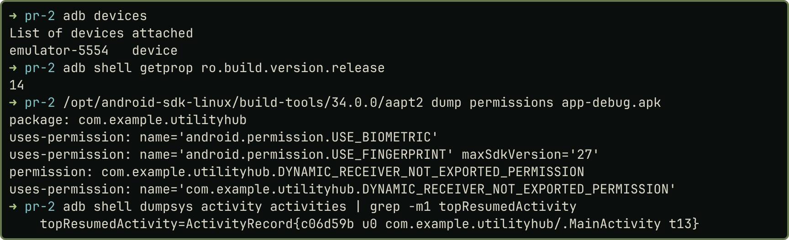
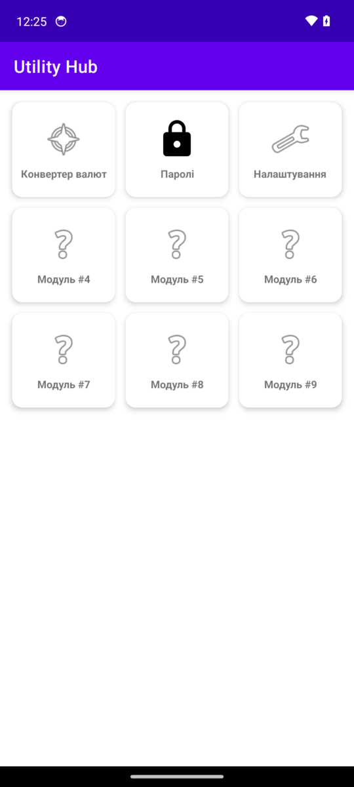
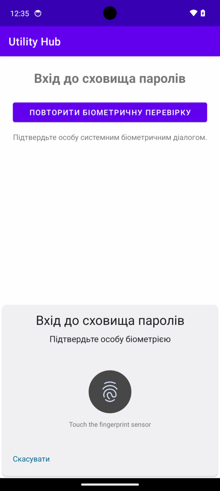
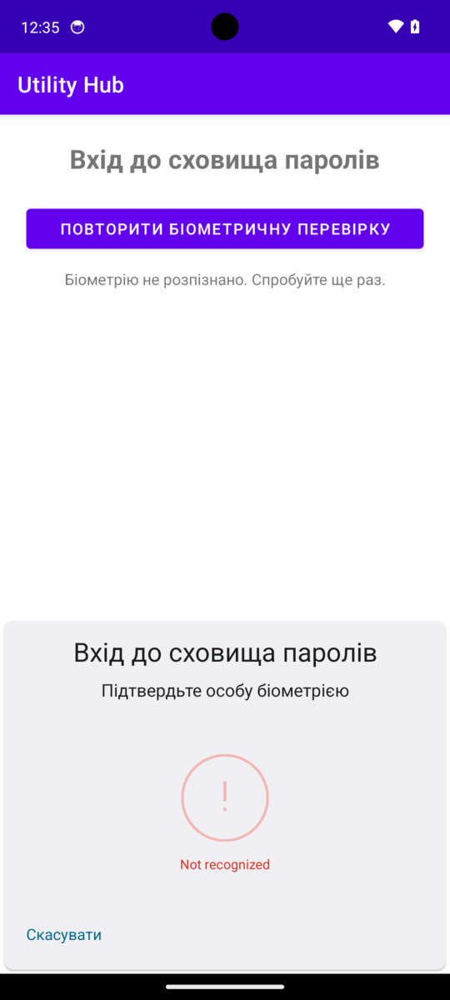
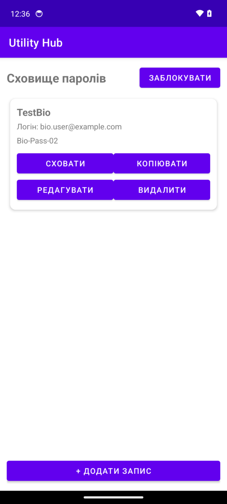
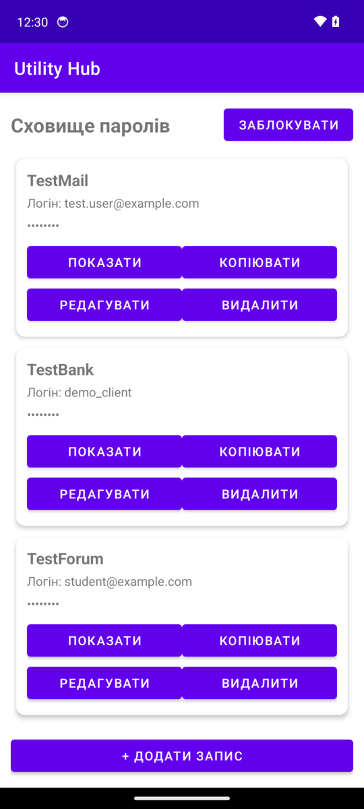
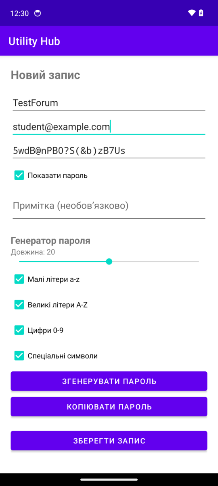
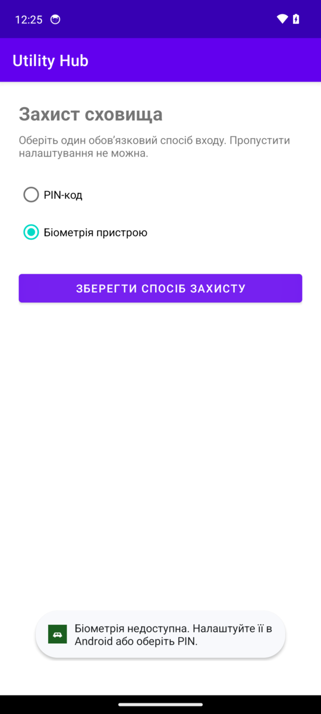

# 1. Мета роботи та виконані завдання

Мета роботи: додати до Utility Hub локальний менеджер паролів із генератором, CRUD, шифруванням і входом через PIN або біометрію.

Я активував плитку «Паролі», зробив вибір способу захисту, вхід через PIN і `BiometricPrompt`, сховище записів і генератор на 8–32 символи. Для підвищеної оцінки додатково шифрую `service`, `login`, `note` і блокую сховище, якщо воно понад 30 с не на екрані.

Відмінності від методички: `"\d{4,8}"` не компілюється (`illegal escape character`), тому в коді `"\\d{4,8}"`. `Toast` про біометрію скорочено: Android 14 показує два рядки. Додано `requestFocus()` для помилки PIN, `allowBackup="false"` і тему з ЛР 1 на нових екранах. Блок `if` у `GridPageFragment` доповнено, а не замінено (п. 7): лишилась плитка № 3.

Збірка: Gradle у Docker, Java 17 (JDK 21), `minSdk 24`, `targetSdk 34`. Запуск: емулятор Android 14 (API 34). Код і журнали: [тека роботи](https://github.com/brizzinck/krinzhrepoduta/tree/main/mobile_dev/pr-2).

{width=12cm}

# 2. Створені файли

| Файли | Призначення |
|---------------------------------------|--------------|
| `SecuritySetupActivity.java`, `activity_security_setup.xml` | вибір захисту |
| `UnlockActivity.java`, `activity_unlock.xml` | вхід у сховище |
| `PasswordVaultActivity.java`, `activity_password_vault.xml` | список, блокування |
| `PasswordEditActivity.java`, `activity_password_edit.xml` | редактор, генератор |
| `PasswordAdapter.java`, `item_password.xml` | картка запису |
| `PasswordItem.java`, `ic_password.xml` | модель, іконка |
| `CryptoManager.java` | AES/GCM, Keystore |
| `PinSecurityHelper.java` | salt і хеш PIN |
| `VaultSession.java` | сесія, автоблокування |
| `PasswordStorage.java` | збереження JSON |

Змінено `app/build.gradle.kts` (`biometric:1.1.0`), `AndroidManifest.xml` (дозволи, чотири Activity) і `GridPageFragment.java` (плитка № 2).

# 3. Ключові фрагменти коду

`PinSecurityHelper`: у файл потрапляють лише salt, хеш і назва KDF. На API 26+ це SHA-256, на API 24–25 SHA-1.

```{.java .small}
byte[] salt = new byte[16];
new SecureRandom().nextBytes(salt);
String algorithm = getDefaultAlgorithm();
byte[] hash = hashPin(pin.toCharArray(), salt, algorithm);   // 120000 ітерацій, 256 біт
// перевірка: той самий salt і алгоритм, порівняння в постійний час
return MessageDigest.isEqual(savedHash, enteredHash);
```

`CryptoManager`: ключ створює Keystore, IV генерується під час кожного шифрування й зберігається поруч із шифротекстом.

```{.java .small}
KeyGenParameterSpec spec = new KeyGenParameterSpec.Builder(KEY_ALIAS,
        KeyProperties.PURPOSE_ENCRYPT | KeyProperties.PURPOSE_DECRYPT)
        .setBlockModes(KeyProperties.BLOCK_MODE_GCM)
        .setEncryptionPaddings(KeyProperties.ENCRYPTION_PADDING_NONE)
        .setRandomizedEncryptionRequired(true).build();
cipher.init(Cipher.ENCRYPT_MODE, key);   // encrypt
byte[] iv = cipher.getIV();
byte[] encrypted = cipher.doFinal(plainText.getBytes(StandardCharsets.UTF_8));
return Base64.encodeToString(iv, Base64.NO_WRAP) + ":"
        + Base64.encodeToString(encrypted, Base64.NO_WRAP);
```

`BiometricPrompt` (`UnlockActivity`): застосунок отримує лише результат перевірки.

```{.java .small}
// у AuthenticationCallback: onAuthenticationSucceeded викликає openVault(),
// onAuthenticationFailed показує «Біометрію не розпізнано. Спробуйте ще раз.»
promptInfo = new BiometricPrompt.PromptInfo.Builder().setTitle("Вхід до сховища паролів")
        .setAllowedAuthenticators(BiometricManager.Authenticators.BIOMETRIC_STRONG)
        .setNegativeButtonText("Скасувати").build();
biometricPrompt.authenticate(promptInfo);
```

Генератор (`PasswordEditActivity`): по одному символу з кожної вибраної групи, далі випадкові символи й перемішування Fisher-Yates.

```{.java .small}
for (String group : groups) chars.add(group.charAt(secureRandom.nextInt(group.length())));
while (chars.size() < length) chars.add(pool.charAt(secureRandom.nextInt(pool.length())));
for (int i = chars.size() - 1; i > 0; i--) {
    int j = secureRandom.nextInt(i + 1);
    Character temp = chars.get(i); chars.set(i, chars.get(j)); chars.set(j, temp);
}
```

`PasswordStorage`: пароль приходить уже зашифрованим, решту полів шифрує `save()`.

```{.java .small}
obj.put("service", crypto.encrypt(item.getService()));
obj.put("login", crypto.encrypt(item.getLogin()));
obj.put("encryptedPassword", item.getEncryptedPassword());
obj.put("note", crypto.encrypt(item.getNote()));
prefs.edit().putString(KEY_ITEMS, array.toString()).apply();
```

# 4. Скриншоти

| Рис. 2 | Рис. 3 | Рис. 4 | Рис. 5 |
|:---:|:---:|:---:|:---:|
| {width=3.6cm} | {width=3.6cm} | {width=3.6cm} | {width=3.6cm} |
| **Рис. 6** | **Рис. 7** | **Рис. 8** | **Рис. 9** |
| {width=3.6cm} | {width=3.6cm} | {width=3.6cm} | {width=3.6cm} |

Рис. 2: плитка «Паролі». Рис. 3: вибір захисту. Рис. 4: `BiometricPrompt`. Рис. 5: чужий відбиток відхилено. Рис. 6: вхід відбитком успішний. Рис. 7: три тестові записи. Рис. 8: згенерований пароль. Рис. 9: біометрію не налаштовано. Усі дані тестові.

# 5. Обов’язкове тестування

| № | Тест | Результат на емуляторі |
|---|----------|----------------------------|
| 1 | Перший запуск | `SecuritySetupActivity`; без вибору `Toast`, далі не пускає |
| 2 | PIN 123/123456789 | 123: помилка; 9-ту цифру поле не приймає (`maxLength=8`) |
| 3 | Різні PIN | помилка, `security_method` не збережено |
| 4 | Правильний PIN | відкрито сховище |
| 5 | Неправильний PIN | «Неправильний PIN», сховище закрите |
| 6 | Без біометрії | 0 відбитків: `Toast`, режим не збережено (рис. 9) |
| 7 | Біометрія успішна | відбиток 1 (імітація: `adb -e emu finger touch 1`): відкрито сховище (рис. 6), `accept=1` |
| 8 | Невірний відбиток | відбиток 2: «Біометрію не розпізнано» (`onAuthenticationFailed`), `reject=1`, вхід закрито (рис. 5) |
| 9 | Генератор 8/16/32 | по 3 паролі: довжина й групи відповідають вибраним |
| 10 | CRUD | запис створено, логін змінено, інший запис видалено |
| 11 | Показати/сховати | маска, далі `Test-Pass-01`, потім знову маска |
| 12 | Копіювання | вставлене в поле значення збіглося з паролем |
| 13 | Перезапуск | записи на місці, плитка веде на `UnlockActivity` |
| 14 | Заблокувати | `UnlockActivity`, повторний вхід знову вимагає PIN |
| 15 | Без INTERNET | дозволу немає (рис. 1); в авіарежимі пароль розшифровано |

Додаткові завдання: у `vault_data.xml` немає відкритих сервісу, логіна, примітки й пароля; після 35 с у фоні відкривається `UnlockActivity`, після 5 с ні. Гілку SHA-1 для API 24–25 не запускав: перевірка лише на API 34. Застосунок не пише секрети в журнал, але Gboard записала скопійований пароль у `logcat`, тому буфер обміну не є захищеним.

# 6. Висновок

Я додав до Utility Hub менеджер паролів і пройшов 15 тестів на емуляторі, зокрема вхід імітованим відбитком. Відкритий PIN можна було б просто прочитати з файлу, тому там лежить хеш PBKDF2, який обчислюється повільно й ускладнює перебір. Salt робить хеші однакових PIN різними й не дає використати готові таблиці. Android Keystore зберігає ключ AES поза кодом і `SharedPreferences`. AES/GCM шифрує дані й перевіряє їх цілісність, а випадковий IV дає різний шифротекст для однакових паролів. `BiometricPrompt` передає перевірку системі, а застосунок отримує лише успіх або помилку. Обмеження: ключ не привʼязаний до автентифікації, тому PIN і біометрія захищають вхід в інтерфейс, а не сам ключ.
