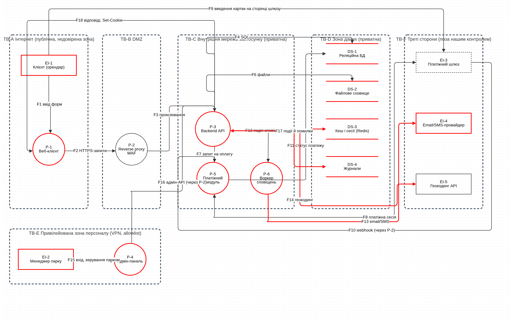
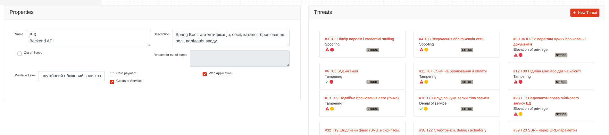
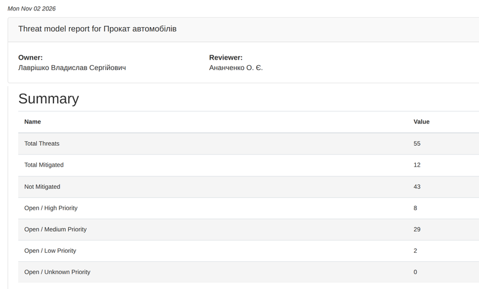

# 1. Тема та мета роботи

**Тема:** «Моделювання загроз програмного забезпечення».

**Мета роботи:** проаналізувати архітектуру програмного продукту та створити модель загроз.

Теорія коротко. Моделювання загроз знаходить загрози ще на етапі проєктування (secure by design). Їх класифікують за STRIDE: Spoofing (автентичність), Tampering (цілісність), Repudiation (неспростовність), Information disclosure (конфіденційність), Denial of service (доступність), Elevation of privilege (авторизація). Загрози розглядають для кожного елемента діаграми потоків даних (DFD): зовнішні учасники схильні до S і R, сховища до T, R, I, D, процеси до всіх шести, потоки до T, I, D.

Інструмент: OWASP Threat Dragon v2.2.0 (реліз із методички), веб-версія в docker, режим «Local Session» (`threat-dragon/run.sh start`). Microsoft Threat Modeling Tool працює лише в Windows, тому для Linux викладач дозволив OWASP Threat Dragon. Файли роботи лежать у [теці репозиторію](https://github.com/brizzinck/krinzhrepoduta/tree/main/security/lr-1).

# 2. Схема архітектури досліджуваного додатку

Досліджується вебсервіс «Прокат автомобілів» (власна розробка, архітектура є моїм припущенням): клієнт реєструється, обирає авто, бронює й оплачує на сторінці зовнішнього шлюзу (номер картки до сервісу не потрапляє); менеджер керує парком через окрему адмін-панель. Модель має 15 елементів, 6 меж довіри й 18 потоків; ідентифікатори однакові в діаграмі й таблицях.

| Тип | Елементи |
|------|--------------------|
| Зовнішні учасники (EI) | EI-1 Клієнт, EI-2 Менеджер парку, EI-3 Платіжний шлюз, EI-4 Email/SMS-провайдер, EI-5 Геокодинг API |
| Процеси (P) | P-1 Веб-клієнт, P-2 Reverse proxy (WAF), P-3 Backend API, P-4 Адмін-панель, P-5 Платіжний модуль, P-6 Воркер сповіщень |
| Сховища (DS) | DS-1 Реляційна БД, DS-2 Файлове сховище, DS-3 Кеш і сесії (Redis), DS-4 Журнали |
| Межі довіри (TB) | A Інтернет (публічна), B DMZ, C внутрішня мережа, D зона даних (приватні), E зона персоналу (привілейована), F треті сторони |

Потоки (напрямок «з … до …», двосторонні позначено «між … і …»): F1 з EI-1 до P-1; F2 з P-1 до P-2 (HTTPS); F3 з P-2 до P-3; F4 між P-3 і DS-1; F5 між P-3 і DS-3; F6 між P-3 і DS-2; F7 з P-3 до P-5; F8 між P-5 і EI-3; F9 з EI-1 до EI-3 (картка); F10 з EI-3 до P-5 (webhook, HMAC); F11 з P-5 до DS-1; F12 з P-3 до P-6; F13 з P-6 до EI-4; F14 між P-3 і EI-5; F15 з EI-2 до P-4 (MFA); F16 з P-4 до P-3; F17 з P-3 до DS-4; F18 з P-3 до P-1. Опис і властивості кожного елемента, протоколи й дані потоків: `model/architecture.md`.

{width=100%}

Методичка називає формат `.tm7`, але це формат Microsoft Threat Modeling Tool (лише Windows). Threat Dragon зберігає модель у JSON: схему здано файлом `model/rental-threat-model.json` (кнопка Save в інтерфейсі) і діаграмою `img/dfd.png`. Кожен елемент досліджено окремо: задано властивості (зберігає облікові дані, шифрування, протокол, рівень привілеїв) і зафіксовано загрози відповідного STRIDE-типу; на знімку властивості й загрози процесу P-3:

{width=100%}

# 3. Згенерований звіт про загрози

Threat Dragon сам ризики не оцінює, тому реєстр складено за STRIDE для кожного елемента, а таблицю згенеровано скриптом `threat-dragon/td2md.py` з JSON-моделі. Ризик = L × I (імовірність і наслідок, шкала 1–5): 1–6 низький, 7–14 середній, 15–25 високий. Статус: Open (захід потрібно реалізувати), Mitigated (захід передбачено в архітектурі), N/A (відхилено). Нижче загрози високого рівня; повний реєстр із 29 загроз, оцінками й заходами з посиланнями на ASVS 5.0.0 лежить у `model/threats.md`.

| ID | Елементи | STRIDE | Загроза | L×I | Статус |
|---|-----|---|--------------------|--|-----|
| T02 | P-3 | S | Підбір паролів, credential stuffing | 16 | Open |
| T04 | P-3 | E | IDOR: чужі бронювання й документи | 16 | Open |
| T08 | P-3 | T | Підміна ціни або дат на клієнті | 16 | Open |
| T01 | F18, F2 | I, T | Перехоплення (MITM) облікових даних і сесії | 15 | Mitigated |
| T05 | DS-1, P-3 | T | SQL-ін'єкція | 15 | Mitigated |
| T11 | F10, P-5 | S, T | Підроблений webhook «оплачено» | 15 | Mitigated |
| T14 | EI-2, P-4 | S | Компрометація акаунта адміністратора | 15 | Open |
| T15 | P-4 | E | Адмінка доступна з інтернету | 15 | Open |
| T16 | DS-1 | I | Витік бази даних | 15 | Open |
| T18 | DS-2, F6 | I | Скани посвідчень за вгадуваними URL | 15 | Mitigated |
| T28 | P-3 | E | Mass assignment: `role=ADMIN` у реєстрації | 15 | Open |

Усього 29 загроз у 51 записі за елементами плюс 4 відхилені (FP1–FP4), разом 55 записів: високий рівень 11, середній 17, низький 1; Open 23, Mitigated 6. Чотири загрози відхилено зі статусом N/A (FP1–FP4): публічний каталог авто, недоступність шлюзу, підміна геокодингу (прийняті ризики або поза межами) і скомпрометований пристрій клієнта.

Вбудований звіт Threat Dragon 2.2.0 (Report) підтверджує підсумок: 55 записів, з них 8 відкритих високого пріоритету, 29 середнього, 2 низького, 12 із заходом, 4 відхилено.

{width=62%}

# 4. Висновки

Я розгорнув OWASP Threat Dragon v2.2.0 у docker і побудував модель сервісу «Прокат автомобілів»: 15 елементів, 18 потоків і 6 меж довіри. Для кожного елемента й потоку перебрав загрози за STRIDE-per-element, отримав реєстр із 29 загроз (51 запис за елементами та 4 відхилені). Ризик оцінив вручну як L × I. Високий рівень мають 11 загроз, серед них підбір паролів, IDOR, підміна ціни, SQL-ін'єкція, підроблений webhook, доступ до адмінки з інтернету та mass assignment. Чотири загрози відхилено з поясненням причини. До кожної загрози підібрано захід із посиланням на ASVS, на цьому будуватимуться вимоги безпеки в наступній роботі. Замість формату `.tm7`, який є лише в Windows, здано JSON-модель і діаграму DFD.
