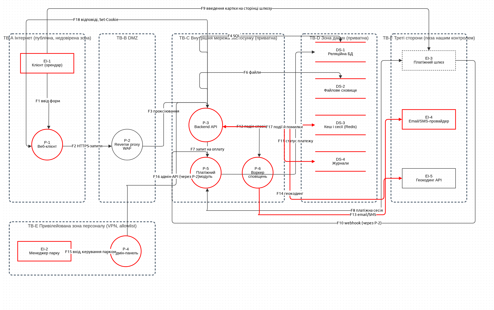

# 1. Тема та мета роботи

**Тема:** «Розробка вимог інформаційної безпеки до програмного забезпечення».

**Мета роботи:** проаналізувати архітектуру програмного продукту та запропонувати список вимог до забезпечення його інформаційної безпеки.

Вимоги я беру з OWASP Application Security Verification Standard (ASVS): це каталог вимог безпеки вебзастосунків для розробників, тестувальників і архітекторів. Версія 5.0.0 (травень 2025) має 345 вимог у 17 розділах (V1–V17). ID `8.2.2` читається як розділ V8, підрозділ 8.2, вимога 2. Рівні: L1 (мінімум, перший рубіж), L2 (для більшості застосунків), L3 (максимальний захист і глибина). Рівень обирає організація за ризиками. Файли ЛР 2 викладено в [репозиторії](https://github.com/brizzinck/krinzhrepoduta/tree/main/security/lr-2).

# 2. Схема архітектури досліджуваного додатку

Досліджується вебсервіс «Прокат автомобілів» з ЛР 1, архітектуру я взяв без змін: клієнт реєструється, бронює авто й платить на сторінці зовнішнього шлюзу (номер картки до сервісу не потрапляє); менеджер керує парком через окрему адмін-панель. Схема має 15 елементів, 6 меж довіри (A Інтернет, B DMZ, C внутрішня мережа, D зона даних, E зона персоналу, F треті сторони) і 18 потоків F1–F18 з ідентифікаторами ЛР 1.

{width=66%}

| Тип | Елементи |
|------|--------------------|
| Зовнішні учасники (EI) | EI-1 Клієнт, EI-2 Менеджер парку, EI-3 Платіжний шлюз, EI-4 Email/SMS-провайдер, EI-5 Геокодинг API |
| Процеси (P) | P-1 Веб-клієнт, P-2 Reverse proxy (WAF), P-3 Backend API (Spring Boot), P-4 Адмін-панель, P-5 Платіжний модуль із webhook, P-6 Воркер сповіщень |
| Сховища (DS) | DS-1 Реляційна БД, DS-2 Файлове сховище (скани посвідчень), DS-3 Redis (сесії), DS-4 Журнали |

# 3. Список вимог до кожного елемента архітектури

У клітинці спочатку ID вимоги ASVS, потім її суть. В обов'язкових без позначки стоять вимоги L1, а (L2) означає вимогу L2, підняту до обов'язкової, бо вона закриває загрозу високого ризику з ЛР 1. У рекомендованих без позначки стоять вимоги L2, а (L3) означає рівень L3. Вимоги P-4 додаються до вимог P-3.

::: req
| Елемент | Обов'язкові (етап 1) | Рекомендовані (етапи 2–3) |
|-----|-----------|-----------|
| EI-1 Клієнт (орендар) | 6.2.1 пароль від 8 символів (бажано 15); 6.2.4 перевірка за топ-3000 поширених паролів; 6.2.5 будь-який склад пароля, без правил «літера + цифра»; 6.2.8 пароль перевіряється як отримано (без обрізання, зміни регістру); 6.2.12 перевірка за базою скомпрометованих паролів (L2); 6.2.7 дозволені вставка й менеджери паролів | 6.3.3 багатофакторна автентифікація; 6.3.7 сповіщення про зміну облікових даних (L3); 6.3.8 помилки входу не розкривають існування акаунта (L3) |
| EI-2 Менеджер парку | 6.3.2 без типових акаунтів (admin, root); 6.3.3 багатофакторна автентифікація (L2); 7.4.2 завершення всіх сесій при блокуванні акаунта; 8.2.1 доступ до функцій лише за явними правами (ролі) | 6.4.4 перевірка особи при втраті MFA-фактора; 16.3.2 журнал невдалих спроб авторизації; 6.3.5 сповіщення про підозрілі спроби входу (L3) |
| EI-3, EI-4, EI-5 Платіжний шлюз, Email/SMS, геокодинг (треті сторони) | 2.2.1 валідація за allow-list | 13.1.1 задокументовані всі зовнішні комунікації; 13.2.4 allow-list зовнішніх ресурсів для вихідних запитів; 12.3.1 TLS для всіх вхідних і вихідних зʼєднань; 12.3.2 TLS-клієнти перевіряють сертифікати; 14.2.3 чутливі дані не передаються третім сторонам без потреби; 1.3.6 захист від SSRF; 15.3.2 не слідувати за редіректами у вихідних запитах |
| Залежності й SDK (P-1, P-3, P-4, EI-3, EI-4, EI-5) | 15.1.1 строки усунення вразливостей у залежностях; 15.2.1 без компонентів із простроченим усуненням вразливостей | 15.1.2 SBOM: перелік залежностей і версій |
| P-1 Веб-клієнт | 1.2.1 кодування виводу за контекстом (HTML, атрибути, заголовки); 1.2.2 кодування недовірених даних в URL, без javascript: і data:; 1.2.3 кодування при побудові JavaScript і JSON; 3.2.1 відповідь не рендериться в хибному контексті; 3.2.2 текст виводиться як текст (textContent); 2.2.2 валідація на довіреному серверному рівні; 6.2.6 поле пароля type=password; 3.3.1 cookie з атрибутом Secure; 3.5.1 захист від CSRF для чутливих запитів; 3.5.3 чутливі дії лише методами POST/PUT/PATCH/DELETE; 14.2.1 чутливі дані не передаються в URL; 14.3.1 очищення клієнтського сховища після виходу | 3.3.4 cookie сесії з HttpOnly; 3.3.2 cookie з SameSite за призначенням; 14.3.2 Cache-Control: no-store для чутливих відповідей; 14.3.3 без чутливих даних у localStorage і sessionStorage |
| P-2 Reverse proxy / WAF | 12.1.1 лише TLS 1.2 і 1.3; 12.2.1 TLS для всього зовнішнього трафіку, без відкату; 12.2.2 публічно довірені сертифікати; 3.4.1 заголовок HSTS; 2.4.1 захист від автоматизації (rate limiting) (L2); 5.2.1 ліміт розміру файлу й тіла запиту; 3.4.2 CORS: allow-list origin; 4.1.1 Content-Type з charset у кожній відповіді; 13.4.1 без метаданих git (.git) у розгортанні | 3.4.3 заголовок Content-Security-Policy; 3.4.4 X-Content-Type-Options: nosniff; 3.4.5 Referrer-Policy; 3.4.6 frame-ancestors проти clickjacking; 4.2.1 однозначні межі HTTP-повідомлень (request smuggling); 12.1.2 лише рекомендовані набори шифрів; 15.3.4 проксі довірено передають справжню IP клієнта |
| P-3 Backend API | 1.2.4 параметризовані запити до БД; 1.3.2 без eval() і динамічних виразів (SpEL); 2.1.1 задокументовані правила валідації вводу; 2.2.1 валідація за allow-list; 2.2.2 валідація на довіреному серверному рівні; 2.2.3 узгодженість звʼязаних значень (дати, ціна) (L2); 15.3.1 повертати лише потрібні поля обʼєкта (DTO); 15.3.3 захист від mass assignment (allow-list полів) (L2); 8.2.3 доступ до полів за правами (role, price не задає клієнт) (L2); 2.3.1 кроки бізнес-процесу лише в заданому порядку; 2.4.1 захист від автоматизації (rate limiting) (L2); 6.1.1 задокументовані rate limiting і anti-automation; 6.3.1 захист від brute force і credential stuffing; 6.3.2 без типових акаунтів (admin, root); 6.2.2 користувач може змінити пароль; 6.2.3 зміна пароля вимагає поточного й нового; 6.4.1 одноразові випадкові токени відновлення зі строком дії; 6.4.2 без секретних питань і підказок; 11.4.2 паролі зберігаються через KDF (BCrypt, Argon2) (L2); 7.2.1 перевірка сесії на довіреному сервері; 7.2.2 динамічно згенеровані токени сесії; 7.2.3 токени сесії унікальні, CSPRNG; 7.2.4 новий токен сесії після входу; 7.4.1 після виходу чи закінчення сесія недійсна; 7.4.2 завершення всіх сесій при блокуванні акаунта; 8.1.1 задокументовані правила доступу до функцій і даних; 8.2.1 доступ до функцій лише за явними правами (ролі); 8.2.2 доступ до обʼєктів лише власнику (проти IDOR); 8.3.1 авторизація на довіреному сервері; 13.3.1 секрети у сховищі секретів, не в коді (L2) | 2.3.2 ліміти бізнес-логіки (бронювань на користувача); 2.3.3 транзакції: операція повністю або відкат; 2.3.4 блокування ресурсу проти подвійного бронювання; 6.4.3 відновлення пароля не обходить MFA; 6.6.3 ліміт спроб для кодів з пошти/SMS; 7.3.1 тайм-аут неактивності; 7.3.2 абсолютна межа тривалості сесії; 7.5.1 повторна автентифікація перед зміною чутливих атрибутів; 13.4.2 debug-режими вимкнені в production; 13.4.5 документація API й actuator не відкриті; 16.5.1 узагальнені повідомлення про помилки; 16.5.3 fail closed: збій не відкриває доступ; 16.3.1 журнал усіх операцій автентифікації; 16.3.3 журнал подій безпеки й спроб обходу контролів |
| P-4 Адмін-панель (додатково до P-3) | 6.3.3 багатофакторна автентифікація (L2); 7.3.1 тайм-аут неактивності (L2); 7.3.2 абсолютна межа тривалості сесії (L2); 3.5.4 окремі застосунки на окремих хостах (origin) (L2); 3.4.2 CORS: allow-list origin; 8.2.1 доступ до функцій лише за явними правами (ролі); 8.3.1 авторизація на довіреному сервері | 6.3.4 без недокументованих шляхів входу; 7.4.5 адміністратор може завершити сесії користувача; 16.3.2 журнал невдалих спроб авторизації; 8.4.2 адмінінтерфейс: кілька рівнів захисту, не лише мережа (L3); 7.5.3 додаткова автентифікація перед критичними операціями (L3); 2.3.5 підтвердження критичних дій другою особою (L3) |
| P-5 Платіжний модуль + webhook | 11.4.1 лише затверджені геш-функції (HMAC-SHA-256); 2.3.1 кроки бізнес-процесу лише в заданому порядку; 2.3.3 транзакції: операція повністю або відкат (L2); 14.2.1 чутливі дані не передаються в URL; 13.3.1 секрети у сховищі секретів, не в коді (L2) | 14.1.1 класифікація чутливих даних за рівнями захисту; 12.3.1 TLS для всіх вхідних і вихідних зʼєднань; 12.3.2 TLS-клієнти перевіряють сертифікати; 13.2.1 автентифікація зʼєднань між компонентами бекенду; 13.2.2 мінімальні привілеї облікових записів компонентів; 16.5.2 безпечна робота при збої зовнішніх сервісів; 3.7.2 редіректи на сторонні домени лише з allow-list; 16.3.3 журнал подій безпеки й спроб обходу контролів; 4.1.5 підпис кожного повідомлення поверх TLS (L3) |
| P-6 Воркер сповіщень | 13.3.1 секрети у сховищі секретів, не в коді (L2) | 12.3.1 TLS для всіх вхідних і вихідних зʼєднань; 12.3.2 TLS-клієнти перевіряють сертифікати; 16.5.2 безпечна робота при збої зовнішніх сервісів; 16.4.1 кодування даних проти log injection; 16.2.5 журнал з урахуванням чутливості (без паролів і PII); 1.3.11 очищення вводу перед поштовими системами (SMTP-ін'єкція); 13.2.2 мінімальні привілеї облікових записів компонентів; SPF, DKIM, DMARC для домену пошти (власна вимога, поза ASVS) |
| DS-1 Реляційна БД | 1.2.4 параметризовані запити до БД; 11.4.2 паролі зберігаються через KDF (BCrypt, Argon2) (L2); 13.3.1 секрети у сховищі секретів, не в коді (L2); 11.3.1 без небезпечних режимів шифрування (ECB); 11.3.2 лише затверджені шифри (AES-GCM) | 13.2.2 мінімальні привілеї облікових записів компонентів; 13.2.3 без типових облікових даних служб; 12.3.1 TLS для всіх вхідних і вихідних зʼєднань; 2.3.3 транзакції: операція повністю або відкат; 2.3.4 блокування ресурсу проти подвійного бронювання; 14.1.1 класифікація чутливих даних за рівнями захисту; 14.1.2 задокументовані вимоги захисту для кожного рівня; 14.2.7 строки зберігання й автовидалення даних (L3) |
| DS-2 Файлове сховище | 5.2.1 ліміт розміру файлу й тіла запиту; 5.2.2 перевірка розширення й вмісту файлу; 5.3.1 завантажені файли не виконуються як код; 3.2.1 відповідь не рендериться в хибному контексті; 5.3.2 шляхи файлів генерує сервіс, не імена користувача; 5.4.1 імена файлів перевіряються, Content-Disposition задано (L2); 8.2.2 доступ до обʼєктів лише власнику (проти IDOR); 11.3.2 лише затверджені шифри (AES-GCM) | 1.3.4 очищення завантажених SVG від скриптів; 5.4.3 антивірусна перевірка завантажень; 14.1.1 класифікація чутливих даних за рівнями захисту; 5.2.4 квота на розмір і кількість файлів користувача (L3); 14.2.8 видалення метаданих (EXIF) із завантажених файлів (L3); 14.2.7 строки зберігання й автовидалення даних (L3) |
| DS-3 Кеш і сесії (Redis) | 7.2.1 перевірка сесії на довіреному сервері; 7.2.3 токени сесії унікальні, CSPRNG | 12.3.1 TLS для всіх вхідних і вихідних зʼєднань; 13.2.1 автентифікація зʼєднань між компонентами бекенду; 13.2.2 мінімальні привілеї облікових записів компонентів; 13.2.3 без типових облікових даних служб; 13.3.1 секрети у сховищі секретів, не в коді; 14.2.2 чутливі дані не кешуються на проміжних компонентах |
| DS-4 Журнали | немає | 16.1.1 інвентар журналювання по шарах; 16.2.1 метадані запису (коли, де, хто, що); 16.2.2 синхронізований час, UTC; 16.2.5 журнал з урахуванням чутливості (без паролів і PII); 16.3.1 журнал усіх операцій автентифікації; 16.3.2 журнал невдалих спроб авторизації; 16.3.3 журнал подій безпеки й спроб обходу контролів; 16.4.1 кодування даних проти log injection; 16.4.2 журнали захищені від доступу й змін; 16.4.3 журнали передаються в окрему систему |
| F1, F9 Ввід користувача; картка на сторінці шлюзу | 14.2.1 чутливі дані не передаються в URL | 14.1.1 класифікація чутливих даних за рівнями захисту |
| F2, F15, F16, F18 Зовнішні HTTPS-потоки | 12.1.1 лише TLS 1.2 і 1.3; 12.2.1 TLS для всього зовнішнього трафіку, без відкату; 12.2.2 публічно довірені сертифікати; 3.4.1 заголовок HSTS; 3.5.4 окремі застосунки на окремих хостах (origin) (L2) | немає |
| F3, F4, F5, F7, F11, F12 Внутрішні зʼєднання | немає | 12.3.1 TLS для всіх вхідних і вихідних зʼєднань; 12.3.3 TLS між внутрішніми HTTP-сервісами; 12.3.4 довірені сертифікати між внутрішніми сервісами; 13.2.1 автентифікація зʼєднань між компонентами бекенду |
| F6 Застосунок і файлове сховище | 8.2.2 доступ до обʼєктів лише власнику (проти IDOR) | pre-signed URL: короткий TTL і привʼязка до власника (рішення архітектури) |
| F8, F13, F14 Виклики до третіх сторін | немає | 12.3.1 TLS для всіх вхідних і вихідних зʼєднань; 12.3.2 TLS-клієнти перевіряють сертифікати; 13.2.4 allow-list зовнішніх ресурсів для вихідних запитів |
| F10 Webhook шлюзу | 11.4.1 лише затверджені геш-функції (HMAC-SHA-256); 2.3.1 кроки бізнес-процесу лише в заданому порядку | 4.1.5 підпис кожного повідомлення поверх TLS (L3) |
| F17 Події до журналів | немає | 16.2.5 журнал з урахуванням чутливості (без паролів і PII); 16.4.1 кодування даних проти log injection; 16.4.3 журнали передаються в окрему систему; 12.3.1 TLS для всіх вхідних і вихідних зʼєднань |
:::

Повний перелік (рядок на пару «елемент і вимога»: ID, рівень, вимога, тип, чому, загрози) і трасування T01–T29 лежать у `requirements.md` (207 рядків, 133 різних вимог ASVS).

# 4. Які вимоги рекомендовані і чому

Правило поділу авторське: стандарт обов'язковості не задає, а лише ранжирує вимоги за рівнями. Застосунок обробляє ПІБ, телефон, пошту, скани посвідчень і платежі, тому цільовий рівень ASVS L2. Усе L2 за один крок не запровадити, тому три етапи:

- Обов'язкові (етап 1): усі застосовні вимоги L1 і ті вимоги L2, що закривають загрози високого ризику з ЛР 1 (T01, T02, T04, T05, T08, T11, T14, T15, T16, T18, T28). Без них сервіс не випускають.
- Рекомендовані, етап 2: решта L2. Знижують середні ризики, додають глибину захисту.
- Рекомендовані, етап 3: L3. Дорогі, потрібні вибірково (адмінка, платежі).

::: req
| Елемент | Обов. | Етап 2 | Етап 3 | Разом |
|--------------------------|---|---|---|---|
| EI-1 Клієнт | 6 | 1 | 2 | 9 |
| EI-2 Менеджер парку | 4 | 2 | 1 | 7 |
| EI-3, EI-4, EI-5 Платіжний шлюз, Email/SMS, геокодинг | 1 | 7 | 0 | 8 |
| Залежності й SDK | 2 | 1 | 0 | 3 |
| P-1 Веб-клієнт | 12 | 4 | 0 | 16 |
| P-2 Reverse proxy / WAF | 9 | 7 | 0 | 16 |
| P-3 Backend API | 30 | 14 | 0 | 44 |
| P-4 Адмін-панель | 7 | 3 | 3 | 13 |
| P-5 Платіжний модуль + webhook | 5 | 8 | 1 | 14 |
| P-6 Воркер сповіщень | 1 | 8 | 0 | 9 |
| DS-1 Реляційна БД | 5 | 7 | 1 | 13 |
| DS-2 Файлове сховище | 8 | 3 | 3 | 14 |
| DS-3 Кеш і сесії | 2 | 6 | 0 | 8 |
| DS-4 Журнали | 0 | 10 | 0 | 10 |
| Потоки F1–F18 | 9 | 13 | 1 | 23 |
| Усього | 101 | 94 | 12 | 207 |
:::

Кожна загроза високого ризику закрита обов'язковою вимогою:

::: req
| Загроза (ЛР 1) | Обов'язкові вимоги |
|------------------------|----------------|
| T01 Перехоплення (MITM) облікових даних і сесії | 3.4.1, 12.1.1, 12.2.1, 12.2.2 |
| T02 Підбір паролів і credential stuffing | 2.4.1, 6.1.1, 6.2.1, 6.2.4, 6.2.5, 6.2.6, 6.2.12, 6.3.1 |
| T04 IDOR: перегляд чужих бронювань і документів | 8.1.1, 8.2.2, 8.3.1 |
| T05 SQL-ін'єкція | 1.2.4, 2.2.1 |
| T08 Підміна ціни або дат на клієнті | 2.2.2, 2.2.3, 2.3.1 |
| T11 Підроблений webhook «оплачено» | 2.3.1, 2.3.3, 11.4.1 |
| T14 Компрометація акаунта адміністратора | 3.5.4, 6.3.2, 6.3.3, 7.3.1, 7.3.2, 7.4.2 |
| T15 Адмінка доступна з інтернету, forced browsing | 3.4.2, 8.2.1, 8.3.1 |
| T16 Витік бази даних | 11.3.1, 11.3.2, 11.4.2, 13.3.1 |
| T18 Скани посвідчень за вгадуваними публічними URL | 5.3.2, 5.4.1, 8.2.2 |
| T28 Mass assignment: role=ADMIN у реєстрації | 2.2.1, 8.2.1, 8.2.3, 15.3.3 |
:::

Приклади обґрунтування:

- L1: обов'язкові всі застосовні (56 із 70; решта про OAuth, JWT, XML, WebSocket, яких немає в архітектурі): дешеві й закривають те, що атакують першим: `1.2.4` параметризовані запити (T05), `8.2.2` перевірка власника обʼєкта (T04 IDOR).
- HSTS (`3.4.1`, L1) обов'язкова, CSP (`3.4.3`, L2) рекомендована. HSTS це один заголовок проти MITM, а CSP лише додатково захищає від XSS поверх кодування виводу (`1.2.1`).
- MFA (`6.3.3`, L2): менеджеру обов'язкова, клієнту рекомендована. Захоплення акаунта адміна (T14) має наслідок 5 із 5. Підбір паролів клієнтів (T02) закривають `6.3.1`, `6.2.12`, `2.4.1`, а MFA для всіх знижує конверсію.
- Секрети поза кодом (`13.3.1`) і KDF для паролів (`11.4.2`) мають рівень L2, але обов'язкові: вони закривають витік БД (T16, ризик 15). Щодо паролів: `6.2.5` забороняє правила складу («літера + цифра»), замість них довжина (`6.2.1`) і перевірка за списками (`6.2.4`, `6.2.12`).
- Подвійне бронювання (`2.3.3`, `2.3.4`, L2) рекомендоване (T09 середній), але коштує мало (транзакція, унікальне обмеження в БД), тому йде першим в етапі 2. SBOM (`15.1.2`, L2) рекомендований: сам перелік нічого не закриває, а `15.2.1` (L1) обов'язкова. Щодо webhook: HMAC (`11.4.1`, L1) обов'язковий, підпис кожного повідомлення (`4.1.5`, L3) ні.
- Журналювання (V16) цілком L2, тож рекомендоване: загроз високого ризику воно не закриває, але T13, T21, T29 без нього не розслідувати. Поза ASVS лишаються SPF, DKIM і DMARC для домену пошти проти фішингу (T24).

# 5. Висновки

Для сервісу «Прокат автомобілів» з ЛР 1 я склав вимоги безпеки за OWASP ASVS 5.0.0 до всіх 15 елементів і потоків F1–F18: 207 пар «елемент і вимога», 133 різних вимог. Кожен ID звірено з текстом стандарту, кожну загрозу T01–T29 пов'язано з вимогою. Обов'язкових 101 (усі L1 і L2, що закривають високі ризики), рекомендованих етапу 2 є 94, етапу 3 є 12. Поділ я зробив сам на основі моделі загроз, тому одна вимога може мати різний статус для різних елементів, як MFA.
