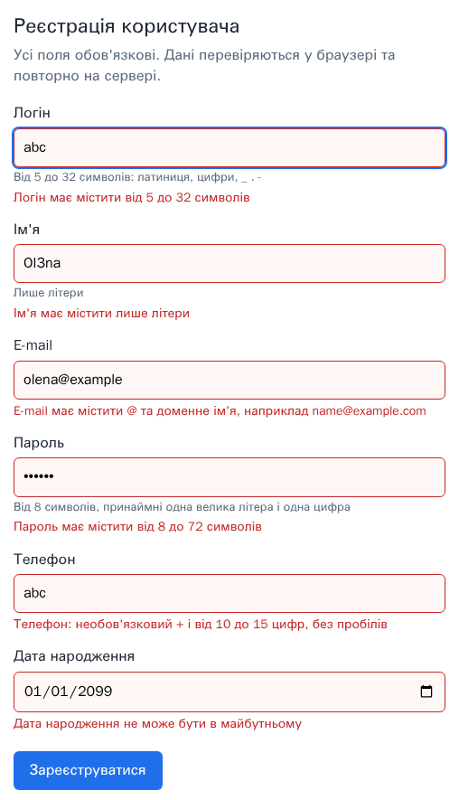
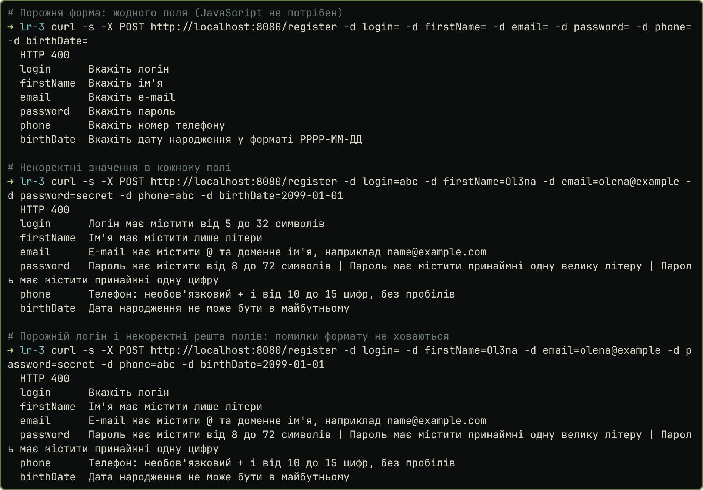
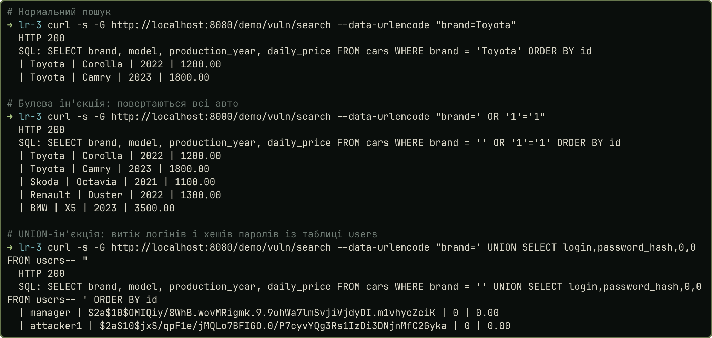
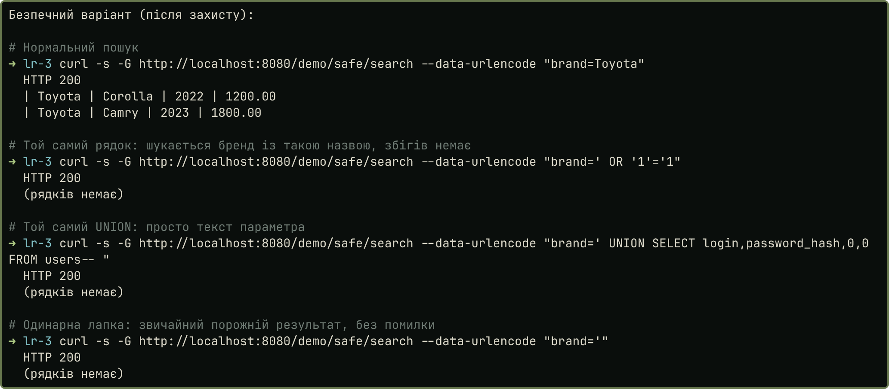
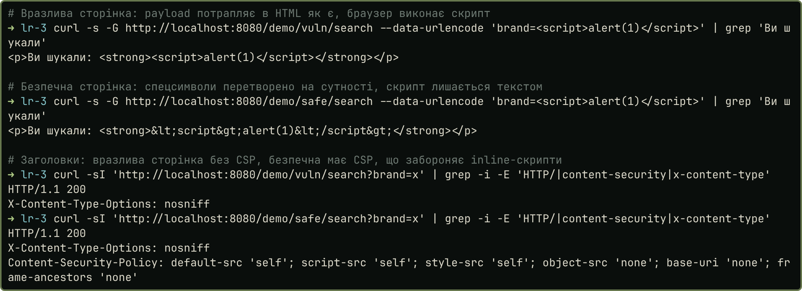
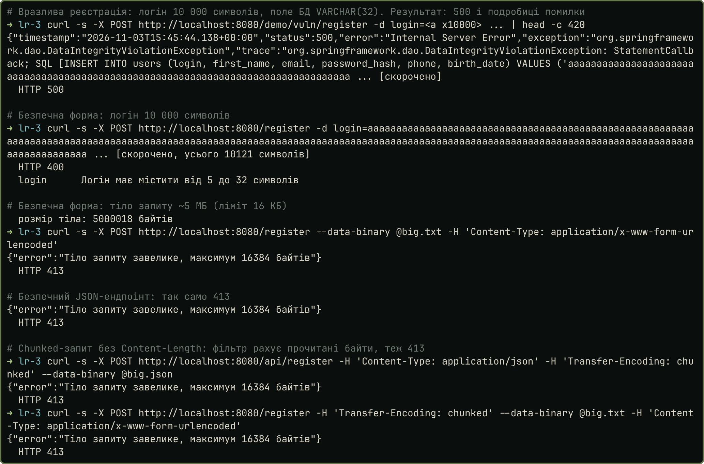
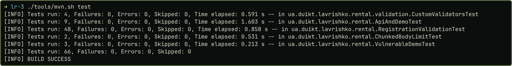

# 1. Тема та мета роботи

**Тема:** «Валідація вхідних даних».

**Мета роботи:** створити форму введення даних з валідацією.

Валідація буває двох видів. Синтаксична перевіряє формат (довжина, символи, шаблон), а семантична перевіряє сенс (дата не з майбутнього, вік 18+). Правила побудовано як білі списки: дозволено лише описане, решту відхилено. Клієнтську перевірку можна обійти, тому серверна валідація обов'язкова (ASVS 2.2.1, 2.2.2). Валідацію доповнюють параметризовані запити й екранування виводу: жоден механізм не замінює інші.

Застосунок. Форма реєстрації навчального сервісу «Прокат автомобілів» (Java 21, Spring Boot 3.3.5, Thymeleaf, Jakarta Bean Validation, `JdbcTemplate`, BCrypt, MySQL 8 у docker). Поля: логін, ім'я, e-mail, пароль, телефон і дата народження (її додано, бо методичка вимагає перевіряти дату). Код лежить у [репозиторії](https://github.com/brizzinck/krinzhrepoduta/tree/main/security/lr-3). Атаки виконано лише на локальному навчальному стенді.

# 2. Приклад коду

## 2.1. Правила й клієнтська валідація

| Поле | Вимога методички | Серверне правило | Відхиляється |
|---|---|---|---|
| Логін | від 5 символів | `@Size(5..32)`, `[A-Za-z0-9_.-]`, унікальний | `abc`, `admin'--` |
| Ім'я | лише літери | `^\p{L}+$`, до 50 | `Олена2`, `<b>Олена</b>` |
| Пароль | ≥ 8, велика літера, цифра | `@Size(8..72)`, `\p{Lu}`, `[0-9]`, ≤ 72 байти | `Abc123`, `secret123` |
| E-mail | `@` і домен | `^[a-zA-Z0-9_.+-]+@[a-zA-Z0-9-]+(\.[a-zA-Z0-9-]+)+$` | `a@b`, `a@b..com` |
| Телефон | правил немає | `^\+?[0-9]{10,15}$` (припущення) | `abc`, `12345` |
| Дата народж. | формат, не майбутнє | `@BirthDate`: ≤ сьогодні, ≥ 1900, вік ≥ 18 | `2026-02-31`, `2099-01-01` |

Скрипт `static/js/validate.js` перевіряє поля при втраті фокуса й відправленні тими самими правилами (регулярні вирази ті ж) і виводить українське повідомлення біля поля. У кожне поле введено некоректне значення (логін `abc`, ім'я `Ol3na`, пошта `olena@example`, пароль `secret`, телефон `abc`, майбутня дата), біля кожного з'явилось повідомлення:

{width=46%}

## 2.2. Серверна валідація

Правила описано анотаціями в DTO. Сеттери полів зберігають порожній або пробільний рядок як `null`: тоді `@NotBlank` дає одне повідомлення «Вкажіть …», а `@Size` і `@Pattern` порожнє значення пропускають. Тому порожнє поле не ховає помилки формату інших полів, усі вони повертаються в одній відповіді. Регулярні вирази прив'язані до `^…$` без неоднозначних вкладених квантифікаторів (немає ReDoS).

```java
public class RegistrationForm {
    @NotBlank(message = "Вкажіть логін")
    @Size(min = 5, max = 32, message = "Логін має містити від 5 до 32 символів")
    @Pattern(regexp = Patterns.LOGIN, message = "Логін може містити лише латинські літери, цифри та символи _ . -")
    private String login;

    @NotBlank(message = "Вкажіть пароль")
    @Size(min = 8, max = 72, message = "Пароль має містити від 8 до 72 символів")
    @Pattern(regexp = Patterns.HAS_UPPER, message = "Пароль має містити принаймні одну велику літеру")
    private String password;

    @NotNull(message = "Вкажіть дату народження у форматі РРРР-ММ-ДД")
    @BirthDate(minYear = 1900, minAge = 18)
    private LocalDate birthDate;

    public void setLogin(String v) { this.login = blankToNull(v); }
```

*`src/main/java/ua/duikt/lavrishko/rental/dto/RegistrationForm.java` (скорочено: решта полів, анотацій і сеттерів так само).*

Власна анотація `@BirthDate` (`validation/BirthDateValidator.java`) перевіряє семантику дати: не з майбутнього, не раніше 1900, вік не менший за 18; час береться з `Clock`, тому тести детерміновані. `@MaxBytes` обмежує пароль 72 байтами, бо BCrypt бачить лише їх.

Ті самі правила діють для JSON-ендпоінта `POST /api/register`. При помилці сервер повертає статус 400 і повідомлення біля поля. Запити до БД виконуються з параметрами `?`, роль у `INSERT` задана константою `'CLIENT'`, пароль зберігається як BCrypt-хеш:

```java
/** Роль не приймається ззовні: завжди CLIENT. */
public void insert(RegistrationForm form, String passwordHash) {
    jdbc.update("INSERT INTO users (login, first_name, email, password_hash, phone, birth_date, role) "
            + "VALUES (?, ?, ?, ?, ?, ?, 'CLIENT')",
            form.getLogin(), form.getFirstName(), form.getEmail(), passwordHash, form.getPhone(),
            java.sql.Date.valueOf(form.getBirthDate()));
}
```

*`repo/UserRepository.java`.*

## 2.3. Демонстрація атак: до і після захисту

Для порівняння є дві версії пошуку авто за брендом. Вразлива версія (`/demo/vuln/search`, лише профіль `vuln`) збирає SQL конкатенацією, виводить рядок через `th:utext` і розкриває помилки. Безпечна (`/demo/safe/search`) використовує `?`, `th:text` і CSP. Скрипти атак лежать у `demo/*.sh`, справжній вивід у `demo/*.txt`.

```java
// ВРАЗЛИВО (лише демо): конкатенація
String sql = "SELECT brand, model, production_year, daily_price FROM cars WHERE brand = '" + brand + "' ORDER BY id";
model.addAttribute("rows", jdbc.queryForList(sql));
// БЕЗПЕЧНО: параметр
return jdbc.queryForList(
    "SELECT brand, model, production_year, daily_price FROM cars WHERE brand = ? ORDER BY id", brand);
```

*`demo/VulnerableDemoController.java` і `repo/CarRepository.java`.*

Атака 1. Обхід клієнтської перевірки. Запит `curl` без браузера з порожніми й некоректними значеннями отримує від сервера 400 і ті самі повідомлення: серверна валідація працює без JavaScript. Порожній логін не ховає помилки формату інших полів (третій запит на знімку). Зайве поле `role=ADMIN` ігнорується (`demo/01_client_bypass.txt`).

{width=60%}

Атака 2. SQL-ін'єкція. *До:* `' OR '1'='1` повертає всі авто, а `UNION SELECT` витягує логіни й хеші паролів з `users`. *Після:* ті самі рядки є звичайним текстом параметра, збігів і помилок немає. У формі реєстрації ін'єкцію в полі `login` відхиляє білий список.

{width=60%}

{width=60%}

Атака 3. XSS. *До:* `<script>alert(1)</script>` потрапляє в HTML як є (`demo/03_xss.txt`); виконання скрипту в браузері зафіксовано для `` і збереженого `<svg onload>` (`demo/xss-dialogs.txt`). *Після:* спецсимволи екрановано (`&lt;`), а CSP забороняє inline-скрипти; форма реєстрації відхиляє розмітку в полях.

{width=60%}

Атака 4. Переповнення. *До:* логін із 10 000 символів доходить до БД і дає 500 з текстом запиту. *Після:* форма відхиляє його статусом 400 до звернення до БД, а тіло ~5 МБ відсікає `RequestGuardFilter` статусом 413 (ліміт 16 КБ). Якщо заголовка `Content-Length` немає (chunked-запит), фільтр читає тіло сам і зупиняється на 16 КБ + 1 байт, тому відповідь теж 413.

{width=60%}

## 2.4. Автотести

66 автотестів (JUnit 5, MockMvc, H2 у режимі MySQL): параметризовані випадки валідації кожного поля, BCrypt і роль `CLIENT`, ліміт тіла (зокрема chunked-запит на справжньому Tomcat), дублікат логіна, `role=ADMIN`, JSON з неправильними типами, безпечні й вразливі сторінки, модульні тести валідаторів. Усі 66 пройдено.

{width=60%}

# 3. Висновки

Я зробив форму реєстрації з полями логін, ім'я, e-mail, пароль, телефон і дата народження, і при помилці біля кожного поля з'являється повідомлення. Валідація працює на сервері за білими списками символів: запити `curl` без браузера це підтверджують, а клієнтський скрипт лише зручність для користувача. На застосунку я відтворив чотири атаки до і після захисту: обхід клієнтської перевірки, SQL-ін'єкцію (булеву та `UNION`), XSS і переповнення довжини та тіла запиту. Захист складається з кількох шарів: білі списки, параметризовані запити, екранування виводу, CSP, ліміт розміру тіла (і для chunked-запитів) і загальні повідомлення про помилки. Пароль зберігається як BCrypt-хеш, а не як SHA-256 чи відкритий текст. Правило «велика літера й цифра» реалізовано за методичкою, хоча ASVS 6.2.5 не радить обмежувати склад символів: краще вимагати довжину й перевіряти пароль за списком відомих. Правила телефону, вік 18+ і межі довжин я обрав сам, бо методичка їх не задає.
