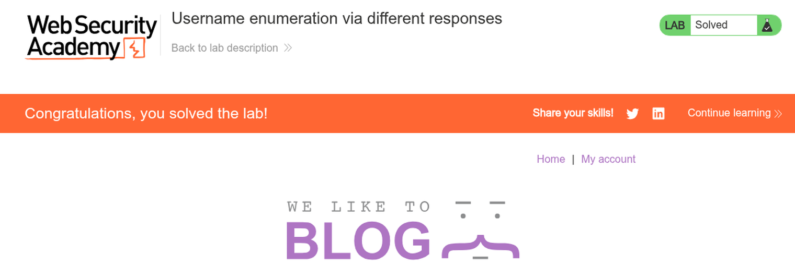
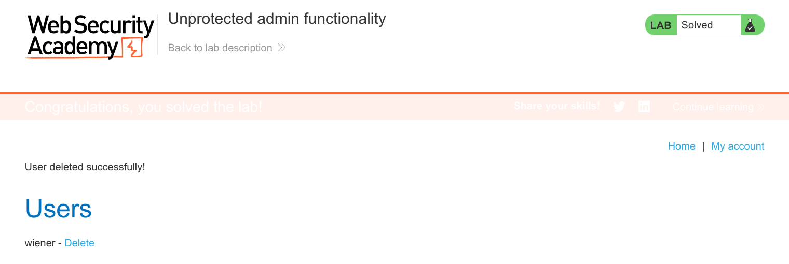
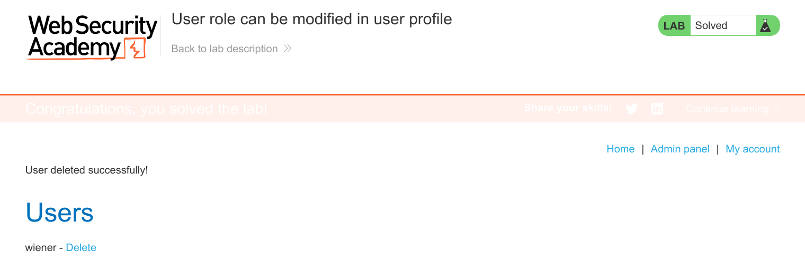
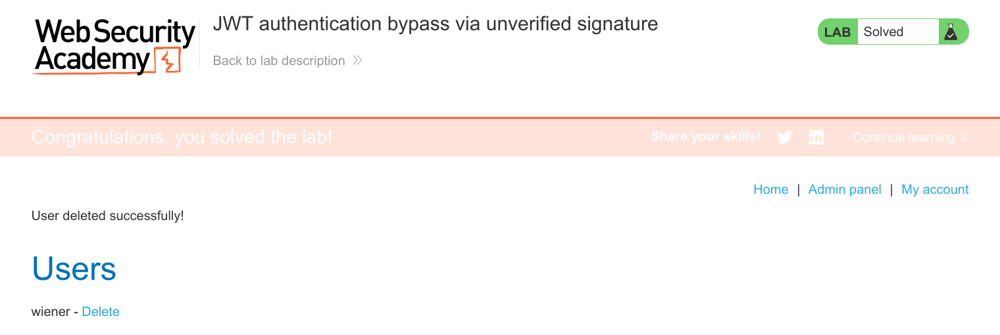
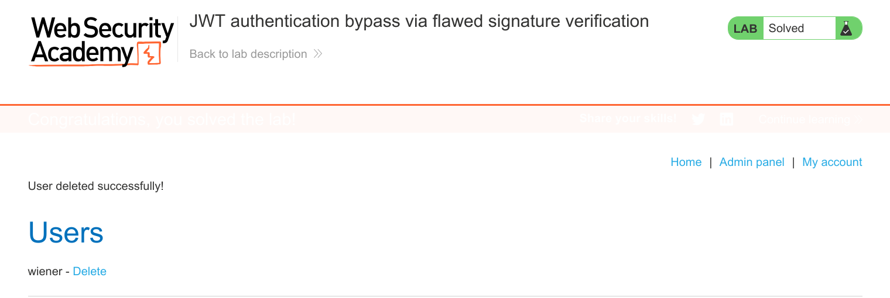
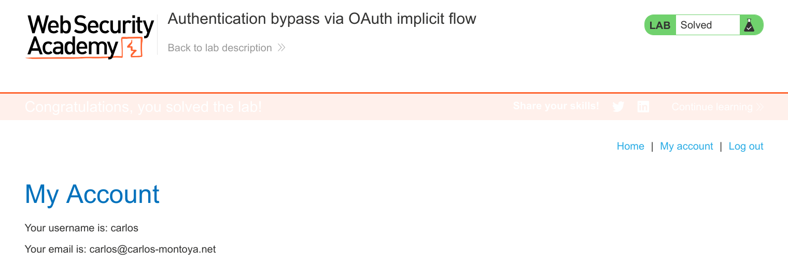

# 1. Тема та мета роботи

**Тема:** «Тестування безпеки програмного забезпечення».

**Мета роботи:** Ознайомитися з роботою інструментів тестування безпеки веб-додатків та набути практичного досвіду виявлення й експлуатації вразливостей механізмів аутентифікації, контролю доступу, JWT та OAuth на лабораторному стенді PortSwigger Web Security Academy.

**Завдання.** Виконати шість вправ Web Security Academy, по дві на кожен клас вразливостей:

1. Аутентифікація: username enumeration via different responses.
2. Контроль доступу: unprotected admin functionality.
3. Контроль доступу: user role can be modified in user profile.
4. JWT: authentication bypass via unverified signature.
5. JWT: authentication bypass via flawed signature verification.
6. OAuth: authentication bypass via OAuth implicit flow.

Вправа вважається виконаною, коли стенд показує статус лабораторії `Solved`.

# 2. Теоретичні відомості

Burp Suite Community Edition: набір інструментів тестування безпеки веб-додатків. Трафік браузера проходить через проксі Burp, після чого запити можна переглядати та змінювати: Repeater повторює й редагує одиночний запит, Intruder автоматизує перебір значень, Inspector розкодовує cookie та токени. У роботі всі шість вправ виконано через Burp: стенди відкривалися через проксі Burp на `127.0.0.1`, запити переглядалися й змінювалися в Proxy, Intruder і Repeater. Базові запити вправ 1 і 4 надіслано утилітою curl через проксі Burp, тому вони зʼявилися в історії Proxy (HTTP history), звідки їх передано в Intruder і Repeater (звідси `User-Agent: curl` на рис. 1 і 5).

Чотири класи вразливостей, що тестуються:

- Аутентифікація: помилки перевірки особи користувача (різні відповіді на неіснуюче імʼя та на невірний пароль, відсутність обмеження спроб).
- Контроль доступу: відсутність перевірки прав на боці сервера (прихована, але незахищена адмін-функція; довіра до параметрів, якими керує користувач).
- JWT: некоректна перевірка підпису токена, через що зловмисник змінює корисне навантаження.
- OAuth: клієнтський застосунок довіряє даним, які не повʼязані криптографічно з токеном провайдера.

# 3. Хід виконання роботи

## 3.1. Вправа 1. Username enumeration via different responses

Вразливість. Форма входу повертає різні повідомлення: на неіснуюче імʼя повідомлення `Invalid username`, на існуюче імʼя з невірним паролем `Incorrect password`. Ця різниця дозволяє відділити правильні імена від неправильних, а через відсутність обмеження спроб можна перебрати паролі.

Кроки.

1. Запит `POST /login` з історії Proxy надіслано в Burp Intruder (атака Sniper), позиція payload — значення поля `username`, пароль фіксований. Перебрано список кандидатів-імен. Відповідь для імені `access` відрізняється довжиною (`Length` 3441 проти 3439 для решти) і повідомленням `Incorrect password` замість `Invalid username`, тож це імʼя визнано дійсним (рис. 1).
2. Для імені `access` перебрано список паролів. Ознакою правильного пароля є відповідь зі статусом 302 (перенаправлення на `/my-account` замість повторного показу форми): пароль `nicole`.
3. Вхід з парою `access:nicole` переводить лабораторію у стан `Solved`.

{width=78%}

{width=70%}

Висновок. Вразливість виникає через різні відповіді та відсутність обмеження спроб. Усувається однаковим узагальненим повідомленням і однаковим часом відповіді для всіх невдалих спроб, а також блокуванням після кількох помилок та CAPTCHA.

## 3.2. Вправа 2. Unprotected admin functionality

Вразливість. Адмін-панель не має перевірки прав: захист зводиться до того, що адреса панелі не вказана у меню. Проте файл `/robots.txt` розкриває цю адресу.

Кроки.

1. Відкрито `/robots.txt`; директива `Disallow: /administrator-panel` розкриває шлях до панелі.
2. Перехід на `/administrator-panel` відкриває панель без аутентифікації.
3. Видалення користувача `carlos` переводить лабораторію у стан `Solved`.

{width=70%}

Висновок. Приховування адреси не є контролем доступу. Адмін-маршрути повинні перевіряти роль користувача на боці сервера; неавторизований запит має отримувати 401 або 403 незалежно від того, чи відома адреса.

## 3.3. Вправа 3. User role can be modified in user profile

Вразливість. Запит зміни email (`POST /my-account/change-email`) приймає у тілі JSON додаткове поле `roleid`, яке сервер зберігає без перевірки. Це приклад масового присвоєння: користувач задає поле, яке має бути лише серверним.

Кроки.

1. Вхід під штатним обліковим записом `wiener:peter`.
2. У тіло запиту `POST /my-account/change-email` додано поле `"roleid":2` (роль адміністратора). Відповідь підтверджує нову роль.
3. Зʼявляється доступ до `/admin`; видалення `carlos` переводить лабораторію у стан `Solved`.

{width=70%}

Висновок. Сервер не повинен приймати від клієнта поля, що визначають права. Потрібен білий список полів, дозволених до зміни, а роль має встановлюватися лише на боці сервера.

## 3.4. Вправа 4. JWT authentication bypass via unverified signature

Вразливість. Сесія зберігається у JWT, але сервер не перевіряє підпис токена. Будь-яка зміна корисного навантаження приймається.

Кроки.

1. Вхід під `wiener:peter`; у cookie `session` отримано JWT з корисним навантаженням `{"sub":"wiener", ...}`.
2. Запит `GET /admin` надіслано у Burp Repeater. У cookie `session` поле `sub` змінено на `administrator`; заголовок і підпис залишено без змін.
3. Repeater повертає статус `200` і сторінку адмін-панелі замість `401`, тобто підпис не перевіряється. Запитом `GET /admin/delete?username=carlos` з тим самим токеном видалено `carlos`; лабораторія переходить у стан `Solved`. Кадр на рис. 5 знято вже після видалення, тому банер у відповіді має клас `is-solved`.

{width=90%}

{width=70%}

Висновок. Сервер повинен перевіряти підпис кожного JWT відповідним секретом або відкритим ключем і відхиляти токен з невірним підписом. Без перевірки підпису JWT не є довіреним джерелом особи.

## 3.5. Вправа 5. JWT authentication bypass via flawed signature verification

Вразливість. Сервер перевіряє підпис лише формально: токен із алгоритмом `none` та порожнім підписом приймається як дійсний. Алгоритм `none` у JWT означає відсутність підпису.

Кроки.

1. Вхід під `wiener:peter`; отримано JWT із заголовком `{"alg":"RS256", ...}`.
2. У заголовку значення `alg` змінено на `none`, поле `sub` на `administrator`, а частину підпису видалено (токен виду `header.payload.`).
3. З підміненим токеном відкрито `/admin` і видалено `carlos`; лабораторія переходить у стан `Solved`.

{width=70%}

Висновок. Потрібно приймати лише очікуваний алгоритм підпису (наприклад, RS256) і відхиляти токени з `alg: none` та з порожнім підписом. Перелік допустимих алгоритмів має бути заданий на боці сервера явно.

## 3.6. Вправа 6. Authentication bypass via OAuth implicit flow

Вразливість. У неявному потоці OAuth браузер отримує токен доступу, після чого клієнтський застосунок надсилає на свій ендпоінт `POST /authenticate` тіло `{"email", "username", "token"}`. Сервер довіряє полю `email` і не звіряє його з власником токена. Підмінивши email, можна увійти до чужого облікового запису.

Кроки.

1. Виконано штатний вхід через OAuth-провайдера під `wiener:peter`; перехоплено запит `POST /authenticate` з полями `email`, `username`, `token`.
2. Повторно надіслано `POST /authenticate` з тим самим дійсним токеном, але з `email` жертви: `carlos@carlos-montoya.net`.
3. Сервер створює сесію для цього email. Сторінка `/my-account` показує обліковий запис `carlos`; лабораторія переходить у стан `Solved`.

{width=70%}

Висновок. Клієнт не повинен довіряти ідентифікатору користувача, переданому в тілі запиту. Особу слід визначати лише з даних, криптографічно повʼязаних з токеном: отримувати профіль через `/userinfo` провайдера за самим токеном, а замість неявного потоку використовувати authorization code flow.

# 4. Висновки

Виконано шість вправ Web Security Academy на чотири класи вразливостей, усі переведено у стан `Solved`. На практиці показано спільну причину цих вад: сервер довіряє даним, якими керує клієнт, і не перевіряє їх на своєму боці. У вправах 1-3 це різні відповіді форми входу та відсутність перевірки прав і полів; у вправах 4-5 відсутня або формальна перевірка підпису JWT; у вправі 6 є довіра до email, не повʼязаного з токеном. Опановано базовий робочий цикл тестувальника: перехоплення та зміна запиту, перебір значень, редагування токена, а також типові способи усунення кожної вади: узагальнені відповіді й обмеження спроб, серверна перевірка прав і білий список полів, сувора перевірка підпису та алгоритму JWT, визначення особи лише за токеном провайдера.
