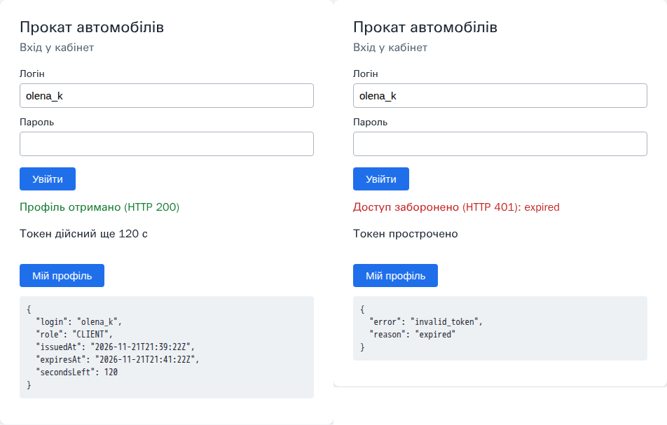
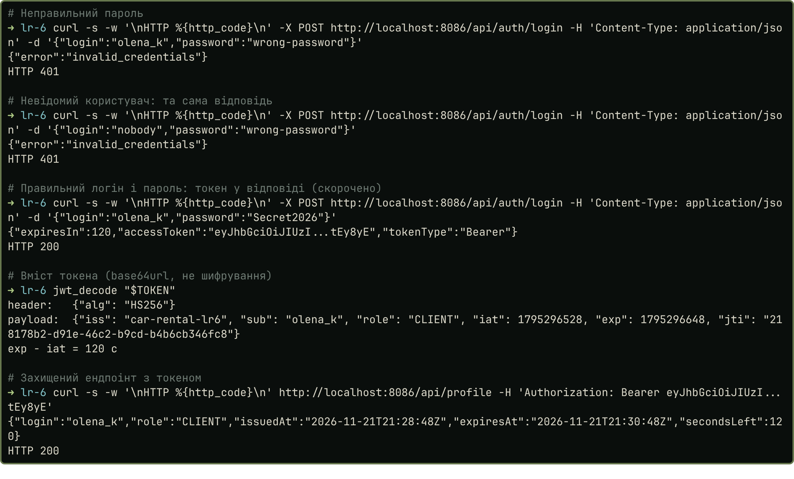
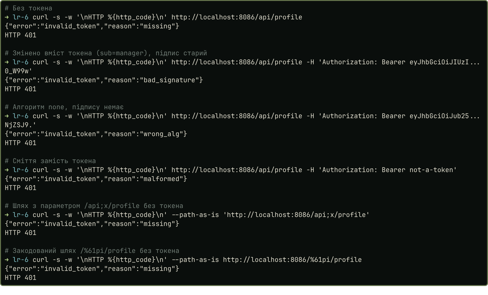
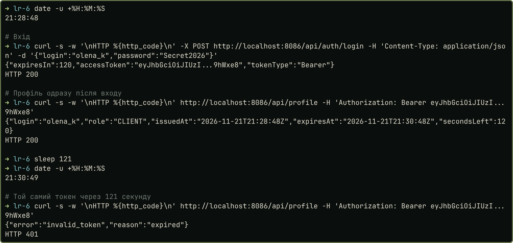
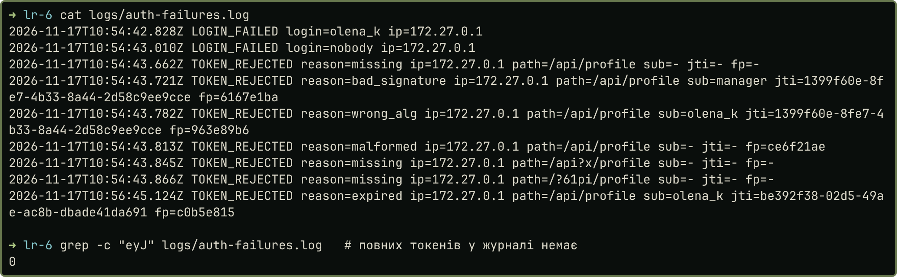
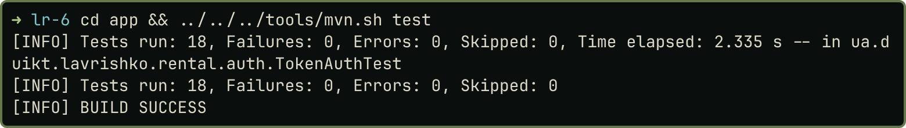

# 1. Тема та мета роботи

**Тема:** «Аутентифікація користувачів за токеном».

**Мета роботи:** навчитись створювати токени й аутентифікувати користувачів.

JWT (JSON Web Token) складається з трьох частин у base64url, розділених крапками: заголовок (алгоритм), вміст (claims: хто, коли видано, до якого часу дійсний) і підпис. Вміст не шифрується, тому в токен не кладуть паролі. Захищає від підробки підпис: його рахує сервер за секретним ключем (HS256, HMAC-SHA256), тож змінений вміст не збігається з підписом. Токен живе недовго (тут 2 хвилини), бо сервер не зберігає стану й відкликати його до кінця строку не може.

Застосунок. Невеликий сервіс «Прокат автомобілів» (Java 21, Spring Boot 3.5.16, бібліотека jjwt 0.13.0, BCrypt зі `spring-security-crypto`, без БД). Є два користувачі в памʼяті: `olena_k` (клієнт, пароль `Secret2026`) і `manager` (менеджер, пароль `Manager2026`), паролі лежать лише як BCrypt-хеші. Секрет підпису не зберігається в репозиторії: він береться зі змінної середовища `JWT_SECRET`, а якщо її не задано, застосунок при запуску створює випадковий ключ. Код: [репозиторій](https://github.com/brizzinck/krinzhrepoduta/tree/main/security/lr-6).

# 2. Робочий код

## 2.1. Склад і вимоги методички

Форма надсилає JSON на `POST /api/auth/login`. `app.js` тримає токен лише в змінній сторінки (не в `localStorage`) і кнопкою «Мій профіль» викликає захищений ендпоінт із заголовком Bearer.

::: {style="break-inside: avoid;"}

Таблиця 1. Вимоги методички й де вони реалізовані

| Вимога | Де реалізовано |
|---|---|
| Форма аутентифікації | `static/index.html`, `static/app.js` |
| Бібліотека генерації JWT | jjwt в `pom.xml`, клас `TokenService` |
| Токен на 2 хвилини за логін і пароль | `AuthController`, `TokenService.issue` |
| Аутентифікація за токеном | `JwtAuthFilter`, `ProfileController` |
| Перевірка токена на сервері | `TokenService.verify` |
| Журнал невдалих спроб (необовʼязково) | `AuditLog`, `logback-spring.xml` |

:::

## 2.2. Бібліотека й видача токена

Бібліотека jjwt 0.13.0 підключена в `pom.xml` (`jjwt-api`, `jjwt-impl`, `jjwt-jackson`). Після перевірки пароля `AuthController` викликає `TokenService.issue`. Час `exp` дорівнює `iat` плюс 120 секунд, у кожного токена свій `jti`. Неправильний пароль і невідомий логін дають однакову відповідь 401, тож за відповіддю не можна дізнатись, які логіни існують.

::: {style="break-inside: avoid;"}

```java
public String issue(User user) {
    Instant now = clock.instant().truncatedTo(ChronoUnit.SECONDS);
    return Jwts.builder()
            .issuer(ISSUER)
            .subject(user.login())
            .claim("role", user.role())
            .issuedAt(Date.from(now))
            .expiration(Date.from(now.plusSeconds(TTL_SECONDS)))   // 120 с
            .id(UUID.randomUUID().toString())
            .signWith(key, Jwts.SIG.HS256)
            .compact();
}
```

*`TokenService.java:38-49`. Годинник `Clock` вводиться через конструктор, тому тести можуть «перемотувати» час.*

:::

## 2.3. Перевірка токена на сервері

`verify` не довіряє нічому з токена, крім результату перевірки: структура з трьох частин, заголовок `alg` строго `HS256` (`none` бібліотека jjwt відхиляє й сама, тут явна перевірка її дублює; а HS384 чи HS512 jjwt прийняла б, якщо ключ із `JWT_SECRET` має щонайменше 48 чи 64 байти, і тоді явна перевірка стає єдиним барʼєром), потім підпис, видавець і строк дії. Допуск розбіжності годинників нульовий. Причина відмови йде у відповідь і в журнал.

::: {style="break-inside: avoid;"}

```java
if (!"HS256".equals(text(header, "alg"))) {
    throw new TokenRejected("wrong_alg", sub, jti);
}
try {
    return Jwts.parser().verifyWith(key).requireIssuer(ISSUER)
            .clock(() -> Date.from(clock.instant()))
            .build().parseSignedClaims(token).getPayload();
} catch (ExpiredJwtException e) {
    throw new TokenRejected("expired", sub, jti);
} catch (SignatureException e) {
    throw new TokenRejected("bad_signature", sub, jti);
}
```

*`TokenService.java:68-91` (скорочено).*

:::

Відповідь з причиною зроблено для демонстрації: у промисловій системі клієнт бачив би лише `invalid_token`, а причина лишалася б у журналі.

## 2.4. Фільтр і журнал невдалих спроб

`JwtAuthFilter` пропускає до контролера лише запити з чинним токеном. Усі шляхи `/api/*`, крім входу, перевіряються, причому шлях спершу нормалізується так, як це робить Spring MVC. Інакше запити `/api;x/profile` чи `/%61pi/profile` обійшли б фільтр, а контролер їх усе одно обробив би. У відповіді 401 є заголовок `WWW-Authenticate` і причина, а кожну відмову фільтр записує в журнал `security-audit`.

::: {style="break-inside: avoid;"}

```java
protected boolean shouldNotFilter(HttpServletRequest request) {
    String path = UrlPathHelper.defaultInstance
            .getPathWithinApplication(request);
    return !path.startsWith("/api/") || path.equals("/api/auth/login");
}
// у doFilterInternal:
try {
    Claims claims = tokens.verify(token);
    request.setAttribute(CLAIMS, claims);
    chain.doFilter(request, response);
} catch (TokenRejected e) {
    audit.tokenRejected(e, request.getRemoteAddr(),
            request.getRequestURI(), token);
    response.setStatus(HttpServletResponse.SC_UNAUTHORIZED);
    response.setHeader("WWW-Authenticate",
            "Bearer error=\"invalid_token\"");
    // тіло: {"error":"invalid_token","reason":"<причина>"}
}
```

*`JwtAuthFilter.java:29-34, 44-55` (скорочено: запис JSON-тіла відповіді).*

:::

У журнал не потрапляє ні токен, ні пароль: пишеться відбиток (перші 8 символів SHA-256), за яким події зіставляються, а токен не відновити. Керувальні символи з логіна прибираються, щоб введення не підробило рядок журналу.

::: {style="break-inside: avoid;"}

```java
LOG.info("TOKEN_REJECTED reason={} ip={} path={} sub={} jti={} fp={}",
        e.reason(), ip, clean(path), clean(e.sub()), clean(e.jti()),
        fingerprint(token));   // AuditLog.tokenRejected
```

*`AuditLog.java:20-21` (`clean` лишає літери, цифри та `_ . @ / -`, решту замінює на `?`); `logback-spring.xml` спрямовує логер `security-audit` у файл `logs/auth-failures.log`.*

:::

# 3. Приклад успішного входу по токену

## 3.1. Вхід і доступ із токеном

У браузері: вхід `olena_k` і кнопка «Мій профіль»; сторінка показує відлік до кінця дії токена й відповідь ендпоінта (HTTP 200).

{width=66%}

Те саме через `curl`: однакова 401 для неправильного пароля й невідомого логіна, токен з `exp - iat = 120` і профіль (200).

{width=75%}

## 3.2. Токени, які сервер відхиляє

Без токена, зі зміненим вмістом (`sub=manager`), з `alg=none` і зі сміттям сервер відповідає 401 з різними причинами. Запити `/api;x/profile` і `/%61pi/profile` без токена він зводить до `/api/profile`, тож теж 401.

{width=75%}

## 3.3. Строк дії: справжнє очікування 121 секунда

Скрипт отримує токен (діє до 21:30:48), перевіряє профіль (200), чекає `sleep 121` і повторює запит: позначки 21:28:48 і 21:30:49 різняться на 121 секунду, відповідь 401 `expired`. У браузері так само (правий знімок у п. 3.1).

{width=75%}

## 3.4. Журнал невдалих спроб

Відмови з прикладів вище потрапили в `logs/auth-failures.log`: два невдалі входи й сім відхилених запитів, у кожному рядку є причина, адреса, шлях, `sub`, `jti` і відбиток. Символи `;` і `%` у шляху журнал замінює на `?`, тому два останні запити видно як `/api?x/profile` і `/?61pi/profile`. Повного токена немає (`grep -c eyJ` дає 0).

{width=80%}

## 3.5. Автотести

18 тестів JUnit 5 (MockMvc) перевіряють: `exp - iat = 120`; однакову 401 для неправильного пароля й невідомого логіна; профіль на 119-й (200) і 121-й (401) секунді з підміненим годинником; пароль довший за 72 байти; відсутній заголовок, `Basic`, змінений вміст, чужий ключ, `alg=none`, HS384, чужого видавця, сміття; шляхи `/api;x/profile` і `/%61pi/profile`; журнал без токена. Усі пройдено.

{width=75%}

# 4. Висновки

Я зробив сервіс із формою входу: за правильним логіном і паролем він видає JWT (jjwt, HS256) на 2 хвилини, а `/api/profile` пускає лише з токеном. Сервер перевіряє підпис, видавця й строк дії, а алгоритм я перевіряю явно: `none` jjwt відхиляє й сама, а HS384 чи HS512 вона прийняла б за довгого ключа, тож явна перевірка лишає лише HS256. Підроблені й прострочені токени дають 401 з причиною; строк дії підтверджено справжнім очікуванням 121 секунда. Невдалі входи й відхилені запити пишуться в журнал без токена й пароля, секрет береться зі змінної середовища, пароль зберігається як BCrypt-хеш. Вміст токена лише закодовано, а відкликати його до кінця строку не можна, тому строк короткий. Для реального сервісу потрібні ще HTTPS, refresh-токен і ліміт спроб входу.
