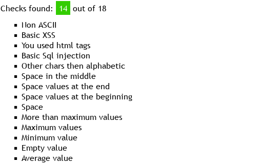
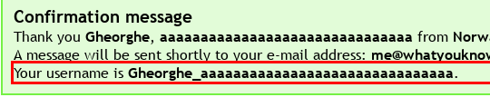
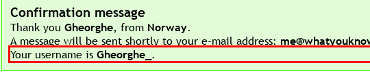
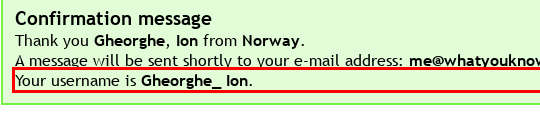
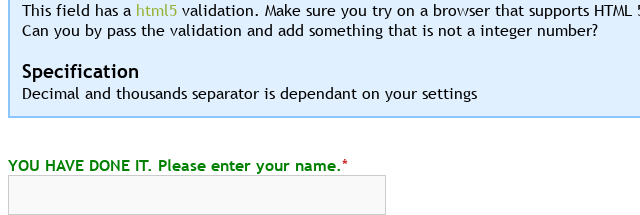
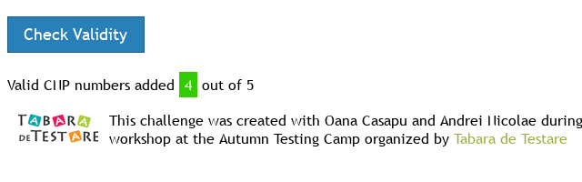
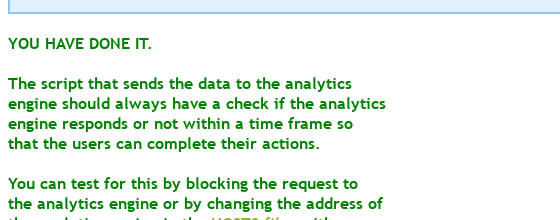
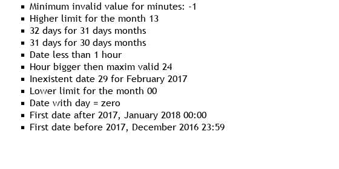
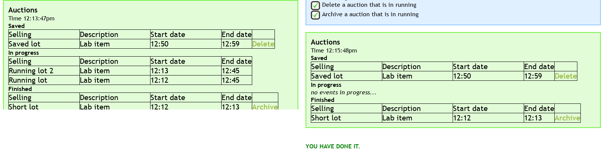

# Мета та порядок роботи

Мета: набути досвіду тестування вебзастосунків, виявлення дефектів і документування результатів. Стенд: <http://testingchallenges.thetestingmap.org/>, перевірка 2026-11-03.

Кожен дефект відтворено двічі. Протоколи Challenge #2, #4, #5, #6 і #8 лежать у [теці lr-1 репозиторію](https://github.com/brizzinck/krinzhrepoduta/tree/main/yatpz/lr-1) (`evidence/`). Поля Bug Report взято з практичної № 1. Форми Hall of fame із капчею, які сайт показує після завершення, не заповнювались: завдання цього не вимагає.

# Challenge #1. Web Testing

Завдання сайту: перевірити поле First Name (максимум 30 символів). Сервер зараховує перевірки за введеними значеннями (Checks found, усього 18). Усі 25 значень отримали підтвердження, помилки не було жодного разу. Форма показує username у вигляді `<Last Name>_<First Name>`.

| Значення First Name | Нова перевірка | Лічильник |
|---------------------------------|-------------------------|-----------|
| `Gheorghe` | Average value | 1 |
| порожнє | Empty value | 2 |
| `A` | Minimum value | 3 |
| 29, потім 30 літер `a` | немає, потім Maximum values | 4 |
| 31 літера `a` | More than maximum values | 5 |
| три пробіли | Space | 6 |
| `Ion` із пробілом на початку | Space values at the beginning | 7 |
| `Ion` із пробілом у кінці | Space values at the end | 8 |
| `Ana Maria` | Space in the middle | 9 |
| `Ion2` | Other chars then alphabetic | 10 |
| `12345`, `!@#$%^&*()` | немає | 10 |
| `O'Brien` | Basic Sql injection | 11 |
| `Jean-Luc`, `J.R.`, `Ion_` | немає | 11 |
| `<b>a</b>` | You used html tags | 12 |
| `` | Basic XSS | 13 |
| `' OR '1'='1` | немає | 13 |
| `Ștefan` | Non ASCII | 14 |
| `Іван`, `GHEORGHE`, `gheorghe`, `Gheorghe` повторно | немає | 14 |

Результат: Checks found 14 out of 18. Які 4 перевірки лишились, сайт не показує, тому назвати їх я не можу. HTML і `<script>` у відповіді екрановані, SQL-лапки помилки не дали. Дозволених символів специфікація не описує, тому цифри й спецсимволи не вважаю дефектом.

{width=42%}

+----------------------------------------------------------------------------------------------------------+
| **BUG-LR1-01. First Name приймає значення довше за 30 символів.**                                        |
|                                                                                                          |
| Description: специфікація задає max length 30, але обмеження немає ні у формі, ні на сервері.            |
|                                                                                                          |
| Steps: 1) відкрити `index.php`; 2) у First Name ввести 31 літеру `a`; 3) натиснути Submit.               |
|                                                                                                          |
| Expected: значення відхилено або обрізано до 30 символів.                                                |
|                                                                                                          |
| Actual: показано підтвердження, username `Gheorghe_` і всі 31 літера.                                    |
|                                                                                                          |
| {width=58%}                                                                    |
+----------------------------------------------------------------------------------------------------------+

+----------------------------------------------------------------------------------------------------------+
| **BUG-LR1-02. Обов'язкове поле First Name приймає порожнє значення.**                                    |
|                                                                                                          |
| Description: поле позначено зірочкою, але порожнє значення реєструється.                                 |
|                                                                                                          |
| Steps: 1) відкрити `index.php`; 2) лишити First Name порожнім; 3) натиснути Submit.                      |
|                                                                                                          |
| Expected: помилка про обов'язкове поле, підтвердження немає.                                             |
|                                                                                                          |
| Actual: «Thank you Gheorghe, from Norway.», username `Gheorghe_`.                                        |
|                                                                                                          |
| {width=58%}                                                                    |
+----------------------------------------------------------------------------------------------------------+

+----------------------------------------------------------------------------------------------------------+
| **BUG-LR1-03. First Name приймає значення лише з пробілів.**                                             |
|                                                                                                          |
| Description: три пробіли проходять як ім'я, хоча фактично поле порожнє.                                  |
|                                                                                                          |
| Steps: 1) відкрити `index.php`; 2) у First Name ввести три пробіли; 3) натиснути Submit.                 |
|                                                                                                          |
| Expected: помилка, як для порожнього поля.                                                               |
|                                                                                                          |
| Actual: показано підтвердження, username `Gheorghe_` із трьома пробілами в кінці.                        |
|                                                                                                          |
| {width=58%}                                                                    |
+----------------------------------------------------------------------------------------------------------+

+----------------------------------------------------------------------------------------------------------+
| **BUG-LR1-04. Пробіли на початку й у кінці імені потрапляють у username.**                               |
|                                                                                                          |
| Description: зайві пробіли не обрізаються. Специфікація про обрізання пробілів мовчить, тому очікуваний  |
| результат тут наш.                                                                                       |
|                                                                                                          |
| Steps: 1) відкрити `index.php`; 2) у First Name ввести `Ion` із пробілом на початку (другий варіант: у   |
| кінці); 3) натиснути Submit.                                                                             |
|                                                                                                          |
| Expected: пробіли обрізано, username `Gheorghe_Ion`.                                                     |
|                                                                                                          |
| Actual: username містить ці пробіли (видно в HTML-відповіді).                                            |
|                                                                                                          |
| {width=58%}                                                                    |
+----------------------------------------------------------------------------------------------------------+

# Challenge #2. HTML5 Validation

Сайт просить обійти HTML5-перевірку поля `type="number"` і відправити значення, яке не є цілим числом.

| Спроба | Введено | Браузер | На сервер | Реакція сайту |
|---------------------------|-------|------------|--------|---------------|
| Звичайне поле | `5` | пройдено | так | лише форма |
| Звичайне поле | `1.5` | відмова (step) | ні | немає запиту |
| Звичайне поле | `abc` | відмова | ні | немає запиту |
| Звичайне поле | `1e3` | пройдено | так, `1e3` | лише форма |
| `novalidate` у формі | `1.5` | вимкнено | так, `1.5` | лише форма |
| `type="text"` замість `number` | `abc` | вимкнено | так, `abc` | YOU HAVE DONE IT |

Результат: перевірку обійдено зміною атрибута `type` на `text`, сервер прийняв `abc`.

{width=44%}

+----------------------------------------------------------------------------------------------------------+
| **BUG-LR1-05. Сервер приймає нечислове значення в полі Numeric value.**                                  |
|                                                                                                          |
| Description: перевірка типу є лише в браузері.                                                           |
|                                                                                                          |
| Steps: 1) відкрити `challenge2.php`; 2) у DevTools змінити `type` поля на `text`; 3) ввести `abc`,       |
| натиснути Submit.                                                                                        |
|                                                                                                          |
| Expected: сервер відхиляє значення й показує помилку.                                                    |
|                                                                                                          |
| Actual: POST `valuesadded=abc` прийнято без помилки поля (другий прохід дав те саме).                    |
+----------------------------------------------------------------------------------------------------------+

# Challenge #4. Test Data Generation

Тут треба створити 5 коректних CNP і ввести їх по одному. Контрольну цифру рахує `evidence/cnp.py` за вагами `279146358279`: сума добутків ділиться на 11, остача 10 дає цифру 1.

| CNP | Сума | Остача | Цифра | Що перевіряє |
|----------------|-----|------|------|---------------------------------|
| 1800515010016 | 116 | 6 | 6 | чоловік, XX ст., регіон 01 |
| 2991231520026 | 237 | 6 | 6 | жінка, 31.12.1999, регіон 52 |
| 5000229120036 | 105 | 6 | 6 | чоловік, XXI ст., 29 лютого 2000 |
| 6040430400046 | 138 | 6 | 6 | жінка, XXI ст., 30 квітня |
| 1750131230011 | 164 | 10 | 1 | остача 10, контрольна цифра 1 |

Результат у чистій сесії: лічильник після кожного значення 1, 2, 3, 4 з 5, після п'ятого сайт показав YOU HAVE DONE IT. Значення з неправильною контрольною цифрою `1800515010017` не зараховано. Те саме значення, введене двічі, зараховано один раз.

{width=40%}

+----------------------------------------------------------------------------------------------------------+
| **BUG-LR1-06. Лічильник #4 зростає без введення CNP.**                                                   |
|                                                                                                          |
| Description: завершення Challenge #2 у тій самій сесії додає одиницю до лічильника #4, тому #4           |
| завершується чотирма значеннями.                                                                         |
|                                                                                                          |
| Steps: 1) очистити cookies сайту; 2) завершити #2 (див. BUG-LR1-05); 3) відкрити `challenge4.php`.       |
|                                                                                                          |
| Expected: лічильник порожній.                                                                            |
|                                                                                                          |
| Actual: «Valid CNP numbers added 1 out of 5» (двічі; `evidence/ch4-log.txt`). Без кроку 2 лічильник      |
| порожній.                                                                                                |
|                                                                                                          |
| Доказ: протокол.                                                                                         |
+----------------------------------------------------------------------------------------------------------+

# Challenge #5. Web Analytics Engine

Завдання сайту: перевірити, що реєстрація працює, коли двигун аналітики недоступний. Форма спершу надсилає POST на двигун, а реєстрацію відправляє лише після успішної відповіді. Якщо двигун заблоковано, через 14 с сторінка показує лише повідомлення сайту про завершення Challenge.

Я заблокував адресу двигуна (двічі): запит обривається, через 5 с форма без змін, через 14 с сайт показує YOU HAVE DONE IT. Без блокування двигун на дату перевірки відповідав HTTP 404, результат той самий, тому сценарій «аналітика працює» на стенді не побачити.

{width=44%}

+----------------------------------------------------------------------------------------------------------+
| **BUG-LR1-07. Реєстрація не підтверджується, коли аналітика недоступна.**                                |
|                                                                                                          |
| Description: реєстрація чекає на відповідь стороннього сервісу.                                          |
|                                                                                                          |
| Steps: 1) відкрити `challenge5.php`; 2) заблокувати адресу двигуна в браузері; 3) натиснути Submit.      |
|                                                                                                          |
| Expected: реєстрація одразу проходить і показано повідомлення «Thank you...».                            |
|                                                                                                          |
| Actual: через 5 с форма ще без змін, через 14 с повідомлення про реєстрацію немає, лише текст |
| про завершення Challenge.                                                                                |
+----------------------------------------------------------------------------------------------------------+

# Challenge #6. Boundary Testing

Треба перевірити неприпустимі межі дати й часу замовлення таксі (лише 2017 рік, не менше 1 години наперед), по одній за раз, формат DD/MM/YYYY HH:MM.

| Межа | Значення | Зараховано сайтом |
|--------------------------|----------------------------|--------------------------------|
| день 00 і 32 | 00/12/2017 12:00, 32/12/2017 12:00 | Date with day = zero, 32 days for 31 days months |
| день 31 і 29 лютого | 31/11/2017 12:00, 29/02/2017 12:00 | 31 days for 30 days months, Inexistent date 29 for February 2017 |
| місяць 00 і 13 | 15/00/2017 12:00, 15/13/2017 12:00 | Lower limit 00, Higher limit 13 |
| година 24, хвилина 60 і -1 | 15/12/2017 24:00, 12:60, 12:-1 | Hour bigger then maxim valid 24, Maximum 60, Minimum -1 |
| рік до і після 2017 | 31/12/2016 23:59, 01/01/2018 00:00 | First date before / after 2017 |
| менше 1 години | на 10, 1, 0 хв наперед | Date less than 1 hour |

Результат: Checks found 12 out of 16. Решта спроб (година 25, хвилина 61, -1 для години, дня й місяця, 30 і 31 лютого, 31 квітня, червня, вересня, рік 0000 і 9999, цифра без нуля тощо) нових перевірок не дала. Які 4 перевірки лишились, сайт не показує, перелік спроб у `evidence/ch6-log.txt`.

{width=42%}

+----------------------------------------------------------------------------------------------------------+
| **BUG-LR1-08. Замовлення менше ніж за годину не завжди визначається.**                                   |
|                                                                                                          |
| Description: перевірка «Date less than 1 hour» спрацьовує не на всьому проміжку.                         |
|                                                                                                          |
| Steps: 1) очистити cookies; 2) від значення за замовчуванням (зараз плюс 1 год 10 хв) відняти 11 хв,     |
| тобто отримати час на 59 хв наперед; 3) натиснути Submit.                                                |
|                                                                                                          |
| Expected: перевірка «Date less than 1 hour».                                                             |
|                                                                                                          |
| Actual: для 59, 45 і 30 хв наперед лічильник лишився 0, а для 10, 1 і 0 хв спрацював (два проходи,       |
| `evidence/ch6-log.txt`).                                                                                 |
|                                                                                                          |
| Доказ: протокол.                                                                                         |
+----------------------------------------------------------------------------------------------------------+

# Challenge #8. State Transition

Завдання: видалити й архівувати аукціон у стані In progress, хоча специфікація це забороняє. У цьому стані посилань Delete і Archive немає, але в Saved і Finished вони мають вигляд `challenge8.php?action=delete&item=N`. Я створив аукціони через форму, дочекався переходу в In progress і відкрив такі самі адреси.

| Запит | Лот | Результат |
|-------------------------|-------------|------------------------------------|
| `action=delete&item=2` | Running lot | лот зник, позначку Delete зараховано |
| `action=archive&item=4` | Running lot 2 | нічого: номери зсунулись, лота 4 немає |
| `action=archive&item=3` | Running lot 2 | лот зник, YOU HAVE DONE IT |

{width=96%}

+----------------------------------------------------------------------------------------------------------+
| **BUG-LR1-09. Сервер не перевіряє стан аукціону перед Delete і Archive.**                                |
|                                                                                                          |
| Description: заборону реалізовано лише приховуванням посилань.                                           |
|                                                                                                          |
| Steps: 1) створити два аукціони з початком у поточну хвилину; 2) дочекатися стану In progress; 3)        |
| відкрити `challenge8.php?action=delete&item=2`, потім `challenge8.php?action=archive&item=1`.            |
|                                                                                                          |
| Expected: сервер відмовляє, аукціони лишаються в In progress.                                            |
|                                                                                                          |
| Actual: обидва зникли зі списку, повідомлення про відмову немає (два проходи).                           |
+----------------------------------------------------------------------------------------------------------+

# Висновок

У Challenge #1 перевірено 25 значень і знайдено 14 перевірок із 18. Challenge #2, #4, #5 і #8 завершено повністю, а в #6 знайдено 12 перевірок із 16. У #2 HTML5-перевірку обійдено зміною типу поля, і сервер прийняв `abc`. Для #4 я написав генератор CNP із розрахунком контрольної цифри. У #5 видно, що реєстрація залежить від сервісу аналітики, а в #8 вдалося видалити й архівувати аукціон, який за специфікацією змінювати не можна. Усього оформлено 9 дефектів, найсерйозніші BUG-LR1-09 (немає серверної перевірки стану) і BUG-LR1-05 (немає серверної перевірки значення). Спільна причина більшості дефектів одна: обмеження описані в специфікації або є в інтерфейсі, але сервер їх не перевіряє.
