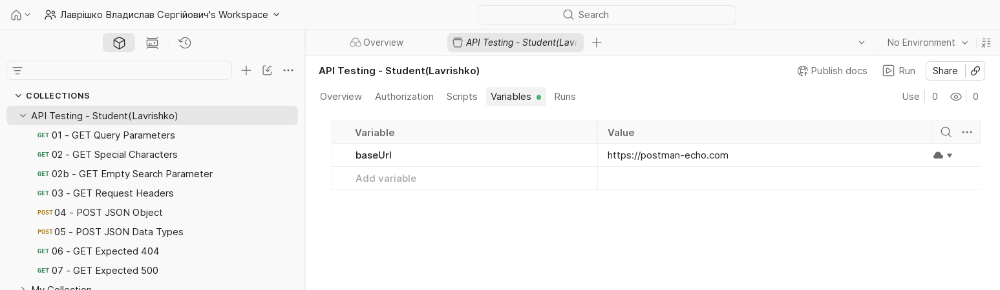
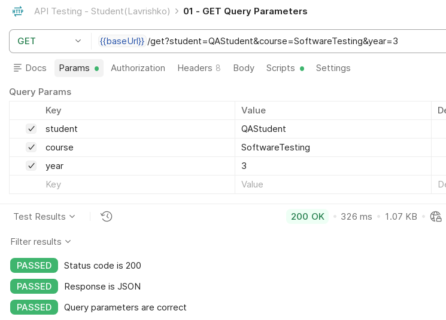
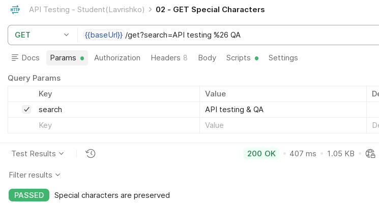
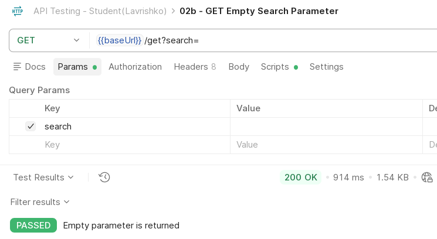
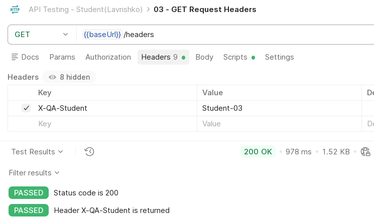
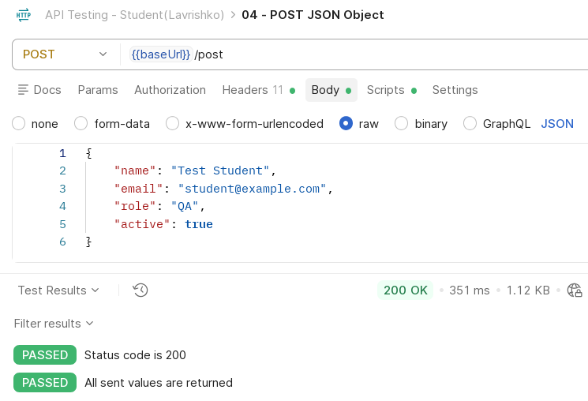
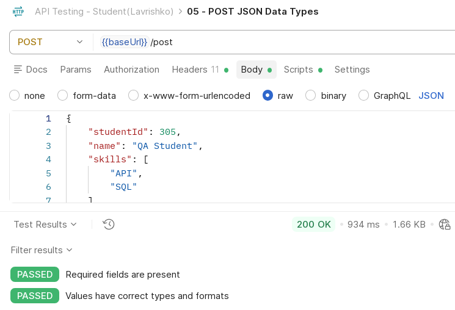
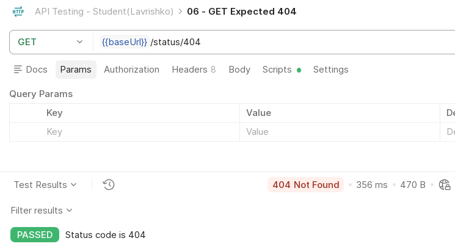
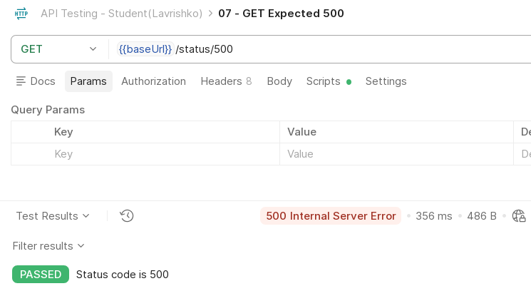
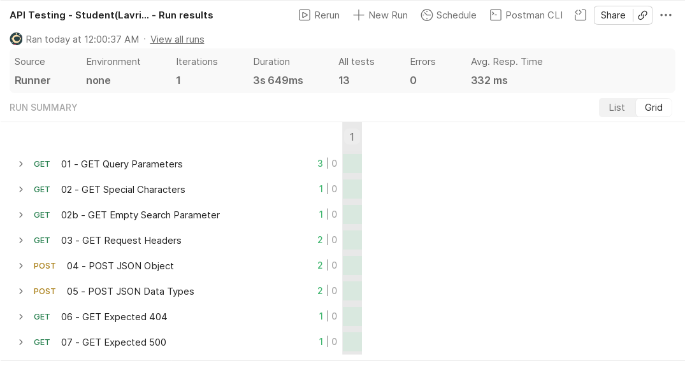

# Мета та завдання

**Мета:** навчитися виконувати HTTP-запити до REST API, перевіряти відповіді автоматизованими тестами на JavaScript (`pm.test`, `pm.expect`) і запускати всю колекцію одним проходом.

**Завдання:** колекція Postman `API Testing - Student(Lavrishko)` зі змінною `baseUrl = https://postman-echo.com` та запитами до Postman Echo (GET із параметрами, спецсимволами, порожнім параметром і заголовком; два POST із JSON; запити з очікуваними 404 і 500) зі скриптами перевірок і запуск колекції цілком. Файли роботи лежать у [теці lr-3 репозиторію](https://github.com/brizzinck/krinzhrepoduta/tree/main/yatpz/lr-3).

Коротко з теорії. Метод HTTP (GET, POST) задає дію, код стану (200, 404, 500) повідомляє результат. Postman Echo повертає в `args` параметри запиту, у `headers` заголовки (імена в нижньому регістрі), у `json` розібране тіло POST, а `/status/<код>` відповідає заданим кодом. Перевірка в Post-response: `pm.test(назва, функція)` і `pm.expect(...)` (Chai). Collection Runner (його консольний аналог Newman) виконує всі запити й показує кількість PASS і FAIL.

# Хід виконання роботи

Колекцію `API_Testing_Student.postman_collection.json` я імпортував у веб-версію Postman, змінну `baseUrl` видно на знімку нижче. Кожен запит надіслано, відповідь показано на рисунку, а всю колекцію запущено в Collection Runner (Iterations = 1). Той самий файл я додатково прогнав у Newman, результат збігся (вивід у `newman-report/`). Усі адреси починаються з `{{baseUrl}}`. У колекції 8 запитів: сім із завдань 2-7 і окремий `02b` для порожнього параметра із завдання 3. Адрес для 03, 06 і 07 методичка не задає, тому я взяв `/headers`, `/status/404` і `/status/500`. Поле «Active» із завдання 6 я трактував як `active`.

| Запит | Метод, ресурс | Очікувано | Фактично | Перевірок |
|--------------------|------------------------------|---------|---------------|--------|
| 01 - GET Query Parameters | GET `/get`, `student`, `course`, `year` | 200 | 200 OK | 3 |
| 02 - GET Special Characters | GET `/get`, `search` = `API testing & QA` | 200 | 200 OK | 1 |
| 02b - GET Empty Search Parameter | GET `/get`, `search` порожній | 200 | 200 OK | 1 |
| 03 - GET Request Headers | GET `/headers`, `X-QA-Student: Student-03` | 200 | 200 OK | 2 |
| 04 - POST JSON Object | POST `/post` | 200 | 200 OK | 2 |
| 05 - POST JSON Data Types | POST `/post` | 200 | 200 OK | 2 |
| 06 - GET Expected 404 | GET `/status/404` | 404 | 404 Not Found | 1 |
| 07 - GET Expected 500 | GET `/status/500` | 500 | 500 Internal Server Error | 1 |

Скрипт запиту 01 (завдання 2):

```javascript
pm.test("Status code is 200", function () {
    pm.response.to.have.status(200);
});
pm.test("Response is JSON", function () {
    pm.response.to.be.json;
});
pm.test("Query parameters are correct", function () {
    const body = pm.response.json();
    pm.expect(body.args.student).to.eql("QAStudent");
    pm.expect(body.args.course).to.eql("SoftwareTesting");
    pm.expect(body.args.year).to.eql("3");
});
```

::: {style="break-inside: avoid"}
Скрипт запиту 05 (завдання 6), тіло `{"studentId": 305, "name": "QA Student", "skills": ["API", "SQL"], "active": true, "middleName": null, "comment": ""}`:

```javascript
pm.test("Required fields are present", function () {
    const json = pm.response.json().json;

    pm.expect(json).to.have.property("studentId");
    pm.expect(json).to.have.property("name");
    pm.expect(json).to.have.property("skills");
    pm.expect(json).to.have.property("active");
});

pm.test("Values have correct types and formats", function () {
    const json = pm.response.json().json;

    pm.expect(json.studentId).to.be.a("number");
    pm.expect(json.name).to.be.a("string");
    pm.expect(json.skills).to.be.an("array");
    pm.expect(json.active).to.be.a("boolean");
    pm.expect(json.middleName).to.be.null;
    pm.expect(json.comment).to.eql("");
});
```
:::

Решта скриптів схожа: 02 перевіряє `args.search` = `API testing & QA`, 02b `args.search` = `""`, 03 `headers["x-qa-student"]` = `Student-03`, 04 повернені `name`, `email`, `role`, `active`, 06 і 07 тільки код 404 і 500 (повні тексти в колекції `API_Testing_Student.postman_collection.json`).

# Результати тестування

На знімках видно запит, статус відповіді й вкладку Test Results, де всі перевірки мають статус PASSED.

{width=50%}

::: {.pair}
{width=48%} {width=48%}

Запит 01: query-параметри (ліворуч); запит 02: спецсимволи в параметрі (праворуч)
:::

::: {.pair}
{width=48%} {width=48%}

Запит 02b: порожній параметр (ліворуч); запит 03: власний заголовок X-QA-Student (праворуч)
:::

::: {.pair}
{width=48%} {width=48%}

Запит 04: POST із JSON-обʼєктом (ліворуч); запит 05: POST, типи даних JSON (праворуч)
:::

::: {.pair}
{width=48%} {width=48%}

Запит 06: очікуваний код 404 (ліворуч); запит 07: очікуваний код 500 (праворуч)
:::

Підсумковий запуск колекції (Collection Runner, Iterations = 1): 8 запитів, 13 перевірок, 13 PASS, 0 FAIL, 0 помилок.

{width=70%}

# Висновки

Я зібрав колекцію з 8 запитів до Postman Echo й перевірив: передавання query-параметрів, збереження спецсимволів і порожнього параметра, повернення власного заголовка `X-QA-Student`, обмін JSON у POST (значення й типи: число, рядок, масив, булеве, `null`, порожній рядок) та негативні відповіді сервера. Шість запитів повернули 200 OK, `/status/404` повернув 404 Not Found, `/status/500` повернув 500 Internal Server Error. Обидва коди помилок були очікуваними, тому тести пройшли. У Collection Runner усі 13 перевірок мають PASS, невдалих немає, Newman показав те саме. Запуск усієї колекції зручний тим, що за один прохід повторює всі перевірки й показує кількість запитів, PASS і FAIL. Так швидко видно регресію після змін в API, а через Newman колекцію можна запускати в CI.
