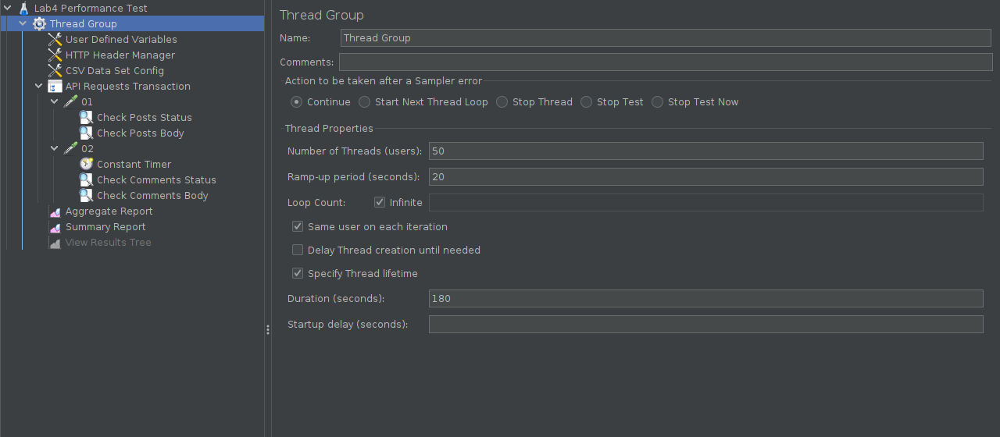
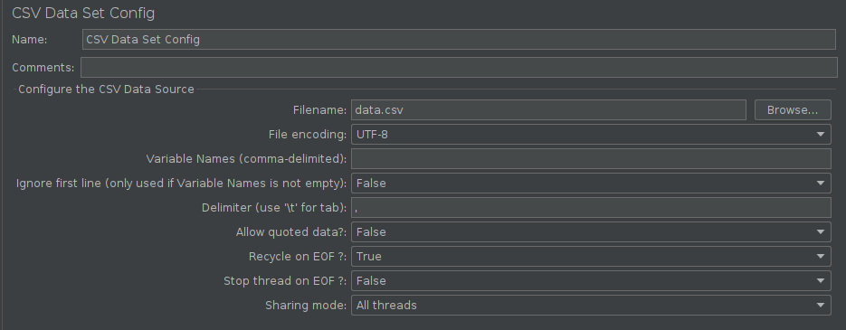
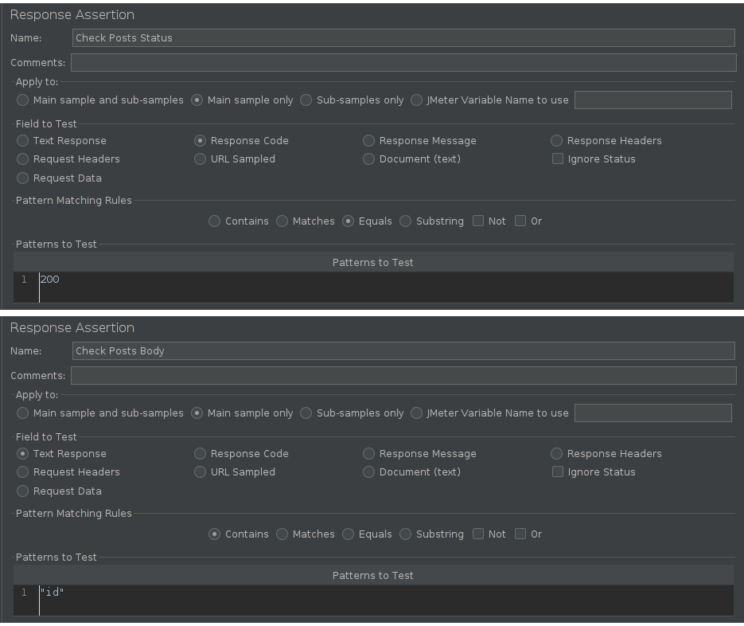
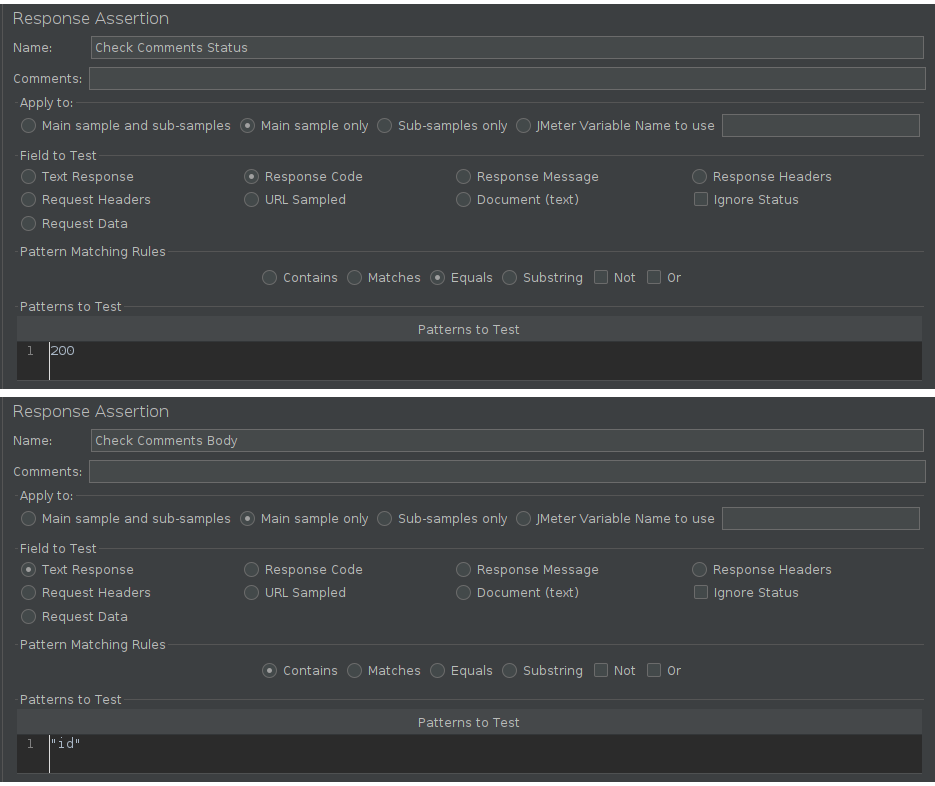
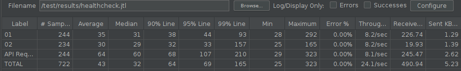
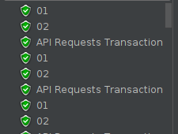
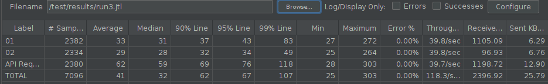
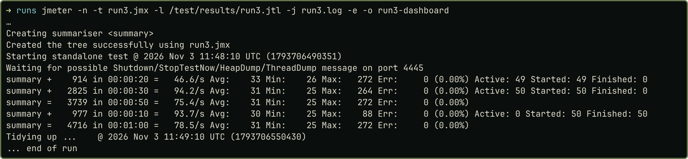

# Мета та завдання

**Мета:** навчитися створювати тест-план у JMeter, налаштовувати віртуальних користувачів, виконувати й параметризувати HTTP-запити, перевіряти відповіді API та аналізувати результати навантажувального тестування.

**Завдання:** тест-план `lab4_performance_test.jmx` і дані `data.csv` для публічного API JSONPlaceholder, перевірка працездатності й три запуски з навантаженням 10, 25 і 50 користувачів. Файли роботи лежать у [теці lr-4 репозиторію](https://github.com/brizzinck/krinzhrepoduta/tree/main/yatpz/lr-4), результати запусків у `results/`.

Коротко з теорії. Thread Group задає кількість віртуальних користувачів і час їх запуску, Sampler виконує запит, Assertion вирішує, чи вдалий результат, а Listener збирає статистику. Aggregate Report показує Average, Median, 90% Line, Error % і Throughput (кількість вибірок за секунду). Кожен потік чекає завершення свого запиту, тому Throughput залежить і від відповіді сервера, і від таймерів плану.

# Конфігурація тест-плану

Я використав Apache JMeter 5.6.3 на Java 21 у контейнері Docker.

| Елемент | Налаштування |
|--------------------------|-----------------------------------------------------------|
| Thread Group | 50 потоків, Ramp-Up 20 с, Loop Count: Infinite, Specify Thread lifetime, Duration 180 с |
| User Defined Variables | `TEST_URL = jsonplaceholder.typicode.com` |
| HTTP Header Manager | `Accept: application/json` |
| CSV Data Set Config | `data.csv` (стовпець `postId`, значення 1-5), UTF-8, рядок заголовка дає імʼя змінної, Recycle on EOF: True |
| API Requests Transaction | Transaction Controller із запитами `01` і `02` |
| Запит 01 | GET https `${TEST_URL}` `/posts` |
| Запит 02 | GET https `${TEST_URL}` `/comments?postId=${postId}`, перед ним Constant Timer 1000 мс |
| Response Assertion | `Check Posts Status`, `Check Comments Status`: Response Code, Equals, 200; `Check Posts Body`, `Check Comments Body`: Text Response, Contains, `"id"` |
| Listeners | Aggregate Report, Summary Report, View Results Tree |

Три місця методички я витлумачив так. У змінній стоїть `TEST_URL`, а в запитах `${BASE_URL}`, тому в Server Name я підставив `${TEST_URL}`, інакше змінна не розкриється. Loop Count «+» я трактував як Infinite: потоки працюють, доки не мине Duration. У файлі лишилося 50/20/180 з кроку налаштування, а 30 с і 60 с я задавав у копіях плану на час запуску. View Results Tree у файлі вимкнений, бо методичка радить вмикати його лише для короткого запуску.

{width=100%}

{width=75%}

{width=70%}

{width=70%}

# Запуски та результати

Перевірку працездатності (10 потоків, Ramp-Up 10 с, 30 с) я виконав у GUI з увімкненим View Results Tree: 478 запитів, усі Assertions пройшли, Error % = 0,00. Запит `02` звертався до всіх пʼяти значень `postId` з CSV, це видно в стовпці URL файлів `.jtl`.

{width=86%}

{width=16%}

Три запуски виконані 2026-11-03 послідовно, кожен один раз, у режимі без GUI, як радить документація JMeter для навантаження. Кожен результат записаний в окремий файл (`results/run1.jtl`, `run2.jtl`, `run3.jtl`). Показники я прочитав в Aggregate Report, відкриваючи файл після Clear All, таблиці збережені в `results/run*-aggregate.csv`.

{width=86%}

{width=94%}

| Показник | 10 користувачів | 25 користувачів | 50 користувачів |
|------------------------------|-----------|-----------|-----------|
| Ramp-Up, Duration | 10 с, 60 с | 10 с, 60 с | 20 с, 60 с |
| Запитів виконано | 1040 | 2595 | 4716 |
| Average (ms) | 34 | 31 | 31 |
| Median / 50th Percentile (ms) | 31 | 30 | 30 |
| 90th Percentile (ms) | 41 | 34 | 35 |
| Throughput (requests/sec) | 17,35 | 43,32 | 78,70 |
| Error % | 0,00 | 0,00 | 0,00 |

У таблиці лише HTTP-запити `01` і `02`: це рядок TOTAL Aggregate Report після того, як я прибрав із файлу вибірки контролера (`results/run*-http-aggregate.csv`). Контролер записує власну вибірку `API Requests Transaction`, яка не є окремим запитом. Звичайний рядок TOTAL враховує і її, тому дає Average 45, 41, 41 мс і Throughput 26,08, 65,14, 118,33 за секунду.

Throughput у запуску 3 нижчий за очікуваний, бо 20 з 60 секунд потоки ще стартували. На інтервалі, де працювали всі 50 потоків, консоль показує 94,2 запита за секунду. Це близько до межі самого плану: один цикл потоку триває приблизно 1062 мс (таймер 1000 мс і два запити по 30 мс), а 50 × 2 / 1,062 ≈ 94. Максимум кожного запуску (271, 310 і 272 мс) дав запит, де 231-245 мс зайняло встановлення зʼєднання (поле Connect у `.jtl`).

Окремі запити `/posts` і `/comments?postId=1` після запусків повернули заголовок `cf-cache-status: HIT` від `server: cloudflare`, тобто відповіді прийшли з кешу CDN (`results/cache-check.txt`).

# Висновки

Зі зростанням кількості користувачів із 10 до 50 середній час відповіді майже не змінився: 34, 31 і 31 мс, а різниця в 3 мс для короткого запуску несуттєва. Throughput зріс із 17,35 до 43,32 і 78,70 запита за секунду, майже пропорційно до потоків, а 94 запити за секунду на робочому інтервалі відповідають межі, яку задає таймер 1000 мс. Помилок не було: Error % = 0,00 в усіх запусках, усі відповіді мали код 200, відповідей 429 не зʼявилося. Межу стабільності API за цими результатами визначити не можна, бо деградації я не побачив, а навантаження обмежене 50 користувачами, 60 секундами й таймером плану. Найімовірніше, я вимірював не сам застосунок, а передусім кеш Cloudflare (`cf-cache-status: HIT`) і власну мережу, до того ж API спільний і його навантаження від інших клієнтів невідоме. Тому ці числа не можна переносити на інші сервери чи production: там інші залежності, інше обладнання, база даних, логіка запису й інший профіль користувачів. Для реальної системи тест потрібно повторити на її власному стенді, поступово збільшуючи навантаження, доки не зʼявляться помилки або зростання часу відповіді.
