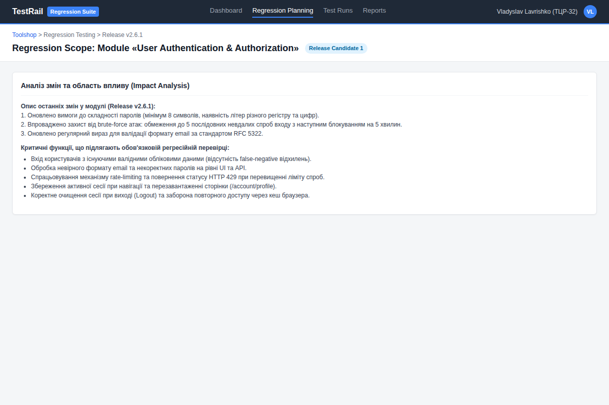
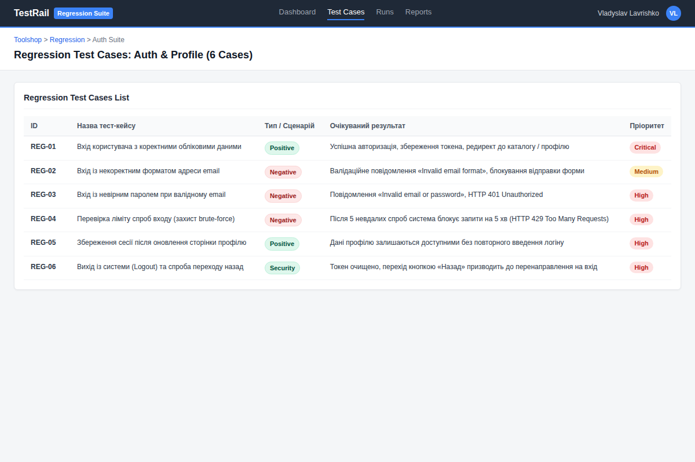
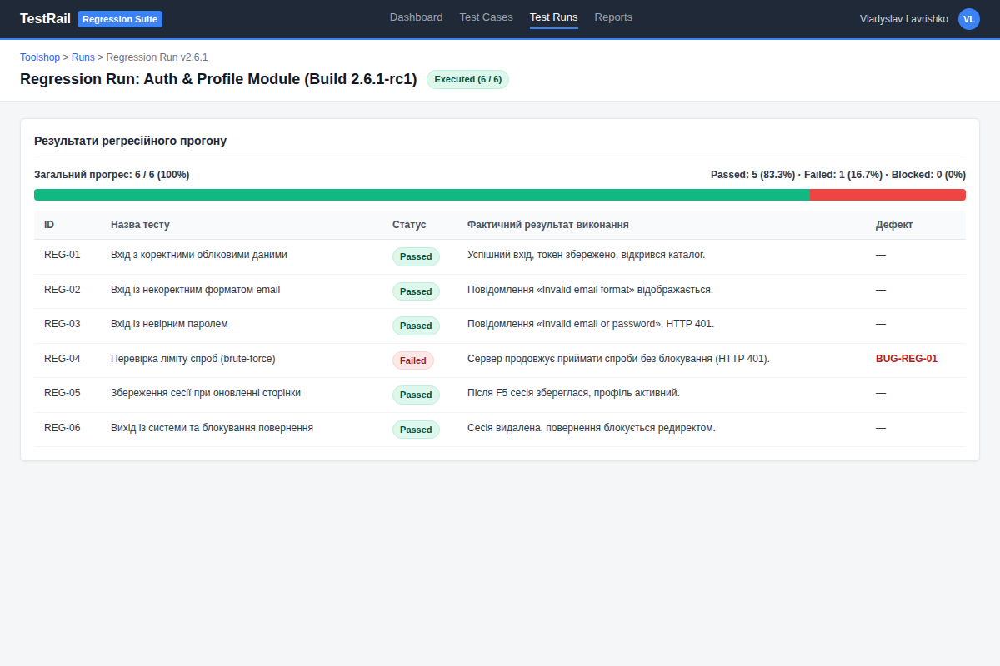
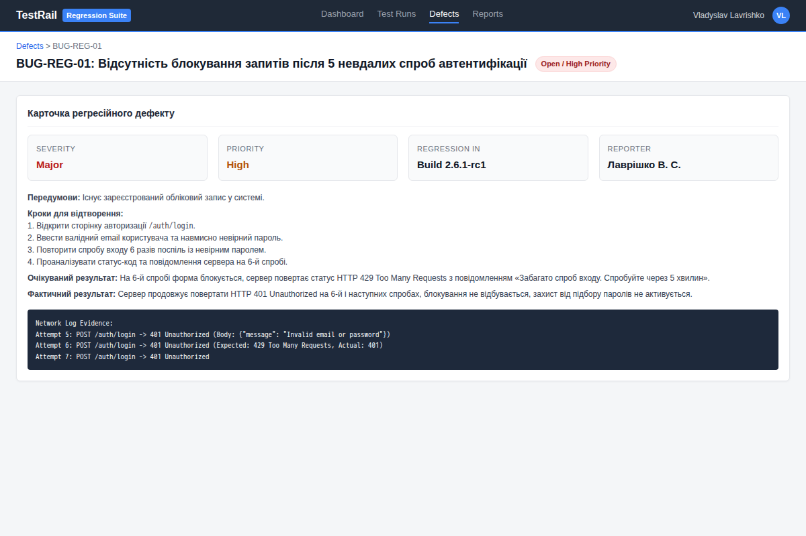
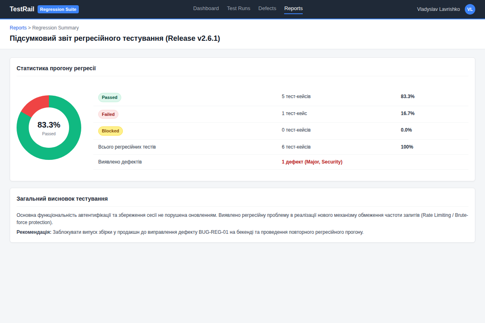

# Мета роботи

Отримати практичні навички планування та проведення регресійного тестування програмного забезпечення, визначення області впливу внесених змін (Impact Analysis), створення регресійних тест-кейсів у середовищі TestRail, перевірки збереження стабільності наявної функціональності та документування виявлених регресійних дефектів.

# 1. Вибір функціоналу та аналіз змін

Для проведення регресійного тестування обрано модуль автентифікації та керування сесією користувача вебзастосунку Practice Software Testing (доступний за адресою <https://practicesoftwaretesting.com>).

У збірці версії `v2.6.1-rc1` у зазначеному модулі відбулися наступні програмні зміни:

1. **Оновлення регулярного виразу валідації email:** впроваджено сувору перевірку адрес за стандартом RFC 5322 для запобігання введенню некоректних поштових скриньок.
2. **Зміна правил складності паролів:** встановлено нову мінімальну довжину пароля (8 символів), обов'язкову наявність літер у верхньому та нижньому регістрах, а також цифр.
3. **Механізм захисту від автоматизованого підбору (Brute-Force Protection):** додано обмеження до 5 послідовних невдалих спроб автентифікації з однієї IP-адреси / для одного облікового запису з наступним тимчасовим блокуванням доступу на 5 хвилин (HTTP 429).

**Аналіз області впливу (Impact Analysis) та функції для повторної перевірки:**
- Успішний вхід для користувачів, створених до оновлення (відсутність регресії доступу).
- Коректність відображення локалізованих повідомлень про помилки валідації.
- Робота механізму обмеження частоти запитів (Rate Limiting).
- Збереження активної сесії при навігації сторінками профілю (`/account/profile`) та після перезавантаження вкладки.
- Безпечний вихід із системи (Logout) із видаленням JWT токена з локального сховища браузера.

{width=75%}

# 2. Створення набору регресійних тест-кейсів

У системі TestRail розроблено набір із 6 регресійних тест-кейсів, які охоплюють як базові позитивні шляхи, так і сценарії обробки некоректних даних та безпекові перевірки:

| ID | Назва тест-кейсу | Сценарій | Очікуваний результат | Пріоритет |
|---|---|---|---|---|
| **REG-01** | Вхід користувача з коректними обліковими даними | Позитивний | Успішна автентифікація, збереження JWT токена, відкриття каталогу товарів. | Critical |
| **REG-02** | Вхід із некоректним форматом адреси email | Негативний | Форма блокує відправку запиту, відображається текст «Invalid email format». | Medium |
| **REG-03** | Вхід із невірним паролем при валідному email | Негативний | Відповідь сервера HTTP 401 Unauthorized, повідомлення «Invalid email or password». | High |
| **REG-04** | Перевірка ліміту спроб входу (захист brute-force) | Негативний / Безпека | На 6-й послідовній невдалій спробі запит блокується зі статусом HTTP 429 Too Many Requests. | High |
| **REG-05** | Збереження сесії після оновлення сторінки профілю | Позитивний | Після перезавантаження (F5) користувач залишається авторизованим, дані профілю доступні. | High |
| **REG-06** | Вихід із системи (Logout) та спроба переходу назад | Безпека | Токен видалено; спроба повернення кнопкою браузера «Назад» викликає редирект на `/auth/login`. | High |

{width=75%}

# 3. Проведення регресійного тестування

Виконано ручне тестування підготовлених сценаріїв у межах тестового прогону `Regression Run: Auth & Profile Module (Build 2.6.1-rc1)`.

| ID | Результат тесту | Фактичний результат виконання | Коментар / Дефект |
|---|---|---|---|
| REG-01 | **Passed** | Авторизація пройшла без затримок, токен успішно збережено в сховищі. | Базовий вхід збережено |
| REG-02 | **Passed** | Валідація спрацювала коректно на клієнті, некоректні адреси відхиляються. | Зміни валідації діють |
| REG-03 | **Passed** | Сервер повернув статус 401 із коректним текстом помилки. | Помилка обробляється |
| REG-04 | **Failed** | Сервер не заблокував запити після 5 невдалих спроб і повернув звичайний 401. | Виявлено дефект **BUG-REG-01** |
| REG-05 | **Passed** | Сесія відновлюється автоматично, дані профілю не зникають. | Сесія стабільна |
| REG-06 | **Passed** | Токен очищено зі сховища, несанкціонований доступ заблоковано. | Безпека виходу дотримана |

{width=75%}

# 4. Документування виявленого дефекту

За результатами провалу тесту REG-04 зареєстровано регресійний дефект **BUG-REG-01**:

- **Заголовок:** Відсутність блокування запитів після 5 невдалих спроб автентифікації підряд.
- **Критичність (Severity):** Major.
- **Пріоритет (Priority):** High.
- **Компонент:** Backend / Auth Rate Limiter.
- **Передумови:** Наявність зареєстрованого тестового користувача в базі даних.
- **Кроки для відтворення:**
  1. Відкрити сторінку `/auth/login`.
  2. Ввести валідний email користувача та навмисно помилковий пароль.
  3. Надіслати форму входу 6 разів поспіль із невірним паролем.
  4. Перевірити код відповіді сервера на 6-му запиті у вкладці Network.
- **Очікуваний результат:** На 6-й спробі сервер повертає статус `HTTP 429 Too Many Requests` з заголовком `Retry-After: 300` та блокує можливість входу на 5 хвилин.
- **Фактичний результат:** Сервер повертає `HTTP 401 Unauthorized` на всіх спробах без жодних обмежень частоти, що створює вразливість до підбору паролів.

{width=75%}

# 5. Підсумки тестування та рекомендації

Загальні статистичні підсумки регресійного тестування:
- Загальна кількість регресійних тест-кейсів: 6.
- Успішно виконано (Passed): 5 (83.3%).
- Провалено (Failed): 1 (16.7%).
- Заблоковано (Blocked): 0 (0.0%).
- Загальна кількість виявлених дефектів: 1 (рівень Major).

{width=75%}

**Загальний висновок щодо якості збірки:**
Основна функціональність входу та керування сесією зберегла працездатність, проте заявлена функція безпеки (Rate Limiting) не працює відповідно до технічних вимог.

**Рекомендації для команди розробки:**
1. Відхилити збірку `Build 2.6.1-rc1` для випуску в продуктивне середовище до усунення дефекту BUG-REG-01.
2. Перевірити конфігурацію проміжного шару (middleware) лімітера запитів у сервісі автентифікації.
3. Після виправлення повторити регресійний прогін усього набору Auth Suite.

# Висновки

Під час виконання лабораторної роботи опановано методику планування та реалізації регресійного тестування. Проведено аналіз області впливу внесених змін до модуля автентифікації, розроблено набір регресійних тест-кейсів у TMS TestRail, виконано тестування нової збірки вебзастосунку, виявлено та задокументовано регресійний дефект безпеки, а також сформовано підсумковий звіт із висновками щодо готовності програмного продукту до релізу.
