

# Вебзастосунок

Назва: Practice Software Testing, демонстраційний магазин Toolshop (версія v2.5).

URL: <https://practicesoftwaretesting.com>

Опис: інтернет-магазин інструментів, який автори підтримують для навчання тестуванню. Сайт має каталог, кошик, акаунти й публічну документацію з User Stories. Дані користувачів сайт видаляє щогодини, про що сказано в Privacy Policy.

Модулі, які я тестував: реєстрація (`/auth/register`), авторизація (`/auth/login`), відновлення паролю (`/auth/forgot-password`), пошук (головна сторінка), перегляд і редагування профілю (`/account/profile`).

Метод. Тестування виконано 2026-11-03. Expected я записав до виконання за критеріями User Stories сайту (AC) і логікою полів. Для входу й профілю я створив власний тестовий акаунт на свою навчальну пошту; імʼя, телефон і поштова адреса в ньому вигадані, email і пароль у звіт не внесені. Через погодинне очищення акаунт довелося створювати повторно. Кожен Fail, крім TC-PRF-08 і TC-AUTH-06, я перевірив щонайменше двома прогонами. Усі 11 полів окремими колонками є у файлі `testcases.csv` ([тека pr-2 репозиторію](https://github.com/brizzinck/krinzhrepoduta/tree/main/yatpz/pr-2)).

# Тест-кейси

Адреси в Links відносні до URL застосунку. Attach вказує на знімок дефекту у розділі «Дефекти».

## Module: Registration (Реєстрація)

Базовий набір даних для реєстрації: Test, Student, 2000-01-15, Ukraine, індекс 01001, будинок 1, вулиця, місто й штат тестові, телефон 0000000000. У Data вказано лише те, що змінюється.

+-----------------+---------------------------------------+---------------------------+---------------------------------+-------------------+
| ID, Submodule   | Test Case Description, Test Steps,    | Expected Results          | Actual Results                  | Pass/Fail,        |
|                 | Test Data                             |                           |                                 | Attachments,      |
|                 |                                       |                           |                                 | Links             |
+=================+=======================================+===========================+=================================+===================+
| TC-REG-01       | Реєстрація з коректними даними.       | Акаунт створено (HTTP     | HTTP 201, відкрито /auth/login. | Pass              |
|                 |                                       | 201), відкривається       | Сайт щогодини видаляє дані,     |                   |
| Позитивний      | Steps: 1. Відкрити форму реєстрації.  | сторінка /auth/login.     | тому той самий крок виконувався | Attach: немає     |
| сценарій        | 2. Заповнити всі поля. 3. Натиснути   |                           | повторно після очищення,        |                   |
|                 | Register.                             |                           | результат той самий.            | /auth/register    |
|                 |                                       |                           |                                 |                   |
|                 | Data: Адреса й пароль тестового       |                           |                                 |                   |
|                 | акаунта; решта полів: базовий набір   |                           |                                 |                   |
+-----------------+---------------------------------------+---------------------------+---------------------------------+-------------------+
| TC-REG-02       | Реєстрація на вже зайняту адресу.     | Показано помилку «Email   | Показано «A customer with this  | Fail              |
|                 |                                       | is already in use.»,      | email address already exists.», |                   |
| Email: дублікат | Steps: 1. Заповнити форму адресою     | сторінка реєстрації       | HTTP 409, форма лишилася        | Attach: DEF-10    |
|                 | існуючого акаунта. 2. Натиснути       | лишається відкритою.      | відкритою. Текст не збігається  |                   |
|                 | Register.                             |                           | з очікуваним.                   | /auth/register    |
|                 |                                       |                           |                                 |                   |
|                 | Data: Адреса тестового акаунта;       |                           |                                 |                   |
|                 | пароль Regdup-Pass-93!x; решта полів: |                           |                                 |                   |
|                 | базовий набір                         |                           |                                 |                   |
+-----------------+---------------------------------------+---------------------------+---------------------------------+-------------------+
| TC-REG-03       | Надсилання порожньої форми.           | Запит не надсилається.    | Запит не надіслано. Під кожним  | Pass              |
|                 |                                       | Під кожним обовʼязковим   | із 12 полів є помилка,          |                   |
| Обовʼязкові     | Steps: 1. Відкрити форму. 2. Не       | полем зʼявляється         | наприклад «First name is        | Attach: немає     |
| поля            | заповнюючи полів, натиснути Register. | помилка: імʼя, прізвище,  | required», «Email is required». |                   |
|                 |                                       | дата, країна, індекс,     |                                 | /auth/register    |
|                 | Data: Усі поля порожні                | будинок, вулиця, місто,   |                                 |                   |
|                 |                                       | штат, телефон, email,     |                                 |                   |
|                 |                                       | пароль.                   |                                 |                   |
+-----------------+---------------------------------------+---------------------------+---------------------------------+-------------------+
| TC-REG-04       | Некоректний формат адреси.            | Кожна адреса відхиляється | abc, a@@b.com, user             | Fail              |
|                 |                                       | з помилкою біля поля      | name@example.com: «Email format |                   |
| Email: формат   | Steps: 1. Заповнити форму. 2. Ввести  | email, акаунт не          | is invalid», запит не           | Attach: DEF-01    |
|                 | адресу з набору. 3. Натиснути         | створюється.              | надіслано. user@example..com    |                   |
|                 | Register. 4. Повторити для кожної     |                           | прийнято: HTTP 201, відкрито    | /auth/register    |
|                 | адреси.                               |                           | /auth/login.                    |                   |
|                 |                                       |                           |                                 |                   |
|                 | Data: abc; a@@b.com; user             |                           |                                 |                   |
|                 | name@example.com; user@example..com;  |                           |                                 |                   |
|                 | решта полів: базовий набір            |                           |                                 |                   |
+-----------------+---------------------------------------+---------------------------+---------------------------------+-------------------+
| TC-REG-05       | Адреса з 257 символів і надто довгою  | Адреса відхиляється з     | «Email format is invalid»,      | Pass              |
|                 | міткою домену.                        | помилкою, акаунт не       | запит не надіслано.             |                   |
| Email: надто    |                                       | створюється.              |                                 | Attach: немає     |
| довга адреса    | Steps: 1. Заповнити форму. 2. Ввести  |                           |                                 |                   |
|                 | адресу довжиною 257 символів. 3.      |                           |                                 | /auth/register    |
|                 | Натиснути Register.                   |                           |                                 |                   |
|                 |                                       |                           |                                 |                   |
|                 | Data: 64 символи a, @, 180 символів   |                           |                                 |                   |
|                 | b, .example.com, разом 257; мітка     |                           |                                 |                   |
|                 | домену 180 символів, більше за        |                           |                                 |                   |
|                 | допустимі 63; решта полів: базовий    |                           |                                 |                   |
|                 | набір                                 |                           |                                 |                   |
+-----------------+---------------------------------------+---------------------------+---------------------------------+-------------------+
| TC-REG-06       | Пароль на 7 і 8 символів.             | 7 символів: помилка про   | 7 символів: запит не надіслано, | Fail              |
|                 |                                       | довжину пароля, акаунт не | але текст «Password must be     |                   |
| Пароль: межа    | Steps: 1. Ввести пароль на 7          | створюється. 8 символів:  | minimal 6 characters long.»     | Attach: DEF-08    |
| довжини         | символів, вийти з поля, прочитати     | помилки про довжину       | називає хибну межу, сайт        |                   |
|                 | стан вимог і помилки, натиснути       | немає.                    | вимагає 8. 8 символів: помилки  | /auth/register    |
|                 | Register. 2. Ввести пароль на 8       |                           | про пароль немає.               |                   |
|                 | символів, вийти з поля, прочитати     |                           |                                 |                   |
|                 | стан вимог (адреса некоректна, форму  |                           |                                 |                   |
|                 | не надіслано).                        |                           |                                 |                   |
|                 |                                       |                           |                                 |                   |
|                 | Data: Aa1!aaa (7); Aa1!aaaa (8); для  |                           |                                 |                   |
|                 | кроку 2 email abc                     |                           |                                 |                   |
+-----------------+---------------------------------------+---------------------------+---------------------------------+-------------------+
| TC-REG-07       | Пароль без потрібних класів символів. | Кожен пароль відхиляється | Усі 4 паролі: запит не          | Fail              |
|                 |                                       | з помилкою про відповідну | надіслано, текст однаковий:     |                   |
| Пароль: склад   | Steps: 1. Заповнити форму. 2. Ввести  | вимогу, акаунт не         | «Password can not include       | Attach: DEF-09    |
|                 | пароль із набору. 3. Натиснути        | створюється.              | invalid characters.» Вимогу,    |                   |
|                 | Register. 4. Повторити для кожного    |                           | якої бракує, не названо.        | /auth/register    |
|                 | пароля.                               |                           |                                 |                   |
|                 |                                       |                           |                                 |                   |
|                 | Data: alllower1!; ALLUPPER1!;         |                           |                                 |                   |
|                 | NoDigits!!; NoSymbol11; решта полів:  |                           |                                 |                   |
|                 | базовий набір                         |                           |                                 |                   |
+-----------------+---------------------------------------+---------------------------+---------------------------------+-------------------+
| TC-REG-08       | Індикатор надійності й вимоги         | Список вимог видно. Без   | Список вимог видно. Під час     | Fail              |
|                 | оновлюються під час введення.         | виходу з поля індикатор   | введення індикатор лишається 0  |                   |
| Пароль:         |                                       | змінюється: Moderate для  | %, вимоги не змінюють колір.    | Attach: DEF-02    |
| елементи UI     | Steps: 1. Поставити курсор у поле     | aB, далі зростає до       | Після виходу з поля вимоги      |                   |
|                 | пароля. 2. Ввести символи по одному,  | Excellent для aB1!aaaa    | зелені, індикатор так само 0 %. | /auth/register    |
|                 | не виходячи з поля, після кожної      | (шкала сайту, 5 рівнів).  |                                 |                   |
|                 | порції прочитати індикатор.           |                           |                                 |                   |
|                 |                                       |                           |                                 |                   |
|                 | Data: a; aB; aB1; aB1!; aB1!aaaa      |                           |                                 |                   |
+-----------------+---------------------------------------+---------------------------+---------------------------------+-------------------+
| TC-REG-09       | Дата не у форматі YYYY-MM-DD.         | Показано помилку про      | «Please enter a valid date in   | Pass              |
|                 |                                       | формат дати, запит не     | YYYY-MM-DD format.», запит не   |                   |
| Дата            | Steps: 1. Заповнити форму. 2. Ввести  | надсилається.             | надіслано.                      | Attach: немає     |
| народження:     | дату 15-01-2000. 3. Натиснути         |                           |                                 |                   |
| формат          | Register.                             |                           |                                 | /auth/register    |
|                 |                                       |                           |                                 |                   |
|                 | Data: 15-01-2000; email               |                           |                                 |                   |
|                 | tc-reg-09@example.com; пароль         |                           |                                 |                   |
|                 | Dob-Check-71!q; решта коректна        |                           |                                 |                   |
+-----------------+---------------------------------------+---------------------------+---------------------------------+-------------------+

## Module: Authorization (Авторизація)

+-----------------+--------------------------------------+---------------------------+---------------------------------+-------------------+
| ID, Submodule   | Test Case Description, Test Steps,   | Expected Results          | Actual Results                  | Pass/Fail,        |
|                 | Test Data                            |                           |                                 | Attachments,      |
|                 |                                      |                           |                                 | Links             |
+=================+======================================+===========================+=================================+===================+
| TC-AUTH-01      | Вхід із правильними даними.          | Вхід виконано,            | HTTP 200, відкрито /account, у  | Pass              |
|                 |                                      | відкривається /account, у | меню Test Student.              |                   |
| Позитивний      | Steps: 1. Відкрити форму входу. 2.   | меню показано імʼя Test   |                                 | Attach: немає     |
| сценарій        | Ввести адресу й пароль. 3. Натиснути | Student.                  |                                 |                   |
|                 | Login.                               |                           |                                 | /auth/login       |
|                 |                                      |                           |                                 |                   |
|                 | Data: Адреса й пароль тестового      |                           |                                 |                   |
|                 | акаунта                              |                           |                                 |                   |
+-----------------+--------------------------------------+---------------------------+---------------------------------+-------------------+
| TC-AUTH-02      | Вхід із неправильним паролем.        | Показано помилку «Invalid | «Invalid email or password»,    | Pass              |
|                 |                                      | email or password», вхід  | HTTP 401, вхід не виконано.     |                   |
| Неправильний    | Steps: 1. Ввести адресу акаунта й    | не виконано.              |                                 | Attach: немає     |
| пароль          | неправильний пароль. 2. Натиснути    |                           |                                 |                   |
|                 | Login.                               |                           |                                 | /auth/login       |
|                 |                                      |                           |                                 |                   |
|                 | Data: Адреса тестового акаунта;      |                           |                                 |                   |
|                 | Wrong-Pass-123!                      |                           |                                 |                   |
+-----------------+--------------------------------------+---------------------------+---------------------------------+-------------------+
| TC-AUTH-03      | Вхід із незареєстрованою адресою.    | Показано ту саму помилку  | «Invalid email or password»,    | Pass              |
|                 |                                      | «Invalid email or         | HTTP 401.                       |                   |
| Незареєстрована | Steps: 1. Ввести незареєстровану     | password».                |                                 | Attach: немає     |
| адреса          | адресу й пароль. 2. Натиснути Login. |                           |                                 |                   |
|                 |                                      |                           |                                 | /auth/login       |
|                 | Data: nobody.pst.2026@example.com;   |                           |                                 |                   |
|                 | Wrong-Pass-123!                      |                           |                                 |                   |
+-----------------+--------------------------------------+---------------------------+---------------------------------+-------------------+
| TC-AUTH-04      | Вхід із порожніми полями.            | Запит не надсилається,    | «Email is required», «Password  | Pass              |
|                 |                                      | під полями email і        | is required», запит не          |                   |
| Обовʼязкові     | Steps: 1. Відкрити форму. 2. Не      | password показано         | надіслано.                      | Attach: немає     |
| поля            | заповнюючи полів, натиснути Login.   | повідомлення про          |                                 |                   |
|                 |                                      | обовʼязковість.           |                                 | /auth/login       |
|                 | Data: Обидва поля порожні            |                           |                                 |                   |
+-----------------+--------------------------------------+---------------------------+---------------------------------+-------------------+
| TC-AUTH-05      | Вихід з акаунта й захист сторінки    | Після виходу              | Після Sign out відкрито         | Pass              |
|                 | профілю.                             | відкривається             | /auth/login, у меню Sign in.    |                   |
| Вихід і захист  |                                      | /auth/login, у меню знову | Прямий перехід на               | Attach: немає     |
| сторінок        | Steps: 1. Увійти. 2. У меню          | Sign in. Прямий перехід   | /account/profile повертає на    |                   |
|                 | користувача обрати Sign out. 3.      | на профіль перекидає на   | /auth/login.                    | /account/profile  |
|                 | Відкрити /account/profile за прямою  | форму входу.              |                                 |                   |
|                 | адресою.                             |                           |                                 |                   |
|                 |                                      |                           |                                 |                   |
|                 | Data: Тестовий акаунт                |                           |                                 |                   |
+-----------------+--------------------------------------+---------------------------+---------------------------------+-------------------+
| TC-AUTH-06      | Блокування після трьох невдалих      | Після третьої невдалої    | Спроба 1 (TC-REC-06) і спроба   | Fail              |
|                 | спроб.                               | спроби вхід заблоковано:  | 2: HTTP 401, «Invalid email or  |                   |
| Блокування      |                                      | помилка «Account locked,  | password». Спроба 3 і дві       | Attach:           |
| акаунта         | Steps: 1. Ввести неправильний пароль | too many failed attempts. | наступні: HTTP 423, «Account    | TC-AUTH-06a,      |
|                 | тричі поспіль (наступні спроби після | Please contact the        | locked, too many failed         | TC-AUTH-06b       |
|                 | TC-REC-06). 2. Спробувати увійти ще  | administrator.», HTTP     | attempts. Please contact the    |                   |
|                 | раз.                                 | 423.                      | administrator.» Блокування      | /auth/login       |
|                 |                                      |                           | настало після двох записаних    |                   |
|                 | Data: Адреса тестового акаунта;      |                           | невдалих спроб, а не трьох.     |                   |
|                 | Wrong-Pass-123!                      |                           |                                 |                   |
+-----------------+--------------------------------------+---------------------------+---------------------------------+-------------------+

## Module: Password Recovery (Відновлення паролю)

+-----------------+---------------------------------+---------------------------+---------------------------------+------------------------+
| ID, Submodule   | Test Case Description, Test     | Expected Results          | Actual Results                  | Pass/Fail,             |
|                 | Steps, Test Data                |                           |                                 | Attachments, Links     |
+=================+=================================+===========================+=================================+========================+
| TC-REC-01       | Запит на відновлення для        | Форма містить поле email. | Форма містить одне поле email.  | Fail                   |
|                 | зареєстрованої адреси.          | Після надсилання показано | HTTP 200. Замість тексту        |                        |
| Позитивний      |                                 | підтвердження, воно       | підтвердження показано ключ     | Attach: DEF-03         |
| сценарій        | Steps: 1. На сторінці входу     | зникає приблизно через 3  | «page.forgot-password.confirm», |                        |
|                 | натиснути Forgot your Password? | с.                        | він зникає приблизно за 3 с.    | /auth/forgot-password  |
|                 | 2. Ввести адресу акаунта. 3.    |                           |                                 |                        |
|                 | Натиснути Set New Password.     |                           |                                 |                        |
|                 |                                 |                           |                                 |                        |
|                 | Data: Адреса тестового акаунта  |                           |                                 |                        |
+-----------------+---------------------------------+---------------------------+---------------------------------+------------------------+
| TC-REC-02       | Запит на відновлення для        | Показано повідомлення про | «The selected email is          | Pass                   |
|                 | незареєстрованої адреси.        | помилку, пароль нікому не | invalid.», HTTP 422,            |                        |
| Незареєстрована |                                 | скидається.               | повідомлення зникає приблизно   | Attach: немає          |
| адреса          | Steps: 1. Відкрити форму. 2.    |                           | за 3 с.                         |                        |
|                 | Ввести незареєстровану адресу.  |                           |                                 | /auth/forgot-password  |
|                 | 3. Натиснути Set New Password.  |                           |                                 |                        |
|                 |                                 |                           |                                 |                        |
|                 | Data:                           |                           |                                 |                        |
|                 | nobody.pst.2026@example.com     |                           |                                 |                        |
+-----------------+---------------------------------+---------------------------+---------------------------------+------------------------+
| TC-REC-03       | Запит із порожнім email.        | Запит не надсилається,    | «Email is required», запит не   | Pass                   |
|                 |                                 | під полем показано        | надіслано.                      |                        |
| Обовʼязкове     | Steps: 1. Відкрити форму. 2. Не | повідомлення про          |                                 | Attach: немає          |
| поле            | заповнюючи поле, натиснути Set  | обовʼязковість.           |                                 |                        |
|                 | New Password.                   |                           |                                 | /auth/forgot-password  |
|                 |                                 |                           |                                 |                        |
|                 | Data: Поле порожнє              |                           |                                 |                        |
+-----------------+---------------------------------+---------------------------+---------------------------------+------------------------+
| TC-REC-04       | Запит із некоректною адресою.   | Запит не надсилається,    | Запит не надіслано, поле        | Fail                   |
|                 |                                 | під полем показано        | позначено червоним, але блок    |                        |
| Email: формат   | Steps: 1. Відкрити форму. 2.    | повідомлення про формат.  | помилки порожній, тексту немає. | Attach: DEF-07         |
|                 | Ввести адресу abc. 3. Натиснути |                           |                                 |                        |
|                 | Set New Password.               |                           |                                 | /auth/forgot-password  |
|                 |                                 |                           |                                 |                        |
|                 | Data: abc                       |                           |                                 |                        |
+-----------------+---------------------------------+---------------------------+---------------------------------+------------------------+
| TC-REC-05       | Відповідь не показує, чи        | Текст відповіді однаковий | Зареєстрована адреса: HTTP 200, | Fail                   |
|                 | зареєстрована адреса.           | для обох адрес,           | зелене повідомлення.            |                        |
| Розкриття       |                                 | зловмисник не може        | Незареєстрована: HTTP 422, «The | Attach: DEF-03, DEF-04 |
| акаунта         | Steps: 1. Надіслати форму з     | перевірити наявність      | selected email is invalid.»     |                        |
|                 | адресою акаунта. 2. Надіслати   | акаунта.                  | Відповіді різні.                | /auth/forgot-password  |
|                 | форму з                         |                           |                                 |                        |
|                 | nobody.pst.2026@example.com. 3. |                           |                                 |                        |
|                 | Порівняти тексти й коди         |                           |                                 |                        |
|                 | відповідей. Кроки 1 і 2         |                           |                                 |                        |
|                 | виконано в прогонах TC-REC-01 і |                           |                                 |                        |
|                 | TC-REC-02.                      |                           |                                 |                        |
|                 |                                 |                           |                                 |                        |
|                 | Data: Зареєстрована й           |                           |                                 |                        |
|                 | незареєстрована адреси          |                           |                                 |                        |
+-----------------+---------------------------------+---------------------------+---------------------------------+------------------------+
| TC-REC-06       | Старий пароль після скидання не | Вхід не виконано,         | HTTP 401, «Invalid email or     | Pass                   |
|                 | діє.                            | показано «Invalid email   | password», вхід не виконано.    |                        |
| Поведінка після |                                 | or password».             |                                 | Attach: немає          |
| відновлення     | Steps: 1. Після TC-REC-01       |                           |                                 |                        |
|                 | ввести адресу акаунта й         |                           |                                 | /auth/login            |
|                 | попередній пароль на формі      |                           |                                 |                        |
|                 | входу. 2. Натиснути Login.      |                           |                                 |                        |
|                 |                                 |                           |                                 |                        |
|                 | Data: Адреса тестового акаунта; |                           |                                 |                        |
|                 | пароль, що діяв до скидання     |                           |                                 |                        |
+-----------------+---------------------------------+---------------------------+---------------------------------+------------------------+
| TC-REC-07       | Новий пароль приходить листом і | Лист із новим паролем     | Не виконано: крок потребує      | Not run                |
|                 | підходить для входу.            | надходить, вхід ним       | відкрити справжню поштову       |                        |
| Лист із новим   |                                 | виконується.              | скриньку студента. Лист не      | Attach: немає          |
| паролем         | Steps: 1. Після TC-REC-01       |                           | відкривався, вхід новим паролем |                        |
|                 | відкрити поштову скриньку       |                           | не перевірявся.                 | /auth/login            |
|                 | акаунта. 2. Знайти лист із      |                           |                                 |                        |
|                 | новим паролем. 3. Увійти новим  |                           |                                 |                        |
|                 | паролем.                        |                           |                                 |                        |
|                 |                                 |                           |                                 |                        |
|                 | Data: Поштова скринька          |                           |                                 |                        |
|                 | тестового акаунта               |                           |                                 |                        |
+-----------------+---------------------------------+---------------------------+---------------------------------+------------------------+

## Module: Search (Пошук)

+-----------------+---------------------------------------+---------------------------+---------------------------------+-------------------+
| ID, Submodule   | Test Case Description, Test Steps,    | Expected Results          | Actual Results                  | Pass/Fail,        |
|                 | Test Data                             |                           |                                 | Attachments,      |
|                 |                                       |                           |                                 | Links             |
+=================+=======================================+===========================+=================================+===================+
| TC-SRC-01       | Пошук наявного товару.                | У сітці лише товари з     | «4 products found for           | Pass              |
|                 |                                       | pliers у назві, над       | 'Pliers'»: Combination Pliers,  |                   |
| Позитивний      | Steps: 1. Відкрити головну. 2. Ввести | сіткою показано запит.    | Pliers, Long Nose Pliers, Slip  | Attach: немає     |
| сценарій        | запит. 3. Натиснути Search.           |                           | Joint Pliers. Над сіткою        |                   |
|                 |                                       |                           | «Searched for: Pliers».         | /                 |
|                 | Data: Pliers                          |                           |                                 |                   |
+-----------------+---------------------------------------+---------------------------+---------------------------------+-------------------+
| TC-SRC-02       | Пошук відсутнього товару.             | Сітка порожня, показано   | 0 товарів, «There are no        | Pass              |
|                 |                                       | повідомлення про          | products found.»                |                   |
| Немає           | Steps: 1. Ввести запит. 2. Натиснути  | відсутність товарів.      |                                 | Attach: немає     |
| результатів     | Search.                               |                           |                                 |                   |
|                 |                                       |                           |                                 | /                 |
|                 | Data: qqqzzzxxx                       |                           |                                 |                   |
+-----------------+---------------------------------------+---------------------------+---------------------------------+-------------------+
| TC-SRC-03       | Пошук із порожнім полем.              | Пошук не виконується,     | Пошук не виконано, сітка без    | Fail              |
|                 |                                       | показано помилку          | змін, жодного повідомлення.     |                   |
| Порожній запит  | Steps: 1. Не заповнюючи поле,         | валідації (мінімум 3      |                                 | Attach: DEF-05a   |
|                 | натиснути Search.                     | символи, AC6).            |                                 |                   |
|                 |                                       |                           |                                 | /                 |
|                 | Data: Поле порожнє                    |                           |                                 |                   |
+-----------------+---------------------------------------+---------------------------+---------------------------------+-------------------+
| TC-SRC-04       | Запити на 2 і 3 символи.              | ha: пошук не виконується, | ha: пошук не виконано, сітка    | Fail              |
|                 |                                       | показано помилку          | без змін, жодного повідомлення. |                   |
| Межа            | Steps: 1. Ввести запит на 2 символи,  | валідації. saw: показано  | saw: 2 товари, Wood Saw і       | Attach: DEF-05b   |
| мінімальної     | натиснути Search. 2. Ввести запит на  | товари з saw у назві.     | Circular Saw.                   |                   |
| довжини         | 3 символи, натиснути Search.          |                           |                                 | /                 |
|                 |                                       |                           |                                 |                   |
|                 | Data: ha (2); saw (3)                 |                           |                                 |                   |
+-----------------+---------------------------------------+---------------------------+---------------------------------+-------------------+
| TC-SRC-05       | Запит на 41 символ.                   | Поле приймає не більше 40 | Поле містить усі 41 символ,     | Fail              |
|                 |                                       | символів (AC7): значення  | обрізання й помилки немає.      |                   |
| Межа            | Steps: 1. Ввести рядок на 41 символ.  | обрізано до 40 або        | Після Search пошук не виконано, | Attach: DEF-06    |
| максимальної    | 2. Прочитати значення поля. 3.        | показано помилку.         | жодного повідомлення.           |                   |
| довжини         | Натиснути Search.                     |                           |                                 | /                 |
|                 |                                       |                           |                                 |                   |
|                 | Data: 41 символ a                     |                           |                                 |                   |
+-----------------+---------------------------------------+---------------------------+---------------------------------+-------------------+
| TC-SRC-06       | Пошук не залежить від регістру.       | Обидва запити дають       | Обидва запити дали 4 однакові   | Pass              |
|                 |                                       | однаковий перелік         | товари.                         |                   |
| Регістр         | Steps: 1. Виконати пошук PLIERS. 2.   | товарів.                  |                                 | Attach: немає     |
|                 | Виконати пошук pliers. 3. Порівняти   |                           |                                 |                   |
|                 | назви товарів.                        |                           |                                 | /                 |
|                 |                                       |                           |                                 |                   |
|                 | Data: PLIERS; pliers                  |                           |                                 |                   |
+-----------------+---------------------------------------+---------------------------+---------------------------------+-------------------+
| TC-SRC-07       | Символ % сприймається буквально.      | Товарів із %%% у назві    | 0 товарів, «There are no        | Pass              |
|                 |                                       | немає, тому сітка порожня | products found.»                |                   |
| Спецсимволи     | Steps: 1. Ввести запит. 2. Натиснути  | й показано повідомлення   |                                 | Attach: немає     |
|                 | Search.                               | про відсутність товарів.  |                                 |                   |
|                 |                                       |                           |                                 | /                 |
|                 | Data: %%%                             |                           |                                 |                   |
+-----------------+---------------------------------------+---------------------------+---------------------------------+-------------------+
| TC-SRC-08       | Пробіли на початку й у кінці запиту.  | Пробіли ігноруються,      | 4 товари, перелік збігається з  | Pass              |
|                 |                                       | перелік збігається з      | TC-SRC-01.                      |                   |
| Пробіли на      | Steps: 1. Ввести запит із пробілами.  | TC-SRC-01.                |                                 | Attach: немає     |
| краях           | 2. Натиснути Search. 3. Порівняти з   |                           |                                 |                   |
|                 | результатом TC-SRC-01.                |                           |                                 | /                 |
|                 |                                       |                           |                                 |                   |
|                 | Data: два пробіли, Pliers, два        |                           |                                 |                   |
|                 | пробіли                               |                           |                                 |                   |
+-----------------+---------------------------------------+---------------------------+---------------------------------+-------------------+
| TC-SRC-09       | Пошук скидає активні фільтри.         | Позначку категорії знято, | Фільтр Hammer дав 7 товарів.    | Pass              |
|                 |                                       | показано товари за        | Після пошуку позначку знято,    |                   |
| Скидання        | Steps: 1. Позначити категорію Hammer  | запитом (AC4).            | показано 4 товари Pliers.       | Attach: немає     |
| фільтрів        | у фільтрі. 2. Ввести запит. 3.        |                           |                                 |                   |
|                 | Натиснути Search.                     |                           |                                 | /                 |
|                 |                                       |                           |                                 |                   |
|                 | Data: Категорія Hammer; запит Pliers  |                           |                                 |                   |
+-----------------+---------------------------------------+---------------------------+---------------------------------+-------------------+

## Module: Profile Editing (Редагування профілю)

+-----------------+--------------------------------------+---------------------------+---------------------------------+-------------------+
| ID, Submodule   | Test Case Description, Test Steps,   | Expected Results          | Actual Results                  | Pass/Fail,        |
|                 | Test Data                            |                           |                                 | Attachments,      |
|                 |                                      |                           |                                 | Links             |
+=================+======================================+===========================+=================================+===================+
| TC-PRF-01       | Перегляд профілю й захист email.     | У полях дані з реєстрації | Поля містять Test, Student,     | Pass              |
|                 |                                      | (Test, Student, телефон). | 0000000000. Поле email має      |                   |
| Перегляд        | Steps: 1. Увійти. 2. Відкрити        | Поле email лише для       | атрибут readonly, введення не   | Attach: немає     |
|                 | сторінку профілю. 3. Спробувати      | читання.                  | змінює значення.                |                   |
|                 | змінити email.                       |                           |                                 | /account/profile  |
|                 |                                      |                           |                                 |                   |
|                 | Data: Тестовий акаунт                |                           |                                 |                   |
+-----------------+--------------------------------------+---------------------------+---------------------------------+-------------------+
| TC-PRF-02       | Зміна імені зберігається після       | Показано повідомлення про | «Your profile is successfully   | Pass              |
|                 | повторного входу.                    | успіх, після повторного   | updated!», HTTP 200. Після      |                   |
| Позитивний      |                                      | входу в полях нові        | повторного входу в полях Testa  | Attach: немає     |
| сценарій        | Steps: 1. Змінити імʼя й місто. 2.   | значення.                 | і Testburg, у меню Testa        |                   |
|                 | Натиснути Update Profile. 3. Вийти,  |                           | Student.                        | /account/profile  |
|                 | увійти знову, відкрити профіль.      |                           |                                 |                   |
|                 |                                      |                           |                                 |                   |
|                 | Data: Імʼя Testa; місто Testburg     |                           |                                 |                   |
+-----------------+--------------------------------------+---------------------------+---------------------------------+-------------------+
| TC-PRF-03       | Порожнє імʼя та імʼя з пробілів.     | В обох випадках показано  | Порожнє: «Please correct the    | Pass              |
|                 |                                      | помилку, збереження       | highlighted fields before       |                   |
| Обовʼязкові     | Steps: 1. Очистити імʼя, натиснути   | немає, імʼя після         | saving.» Пробіли: HTTP 422,     | Attach: немає     |
| поля            | Update Profile. 2. Ввести три        | перезавантаження          | «The first name field is        |                   |
|                 | пробіли, натиснути Update Profile.   | незмінне.                 | required.» Після                | /account/profile  |
|                 | 3. Перезавантажити сторінку.         |                           | перезавантаження імʼя Testa.    |                   |
|                 |                                      |                           |                                 |                   |
|                 | Data: Порожньо; три пробіли          |                           |                                 |                   |
+-----------------+--------------------------------------+---------------------------+---------------------------------+-------------------+
| TC-PRF-04       | Телефон із літерами.                 | Показано помилку (телефон | «Please enter a valid phone     | Pass              |
|                 |                                      | лише цифри), значення не  | number (digits, spaces and ( )  |                   |
| Телефон: формат | Steps: 1. Ввести телефон із          | збережено.                | + - only).» Після               | Attach: немає     |
|                 | літерами. 2. Натиснути Update        |                           | перезавантаження телефон        |                   |
|                 | Profile. 3. Перезавантажити          |                           | 0000000000.                     | /account/profile  |
|                 | сторінку.                            |                           |                                 |                   |
|                 |                                      |                           |                                 |                   |
|                 | Data: abc123                         |                           |                                 |                   |
+-----------------+--------------------------------------+---------------------------+---------------------------------+-------------------+
| TC-PRF-05       | Поштовий індекс на 10 і 11 символів. | 11 символів: помилка,     | 11 символів: HTTP 422, «The     | Pass              |
|                 |                                      | значення не збережено. 10 | address.postal code field must  |                   |
| Індекс: межа    | Steps: 1. Ввести індекс на 11        | символів: збережено.      | not be greater than 10          | Attach: немає     |
| довжини         | символів, натиснути Update Profile,  |                           | characters.», не збережено. 10  |                   |
|                 | перезавантажити. 2. Ввести індекс на |                           | символів: HTTP 200, збережено.  | /account/profile  |
|                 | 10 символів, натиснути Update        |                           |                                 |                   |
|                 | Profile, перезавантажити.            |                           |                                 |                   |
|                 |                                      |                           |                                 |                   |
|                 | Data: 12345678901 (11); 1234567890   |                           |                                 |                   |
|                 | (10)                                 |                           |                                 |                   |
+-----------------+--------------------------------------+---------------------------+---------------------------------+-------------------+
| TC-PRF-06       | Імʼя на 300 символів.                | Показано зрозумілу        | HTTP 422, «The first name field | Pass              |
|                 |                                      | помилку про довжину,      | must not be greater than 40     |                   |
| Імʼя: довге     | Steps: 1. Ввести імʼя на 300         | значення не збережено,    | characters.» Після              | Attach: немає     |
| значення        | символів. 2. Натиснути Update        | сторінка працює далі.     | перезавантаження імʼя Testa.    |                   |
|                 | Profile. 3. Перезавантажити          |                           |                                 | /account/profile  |
|                 | сторінку.                            |                           |                                 |                   |
|                 |                                      |                           |                                 |                   |
|                 | Data: 300 символів a                 |                           |                                 |                   |
+-----------------+--------------------------------------+---------------------------+---------------------------------+-------------------+
| TC-PRF-07       | Перехід зі сторінки без Update       | Зміна не збережена, у     | Після повернення в полі місто   | Pass              |
|                 | Profile.                             | полі попереднє місто.     | Testburg, запиту на збереження  |                   |
| Вихід без       |                                      |                           | не було.                        | Attach: немає     |
| збереження      | Steps: 1. Змінити місто, не          |                           |                                 |                   |
|                 | натискати Update Profile. 2. Перейти |                           |                                 | /account/profile  |
|                 | на /account. 3. Повернутися до       |                           |                                 |                   |
|                 | профілю.                             |                           |                                 |                   |
|                 |                                      |                           |                                 |                   |
|                 | Data: Місто Unsaved                  |                           |                                 |                   |
+-----------------+--------------------------------------+---------------------------+---------------------------------+-------------------+
| TC-PRF-08       | Зміна пароля з помилками.            | Крок 1: «Passwords do not | Крок 1: HTTP 422, «The new      | Fail              |
|                 |                                      | match.» Крок 2: «Your     | password field confirmation     |                   |
| Пароль:         | Steps: 1. Ввести правильний поточний | current password does not | does not match.», текст інший.  | Attach: DEF-11    |
| перевірки       | пароль і різні новий та              | matches with the          | Крок 2 і крок 3: тексти         |                   |
|                 | підтвердження. 2. Ввести             | password.» Крок 3: «New   | збігаються. Пароль не змінено.  | /account/profile  |
|                 | неправильний поточний пароль. 3.     | Password cannot be same   | Результат одного прогону,       |                   |
|                 | Ввести новий пароль, що збігається з | as your current           | повтор кроку 1 результату не    |                   |
|                 | поточним. Після кожного кроку        | password.» Пароль не      | дав.                            |                   |
|                 | натиснути Change Password.           | змінено.                  |                                 |                   |
|                 |                                      |                           |                                 |                   |
|                 | Data: Новий Pst-New-Pass-8842!;      |                           |                                 |                   |
|                 | підтвердження Pst-Other-8842!;       |                           |                                 |                   |
|                 | неправильний поточний                |                           |                                 |                   |
|                 | Wrong-Pass-123!                      |                           |                                 |                   |
+-----------------+--------------------------------------+---------------------------+---------------------------------+-------------------+
| TC-PRF-09       | Зміна пароля, вихід і вхід новим     | Показано повідомлення про | «Your password is successfully  | Pass              |
|                 | паролем.                             | успіх, через 5 с вихід з  | updated!», HTTP 200. Сторінка   |                   |
| Пароль:         |                                      | акаунта. Новий пароль дає | /auth/login відкрилась          | Attach: немає     |
| позитивний      | Steps: 1. Ввести поточний пароль,    | вхід.                     | приблизно через 6,5 с після     |                   |
| сценарій        | новий і підтвердження. 2. Натиснути  |                           | натискання Change Password,     | /account/profile  |
|                 | Change Password. 3. Дочекатися       |                           | разом із часом відповіді        |                   |
|                 | виходу. 4. Увійти новим паролем.     |                           | сервера. Момент появи           |                   |
|                 |                                      |                           | повідомлення не записано. Новий |                   |
|                 | Data: Поточний і новий паролі        |                           | пароль дав вхід.                |                   |
|                 | тестового акаунта (у звіт не         |                           |                                 |                   |
|                 | внесено)                             |                           |                                 |                   |
+-----------------+--------------------------------------+---------------------------+---------------------------------+-------------------+

# Результати виконання

| Модуль | Кейсів | Pass | Fail | Not run |
|---|---|---|---|---|
| Реєстрація | 9 | 4 | 5 | 0 |
| Авторизація | 6 | 5 | 1 | 0 |
| Відновлення паролю | 7 | 3 | 3 | 1 |
| Пошук | 9 | 6 | 3 | 0 |
| Редагування профілю | 9 | 8 | 1 | 0 |
| Разом | 40 | 26 | 13 | 1 |

Створено 40 кейсів, виконано 39. 12 Fail ведуть до дефектів нижче, TC-AUTH-06 оформлено окремо, без дефекту. Доказ кожного Fail: знімок екрана, для TC-PRF-08 запис відповіді сервера.

# Дефекти

Шкала Severity: Low, Medium, High, Critical. Medium: функція працює неправильно або користувач не отримує потрібної інформації, але є обхідний шлях. Low: неточний текст або незручність. Дефектів High і Critical я не знайшов.

+----------------------------------------------------------+----------------------------------------------------------+
| DEF-01. Реєстрація приймає адресу з двома крапками в     | 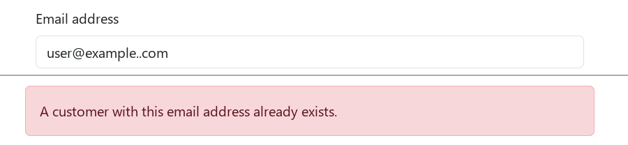{width=2.9in}                 |
| домені.                                                  |                                                          |
|                                                          |                                                          |
| Кейс: TC-REG-04.                                         |                                                          |
|                                                          |                                                          |
| Steps: 1) Відкрити /auth/register. 2) Заповнити форму    |                                                          |
| коректно, email user@example..com. 3) Натиснути          |                                                          |
| Register. 4) Повторити реєстрацію з тією самою адресою.  |                                                          |
|                                                          |                                                          |
| Expected: Адреса відхиляється з помилкою формату, акаунт |                                                          |
| не створюється (AC1: RFC-формат).                        |                                                          |
|                                                          |                                                          |
| Actual: Крок 3: HTTP 201, акаунт створено. Крок 4: HTTP  |                                                          |
| 409, адреса вже зайнята. На таку адресу лист не          |                                                          |
| доставити.                                               |                                                          |
|                                                          |                                                          |
| Severity: Medium: на таку адресу не доставити лист, а    |                                                          |
| змінити email у профілі не можна, бо поле лише для       |                                                          |
| читання.                                                 |                                                          |
+----------------------------------------------------------+----------------------------------------------------------+

+----------------------------------------------------------+----------------------------------------------------------+
| DEF-02. Індикатор надійності пароля не працює, вимоги    | 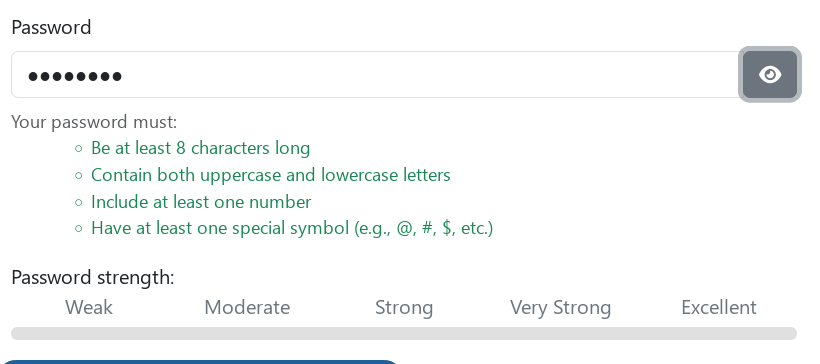{width=2.9in}                 |
| оновлюються лише після виходу з поля.                    |                                                          |
|                                                          |                                                          |
| Кейс: TC-REG-08.                                         |                                                          |
|                                                          |                                                          |
| Steps: 1) Відкрити /auth/register. 2) Поставити курсор у |                                                          |
| поле пароля. 3) Ввести aB1!aaaa, не виходячи з поля. 4)  |                                                          |
| Натиснути Tab.                                           |                                                          |
|                                                          |                                                          |
| Expected: Під час введення вимоги й індикатор            |                                                          |
| оновлюються (AC3, AC4), для aB1!aaaa рівень Excellent.   |                                                          |
|                                                          |                                                          |
| Actual: Крок 3: без змін. Крок 4: вимоги зелені,         |                                                          |
| індикатор лишається 0 %, рівень не підсвічено.           |                                                          |
|                                                          |                                                          |
| Severity: Medium: підказки під час введення немає, але   |                                                          |
| вимоги після виходу з поля й перевірка під час           |                                                          |
| надсилання працюють.                                     |                                                          |
+----------------------------------------------------------+----------------------------------------------------------+

+----------------------------------------------------------------------+----------------------------------------------+
| DEF-03. Після запиту на відновлення показано технічний ключ замість  | {width=2.2in}     |
| тексту.                                                              |                                              |
|                                                                      |                                              |
| Кейс: TC-REC-01.                                                     |                                              |
|                                                                      |                                              |
| Steps: 1) Відкрити /auth/forgot-password. 2) Ввести зареєстровану    |                                              |
| адресу. 3) Натиснути Set New Password.                               |                                              |
|                                                                      |                                              |
| Expected: Зрозуміле підтвердження, що новий пароль надіслано.        |                                              |
|                                                                      |                                              |
| Actual: HTTP 200, зелене повідомлення з текстом                      |                                              |
| page.forgot-password.confirm.                                        |                                              |
|                                                                      |                                              |
| Severity: Medium: користувач не дізнається, що пароль скинуто й      |                                              |
| надіслано, хоча скидання виконується.                                |                                              |
+----------------------------------------------------------------------+----------------------------------------------+

+----------------------------------------------------------------------+----------------------------------------------+
| DEF-04. Форма відновлення показує, чи зареєстрована адреса.          | {width=2.2in}     |
|                                                                      |                                              |
| Кейс: TC-REC-05.                                                     |                                              |
|                                                                      |                                              |
| Steps: 1) Надіслати форму із зареєстрованою адресою. 2) Надіслати    |                                              |
| форму з незареєстрованою адресою. 3) Порівняти відповіді.            |                                              |
|                                                                      |                                              |
| Expected: Однакова відповідь для обох адрес, щоб не можна було       |                                              |
| перевірити наявність акаунта. Вимога поставлена мною з погляду       |                                              |
| безпеки: User Story сайту (AC4) навпаки вимагає помилку.             |                                              |
|                                                                      |                                              |
| Actual: Перша адреса: HTTP 200, зелене повідомлення (знімок DEF-03). |                                              |
| Друга: HTTP 422, «The selected email is invalid.»                    |                                              |
|                                                                      |                                              |
| Severity: Medium: дає перевірити, чи є акаунт, але не дає доступу до |                                              |
| нього.                                                               |                                              |
+----------------------------------------------------------------------+----------------------------------------------+

+----------------------------------------------------------------------+----------------------------------------------+
| DEF-05. Пошук із запитом коротшим за 3 символи не показує помилку.   | {width=2.2in}    |
|                                                                      |                                              |
| Кейс: TC-SRC-03, TC-SRC-04.                                          | 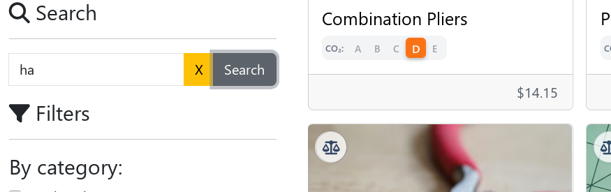{width=2.2in}    |
|                                                                      |                                              |
| Steps: 1) Відкрити головну. 2) Лишити поле порожнім або ввести ha.   |                                              |
| 3) Натиснути Search.                                                 |                                              |
|                                                                      |                                              |
| Expected: Показано помилку валідації (AC6).                          |                                              |
|                                                                      |                                              |
| Actual: Пошук не виконано, сітка без змін (першою лишається          |                                              |
| Combination Pliers), жодного повідомлення. Користувач не розуміє,    |                                              |
| чому нічого не сталося.                                              |                                              |
|                                                                      |                                              |
| Severity: Medium: користувач не розуміє причини відмови; обхід:      |                                              |
| ввести довший запит.                                                 |                                              |
+----------------------------------------------------------------------+----------------------------------------------+

+----------------------------------------------------------------------+----------------------------------------------+
| DEF-06. Поле пошуку приймає більше 40 символів.                      | 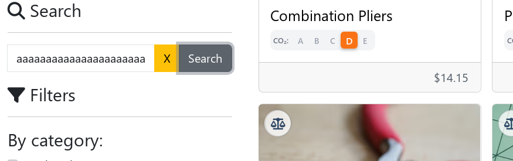{width=2.2in}     |
|                                                                      |                                              |
| Кейс: TC-SRC-05.                                                     |                                              |
|                                                                      |                                              |
| Steps: 1) Ввести в пошук 41 символ a. 2) Натиснути Search.           |                                              |
|                                                                      |                                              |
| Expected: Поле приймає не більше 40 символів (AC7).                  |                                              |
|                                                                      |                                              |
| Actual: Поле прийняло 41 символ (довжину значення записано в         |                                              |
| журналі, у полі видно лише початок рядка). Пошук не виконано, сітка  |                                              |
| без змін, жодного повідомлення.                                      |                                              |
|                                                                      |                                              |
| Severity: Low: запит понад 40 символів рідкісний, коротшим запитом   |                                              |
| пошук працює.                                                        |                                              |
+----------------------------------------------------------------------+----------------------------------------------+

+----------------------------------------------------------------------+----------------------------------------------+
| DEF-07. Порожній блок помилки для некоректної адреси у відновленні.  | 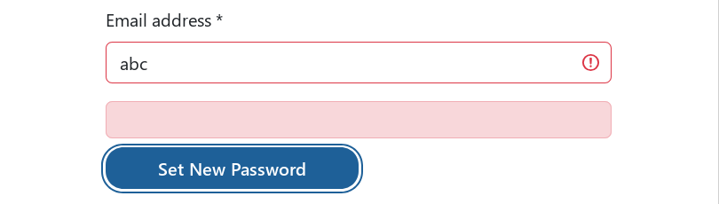{width=2.2in}     |
|                                                                      |                                              |
| Кейс: TC-REC-04.                                                     |                                              |
|                                                                      |                                              |
| Steps: 1) Відкрити /auth/forgot-password. 2) Ввести abc. 3)          |                                              |
| Натиснути Set New Password.                                          |                                              |
|                                                                      |                                              |
| Expected: Під полем текст про неправильний формат.                   |                                              |
|                                                                      |                                              |
| Actual: Під полем червоний блок без тексту.                          |                                              |
|                                                                      |                                              |
| Severity: Low: поле підсвічене червоним, а з адресою правильного     |                                              |
| формату форма працює.                                                |                                              |
+----------------------------------------------------------------------+----------------------------------------------+

+----------------------------------------------------------------------+----------------------------------------------+
| DEF-08. Помилка довжини пароля називає межу 6 замість 8.             | 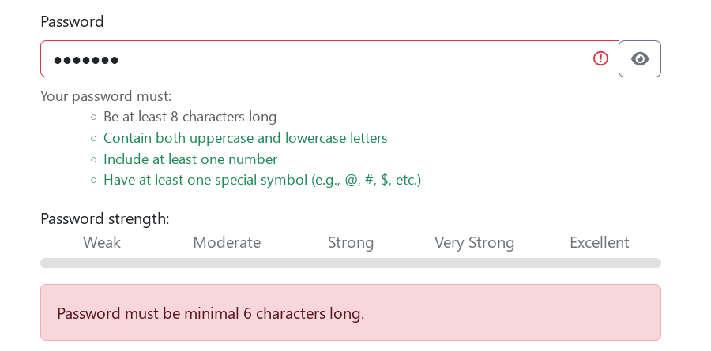{width=2.2in}     |
|                                                                      |                                              |
| Кейс: TC-REG-06.                                                     |                                              |
|                                                                      |                                              |
| Steps: 1) Заповнити форму реєстрації коректно. 2) Ввести пароль      |                                              |
| Aa1!aaa (7 символів). 3) Натиснути Register.                         |                                              |
|                                                                      |                                              |
| Expected: Текст називає правильну межу, 8 символів (AC2).            |                                              |
|                                                                      |                                              |
| Actual: «Password must be minimal 6 characters long.» для пароля із  |                                              |
| 7 символів.                                                          |                                              |
|                                                                      |                                              |
| Severity: Low: перевірка працює правильно, помиляється лише текст.   |                                              |
+----------------------------------------------------------------------+----------------------------------------------+

+----------------------------------------------------------------------+----------------------------------------------+
| DEF-09. Помилка складу пароля не називає вимогу, якої бракує.        | 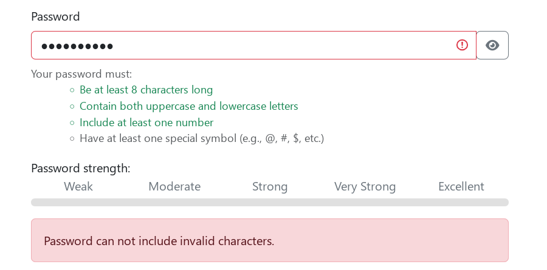{width=2.2in}     |
|                                                                      |                                              |
| Кейс: TC-REG-07.                                                     |                                              |
|                                                                      |                                              |
| Steps: 1) Заповнити форму реєстрації коректно. 2) Ввести пароль      |                                              |
| NoSymbol11. 3) Натиснути Register.                                   |                                              |
|                                                                      |                                              |
| Expected: Текст про відсутній спецсимвол.                            |                                              |
|                                                                      |                                              |
| Actual: «Password can not include invalid characters.», хоча         |                                              |
| недозволених символів немає. Той самий текст для всіх 4 паролів.     |                                              |
|                                                                      |                                              |
| Severity: Low: список вимог під полем підказує, чого бракує;         |                                              |
| помиляється лише текст.                                              |                                              |
+----------------------------------------------------------------------+----------------------------------------------+

+----------------------------------------------------------------------+----------------------------------------------+
| DEF-10. Текст помилки для зайнятої адреси відрізняється від вимоги.  | {width=2.2in}     |
|                                                                      |                                              |
| Кейс: TC-REG-02.                                                     |                                              |
|                                                                      |                                              |
| Steps: 1) Заповнити форму реєстрації адресою існуючого акаунта. 2)   |                                              |
| Натиснути Register.                                                  |                                              |
|                                                                      |                                              |
| Expected: «Email is already in use.» (AC5).                          |                                              |
|                                                                      |                                              |
| Actual: «A customer with this email address already exists.» Зміст   |                                              |
| правильний, текст інший.                                             |                                              |
|                                                                      |                                              |
| Severity: Low: зміст повідомлення правильний, відрізняється лише     |                                              |
| формулювання.                                                        |                                              |
+----------------------------------------------------------------------+----------------------------------------------+

+----------------------------------------------------------------------+----------------------------------------------+
| DEF-11. Текст помилки для різних паролів відрізняється від вимоги.   | 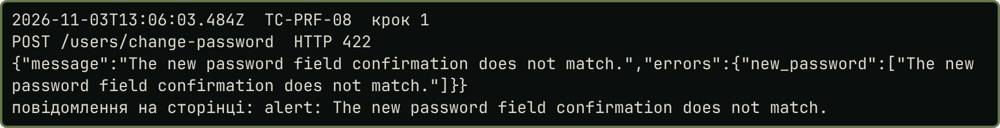{width=2.2in}     |
|                                                                      |                                              |
| Кейс: TC-PRF-08.                                                     |                                              |
|                                                                      |                                              |
| Steps: 1) У профілі ввести правильний поточний пароль. 2) Новий      |                                              |
| Pst-New-Pass-8842!, підтвердження Pst-Other-8842!. 3) Натиснути      |                                              |
| Change Password.                                                     |                                              |
|                                                                      |                                              |
| Expected: «Passwords do not match.» (AC3).                           |                                              |
|                                                                      |                                              |
| Actual: «The new password field confirmation does not match.», HTTP  |                                              |
| 422, зміна пароля не виконана. Відтворено один раз, знімок екрана не |                                              |
| зроблено. Доказ праворуч: запис відповіді сервера з журналу того     |                                              |
| прогону.                                                             |                                              |
|                                                                      |                                              |
| Severity: Low: зміст повідомлення правильний, відрізняється лише     |                                              |
| формулювання.                                                        |                                              |
+----------------------------------------------------------------------+----------------------------------------------+

+----------------------------------------------------------------------+----------------------------------------------+
| DEF-12. Пункт Sign out недоступний із клавіатури.                    | 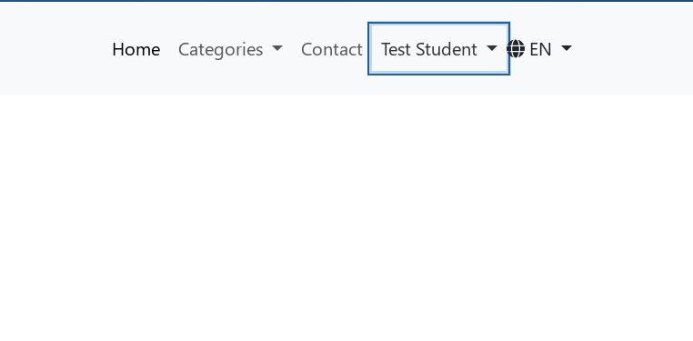{width=2.2in}     |
|                                                                      |                                              |
| Кейс: виявлено під час TC-AUTH-05.                                   |                                              |
|                                                                      |                                              |
| Steps: 1) Увійти. 2) Відкрити меню користувача клавішею Enter. 3)    |                                              |
| Від пункту My messages натиснути Tab.                                |                                              |
|                                                                      |                                              |
| Expected: Фокус переходить на Sign out, Enter виконує вихід.         |                                              |
|                                                                      |                                              |
| Actual: Після Tab меню закривається, фокус повертається на Test      |                                              |
| Student. Sign out є посиланням без href і tabindex, фокус на нього   |                                              |
| не потрапляє, вийти лише клавіатурою не можна.                       |                                              |
|                                                                      |                                              |
| Severity: Low: вийти можна мишею, страждає доступність.              |                                              |
+----------------------------------------------------------------------+----------------------------------------------+

## Fail без дефекту

+--------------------------------------------------------------------+------------------------------------------------+
| TC-AUTH-06. Блокування після трьох невдалих спроб.                 | 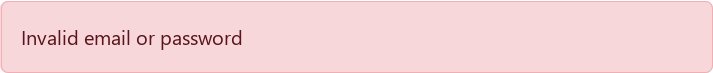{width=2.2in}  |
|                                                                    |                                                |
| Expected: Після третьої невдалої спроби вхід заблоковано: помилка  | 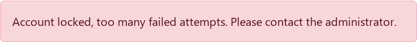{width=2.2in}  |
| «Account locked, too many failed attempts. Please contact the      |                                                |
| administrator.», HTTP 423.                                         |                                                |
|                                                                    |                                                |
| Actual: Спроба 1 (TC-REC-06) і спроба 2: HTTP 401, «Invalid email  |                                                |
| or password». Спроба 3 і дві наступні: HTTP 423, «Account locked,  |                                                |
| too many failed attempts. Please contact the administrator.»       |                                                |
| Блокування настало після двох записаних невдалих спроб, а не       |                                                |
| трьох.                                                             |                                                |
|                                                                    |                                                |
| Дефект не оформлено: перед цією серією була ще одна невдала спроба |                                                |
| входу з діагностичною метою, її відповідь не записано, тому з      |                                                |
| наявних даних не можна встановити, після скількох спроб сайт       |                                                |
| блокує акаунт.                                                     |                                                |
+--------------------------------------------------------------------+------------------------------------------------+

# Висновок

1. Я тестував вебзастосунок Practice Software Testing (Toolshop), <https://practicesoftwaretesting.com>.
2. Перевірив реєстрацію, авторизацію, відновлення паролю, пошук, перегляд і редагування профілю, включно зі зміною пароля.
3. Створив 40 тест-кейсів, виконав 39 (TC-REC-07 потребує справжньої пошти).
4. Статус Pass отримали 26 кейсів, Fail 13.
5. Виявив 12 дефектів, 5 Medium і 7 Low. Medium: прийнята адреса user@example..com, неробочий індикатор пароля, технічний ключ замість тексту й різні відповіді у відновленні, мовчазна відмова пошуку. TC-AUTH-06 має Fail без дефекту, бо кількість спроб до блокування з записів не встановити.
6. Використав позитивні й негативні сценарії, валідацію полів, граничні значення (пароль 7 і 8, запит 2, 3 і 41, індекс 10 і 11 символів), надто довгі значення, перевірку повідомлень, інтерфейсу й поведінки після дій.
7. Основні сценарії працюють: акаунт створюється, вхід, вихід, блокування, пошук і збереження профілю виконуються правильно. Більшість дефектів стосується текстів повідомлень і зворотного звʼязку. Частка Fail серед виконаних кейсів найбільша в реєстрації (5 із 9) і у відновленні паролю (3 із 6), далі пошук (3 із 9), авторизація (1 із 6) і профіль (1 із 9).
