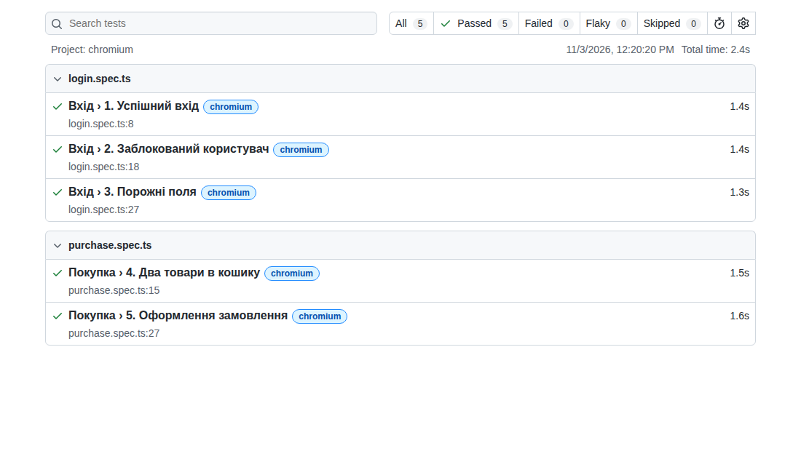
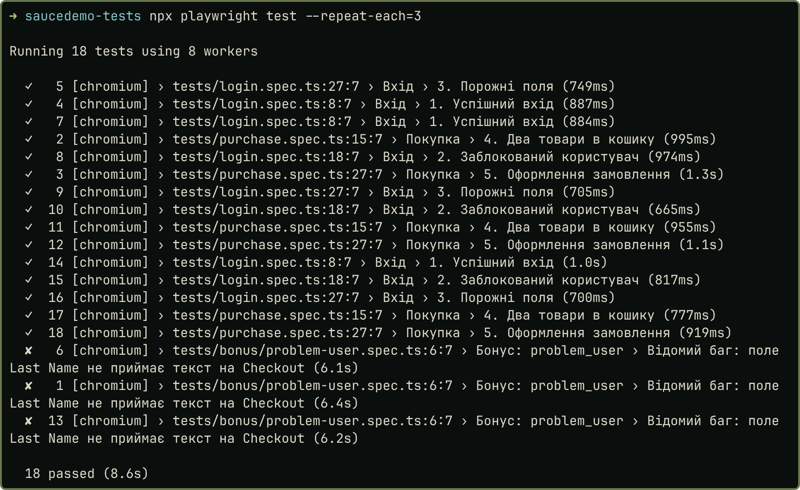
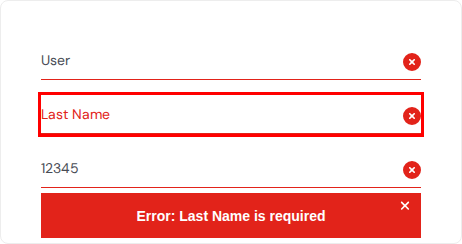

# Мета та об'єкт тестування

Мета: побудувати невеликий проєкт автотестів за патерном Page Object Model, у якому тести працюють лише через класи сторінок. Об'єкт: <https://www.saucedemo.com> (Swag Labs). Проєкт лежить у [теці saucedemo-tests репозиторію](https://github.com/brizzinck/krinzhrepoduta/tree/main/yatpz/pr-3/saucedemo-tests), без `node_modules` (встановлення: `npm install`, `npx playwright install chromium`).

# Структура проєкту

У `playwright.config.ts` задано `baseURL` і `testIdAttribute: 'data-test'`, тому `getByTestId` знаходить елементи сайту. Повтори вимкнено (`retries: 0`), щоб вони не приховали нестабільний тест.

| Page Object (`pages/`) | Методи |
|---------------------|-------------------------------------------------|
| `LoginPage` | `open()`, `login(username, password)`, `errorMessage()` |
| `InventoryPage` | `title()`, `addToCart(productName)`, `cartBadge()`, `openCart()` |
| `CartPage` | `items()`, `checkout()` |
| `CheckoutPage` | `fillInfoAndContinue(firstName, lastName, postalCode)`, `finish()`, `successTitle()`, `errorMessage()` |

Дії (клік, введення) я зробив `async`-методами, а методи, що лише повертають елемент для перевірки, без `async`. Товар шукаю фільтром: картка з потрібною назвою, а в ній кнопка:

```typescript
async addToCart(productName: string): Promise<void> {
  await this.page
    .getByTestId('inventory-item')
    .filter({ hasText: productName })
    .getByRole('button', { name: 'Add to cart' })
    .click();
}
```

| № | Файл (`tests/`) | Тест | Що перевіряє |
|--|-------------------|---------------------|-------------------------------------------|
| 1 | `login.spec.ts` | Успішний вхід | після входу `standard_user` заголовок «Products» |
| 2 | `login.spec.ts` | Заблокований користувач | для `locked_out_user` помилка містить «locked out» |
| 3 | `login.spec.ts` | Порожні поля | помилка містить «Username is required» |
| 4 | `purchase.spec.ts` | Два товари в кошику | лічильник 2, у кошику рівно 2 товари |
| 5 | `purchase.spec.ts` | Оформлення замовлення | заголовок «Thank you for your order!» |

Вимоги до рішення виконано. У тест-файлах немає локаторів і `waitForTimeout` (перевірив пошуком по `tests/`). Кожен тест має `expect`. Вхід для тестів покупки винесено в `beforeEach`, тому кожен тест запускається окремо, наприклад `npx playwright test -g "Оформлення замовлення"` (1 passed).

# Результати

HTML-звіт: усі 5 тестів зелені.

{width=78%}

Запуск `npx playwright test --repeat-each=3`: 18 passed із 18, тобто 5 основних тестів і бонусний, кожен тричі. Хрестик у рядках бонусного тесту означає очікуване падіння через відомий баг (див. далі), такий запуск рахується як пройдений.

{width=78%}

# Бонус

**Дефект `problem_user`: на кроці Checkout не вводиться прізвище.** Тест: `Відомий баг: поле Last Name не приймає текст на Checkout` (`tests/bonus/problem-user.spec.ts`).

Кроки: 1) увійти як `problem_user`; 2) додати «Sauce Labs Backpack»; 3) відкрити кошик, натиснути Checkout; 4) ввести `Test`, `User`, `12345`, натиснути Continue.

Expected: відкривається наступний крок оформлення. Actual: у First Name стоїть `User`, поле Last Name порожнє, показано «Error: Last Name is required», замовлення не оформити. Дефект відтворився в усіх запусках.

{width=45%}

Тест я позначив через `test.fail()` з анотацією `known bug`: набір лишається зеленим, а коли сайт виправлять, тест пройде і Playwright покаже це як помилку, тож позначку доведеться зняти.

Другий бонус: у `fixtures.ts` через `test.extend` оголошено фікстури `loginPage`, `inventoryPage`, `cartPage`, `checkoutPage`. Бонусний тест отримує їх у параметрах, без `new`. Основні п'ять тестів я лишив із явним створенням класів.

# Висновок

Я написав чотири Page Object і п'ять тестів у двох файлах, усі проходять, зокрема 3 рази поспіль. Основна складність була в кроках покупки: після кліку сторінка ще переходить, тому читати кількість товарів одразу не можна. Я перевіряю стан через `expect` із локатором, який чекає сам, і жодна пауза не знадобилась. Друга складність: `npm init playwright` і браузери потребують Node.js у системі, тому я запускав проєкт у docker-образі `mcr.microsoft.com/playwright:v1.64.1-noble`, а версію `@playwright/test` у `package.json` зафіксував такою самою. Також я знайшов і закріпив тестом реальний дефект під `problem_user`.
