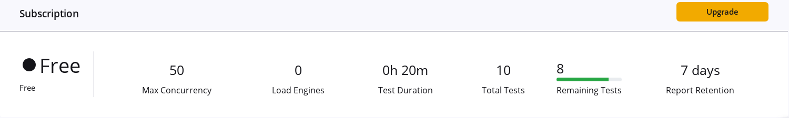
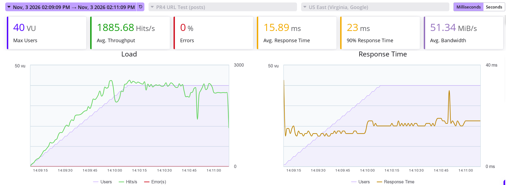
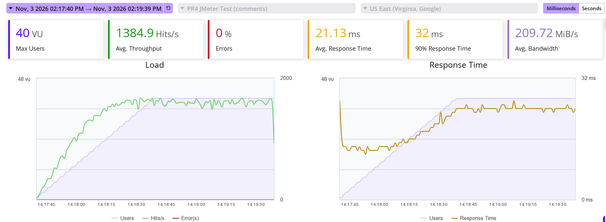

# Опис тестів і параметрів

Мета: запустити URL Test і JMeter Test у BlazeMeter, порівняти їх і оцінити, чи справляється сервіс із навантаженням. Я зареєструвався, переглянув розділи Tests, Reports і Workspaces та перевірив обмеження в Settings, Billing. Тариф Free дає до 50 одночасних користувачів, тест до 20 хв, 10 тестів, а звіти зберігаються 7 днів. Форма тесту не приймає значень поза межами 1-50 користувачів і 1-20 хв.

{width=72%}

| Параметр | URL Test | JMeter Test | JMeter локально |
|------------------|---------------------|---------------------|---------------------|
| Адреса (GET) | `/posts` | `/comments` | `/comments` |
| Сценарій | Performance Test, Enter URL/API Calls | завантажений `pr4_simple.jmx` | `pr4_simple.jmx`, без GUI |
| Навантаження | 40 користувачів, ramp-up 1 хв, 2 хв | 40 користувачів, ramp-up 1 хв, 2 хв | 40 потоків, ramp-up 60 с, 120 с |
| Генератор | US East (Virginia, Google) | US East (Virginia, Google) | мій компʼютер, Docker, JMeter 5.6.3 |

Сервіс: `https://jsonplaceholder.typicode.com`. План `pr4_simple.jmx` містить Thread Group, HTTP Request, Aggregate Report і Summary Report, пауз між запитами немає. BlazeMeter бере навантаження з Load Configuration, а не з файлу, тому там я вказав ті самі значення. Кожен тест я запустив один раз 03.11.2026. План і результати лежать у [теці pr-4 репозиторію](https://github.com/brizzinck/krinzhrepoduta/tree/main/yatpz/pr-4).

# Основні метрики

| Показник | URL Test | JMeter Test | Локально |
|-------------------------|---------------|---------------|---------------|
| Кількість запитів | 226 282 | 164 803 | 4 789 |
| Середній час відповіді, мс | 15,89 | 21,13 | 762 |
| 99 % відповідей, мс | 52 | 57 | 2708 |
| Максимум, мс | 1302 | 307 | 12 568 |
| Throughput, запитів/с | 1885,68 | 1384,90 | 39,6 |
| Помилки | 0 (0 %) | 0 (0 %) | 0 (0 %) |
| Середній трафік | 51,34 MiB/s | 209,72 MiB/s | 6135,61 KB/s |

# Звіти BlazeMeter

{width=80%}

{width=80%}

# Висновки та рекомендації

Сервіс упорався з навантаженням: в обох хмарних тестах усі відповіді мали код 2xx, а 99 % укладалися в 57 мс. `/comments` відповідав на 5,24 мс повільніше за `/posts` і мав на 26,6 % менший throughput, бо його відповідь більша: 157,7 КБ проти 27,5 КБ. Адреси різні, тому порівняння лише якісне. Локально `/comments` дав 762 мс проти 21,13 мс із хмари, тому обмеження там, найімовірніше, створювали мій канал і компʼютер, а не сервер. Окремий запит показав `cf-cache-status: HIT`, тобто я вимірював передусім кеш Cloudflare, а не сам застосунок, і межу можливостей ці тести не показали.

Що можна оптимізувати:

1. Додати до `/comments` пагінацію за замовчуванням, бо адреса щоразу віддає всі записи.
2. Надсилати в клієнтах `Accept-Encoding: gzip`: окрема перевірка дала 40,4 КБ замість 157,7 КБ.
3. Лишити кешування на CDN і шукати межу на власному стенді, поступово збільшуючи навантаження.
