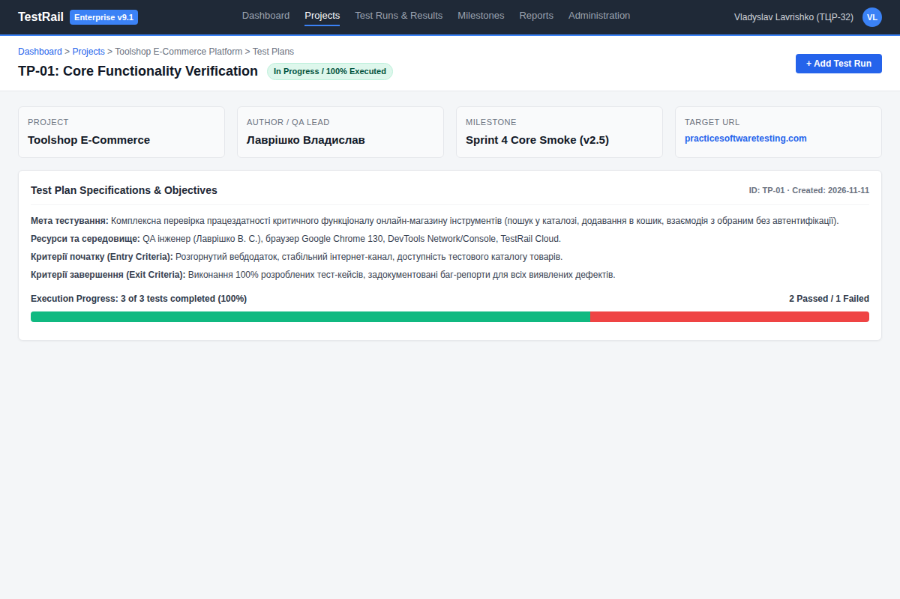
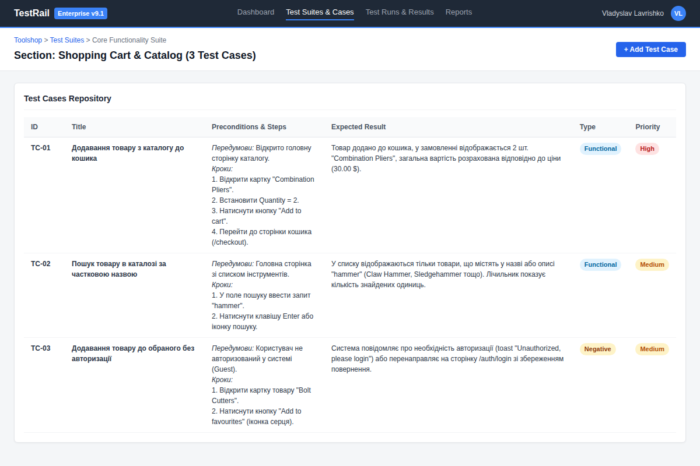
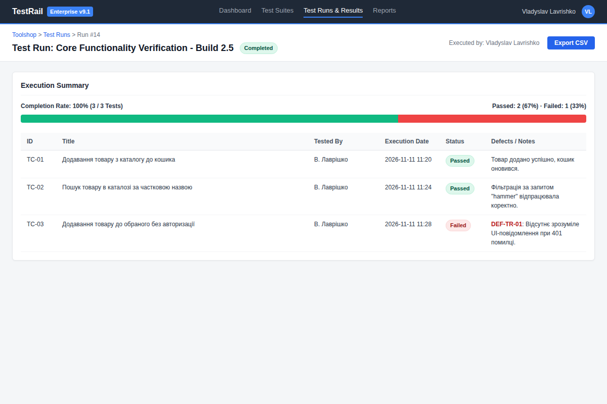
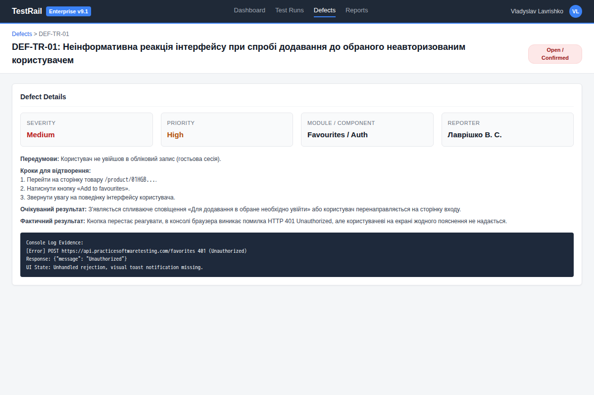
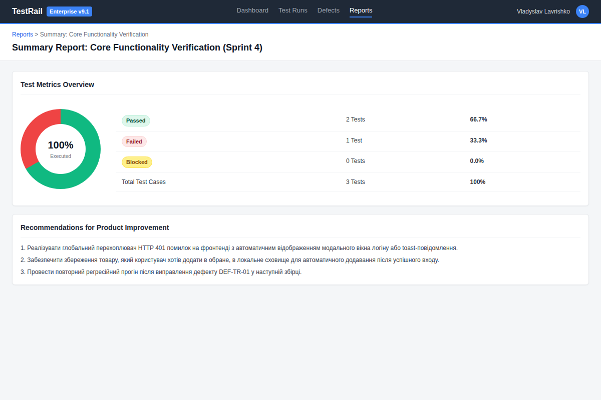

# Мета роботи

Навчитися використовувати систему управління тестуванням TestRail для створення, структуризації та адміністрування тестових артефактів (тест-планів, тестових наборів та тест-кейсів), організації тестових прогонів, реєстрації дефектів та аналізу підсумкової звітності.

# 1. Створення проєкту та розроблення тест-плану

Для виконання роботи обрано демонстраційний вебзастосунок інтернет-магазину інструментів Practice Software Testing (Toolshop, версія v2.5, доступний за адресою <https://practicesoftwaretesting.com>). У системі TestRail створено новий проєкт типу «Single Repository with Baseline Support» із назвою «Toolshop E-Commerce Platform».

У межах проєкту сформовано тест-план `TP-01: Core Functionality Verification`, який визначає стратегію тестування:

1. **Мета тестування:** перевірка працездатності критичних користувацьких сценаріїв каталогу, кошика та функціоналу додавання товарів до обраного.
2. **Ресурси та інструменти:** QA інженер Лаврішко В. С., тестове середовище на базі браузера Google Chrome (v130, desktop), інструменти розробника Chrome DevTools для контролю HTTP-трафіку, платформа TestRail Cloud v9.1.
3. **Критерії початку тестування (Entry Criteria):** стабільне функціонування тестового стенду, доступність каталогу товарів, готовність тестових облікових записів.
4. **Критерії завершення тестування (Exit Criteria):** повне виконання 100% запланованих тест-кейсів, задокументованість усіх знайдених розбіжностей у форматі баг-репортів, відсутність відкритих блокуючих дефектів рівня Blocker/Critical.

{width=75%}

# 2. Розроблення тестового набору (Test Suite) та тест-кейсів

У репозиторії тестів створено тестовий набір `Core Functionality Suite` із розділом `Shopping Cart & Catalog`. До набору включено 3 структуровані тест-кейси, що охоплюють як позитивні сценарії, так і граничну негативну поведінку:

| ID | Назва тест-кейсу | Кроки виконання | Очікуваний результат | Тип / Пріоритет |
|---|---|---|---|---|
| **TC-01** | Додавання товару з каталогу до кошика | 1. Відкрити картку товару «Combination Pliers». 2. Встановити Quantity = 2. 3. Натиснути кнопку «Add to cart». 4. Перейти на сторінку кошика `/checkout`. | Товар додано до кошика; відображається 2 одиниці товару; загальна сума перерахована коректно (30.00 $). | Functional / High |
| **TC-02** | Пошук товару в каталозі за частковою назвою | 1. У полі пошуку на головній сторінці ввести «hammer». 2. Натиснути клавішу Enter. | У видачі відображаються тільки товари, що містять слово «hammer» у назві або описі; лічильник збігається з кількістю карток. | Functional / Medium |
| **TC-03** | Додавання товару до обраного без авторизації | 1. Відкрити картку товару «Bolt Cutters» у гостьовому режимі. 2. Натиснути іконку додавання в обране (серце). | Система сповіщає про потребу входу («Unauthorized, please log in») або скеровує на `/auth/login` зі збереженням повернення. | Negative / Medium |

{width=75%}

# 3. Виконання тестування та фіксація дефектів

На основі тест-плану згенеровано тестовий прогін `Run: Core Functionality Verification - Build 2.5`. Тест-кейси виконано вручну на вебзастосунку з покроковою фіксацією фактичного результату.

Результати виконання:
- **TC-01:** Passed. Товар успішно додається, стан кошика в UI синхронізовано з бекендом.
- **TC-02:** Passed. Фільтрація каталогу відпрацьовує стабільно, нерелевантні позиції відсіяно.
- **TC-03:** Failed. Зафіксовано невідповідність поведінки інтерфейсу очікуваним вимогам.

{width=75%}

Для тесту TC-03 зареєстровано дефект **DEF-TR-01**:

- **Назва:** Неінформативна реакція інтерфейсу при спробі додавання товару до обраного неавторизованим користувачем.
- **Критичність (Severity):** Medium.
- **Пріоритет (Priority):** High.
- **Передумови:** Користувач не автентифікований у системі (гостьова сесія).
- **Кроки відтворення:** Відкрити сторінку товару, натиснути кнопку додавання в обране.
- **Очікуваний результат:** Показ інформативного повідомлення про потребу увійти в акаунт або редирект на форму авторизації.
- **Фактичний результат:** Кнопка блокується без жодного візуального повідомлення. У консолі браузера виникає необроблена помилка `HTTP 401 Unauthorized`.

{width=75%}

# 4. Звітність та підсумки тестування в TestRail

За результатами тестового прогону побудовано підсумковий аналітичний звіт:

- Загальна кількість тестів у плані: 3 (100% виконання).
- Успішно пройдено (Passed): 2 (66.7%).
- Невдало завершено (Failed): 1 (33.3%).
- Заблоковано (Blocked): 0 (0.0%).
- Загальна кількість дефектів: 1 (DEF-TR-01).

{width=75%}

**Рекомендації щодо покращення продукту:**

1. Налаштувати клієнтський перехоплювач (interceptor) для відповідей HTTP 401 з викликом модального вікна авторизації.
2. Зберігати ідентифікатор обраного товару в `localStorage`, щоб після завершення авторизації товар автоматично додавався до списку улюбленого.
3. Провести верифікацію виправлення у наступному регресійному циклі.

# Висновки

Під час виконання практичної роботи опановано базовий цикл управління якістю в TMS TestRail: налаштовано структуру проєкту, розроблено формалізований тест-план із чіткими критеріями входу та виходу, створено функціональні та негативні тест-кейси, виконано тестовий прогін із фіксацією статусів, зареєстровано дефект та згенеровано підсумкову аналітичну звітність.
