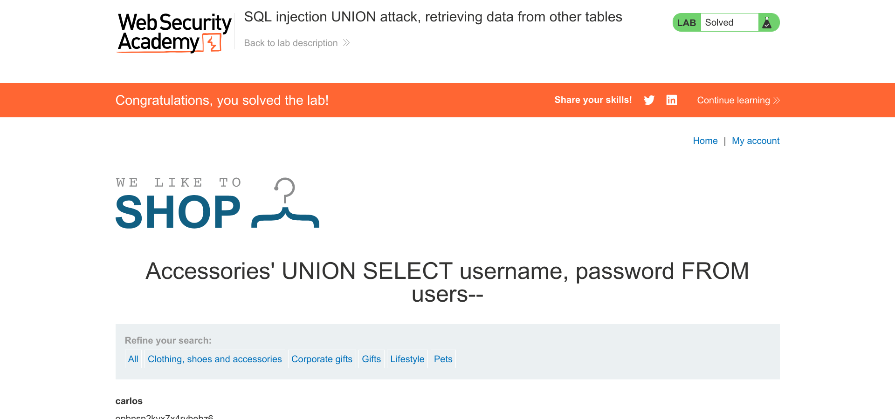

# Мета та стенд

Мета: навчитися аналізувати HTTP-запити вебзастосунку, перевіряти параметри на SQL Injection повторним надсиланням змінених запитів, оцінювати реакцію сервера та документувати результати.

Інструмент: Burp Suite Community Edition (проксі `127.0.0.1:8080`), встановлено як вимагає методичка. Стенд: PortSwigger Web Security Academy, три навчальні лабораторії з SQL-ін'єкцій:

1. SQL injection vulnerability in WHERE clause allowing retrieval of hidden data.
2. SQL injection vulnerability allowing login bypass.
3. SQL injection UNION attack, retrieving data from other tables.

Перевірки виконувались лише в цих навчальних середовищах. Запит перехоплювався проксі, надсилався повторно зі зміненим значенням параметра, після чого початкова й модифікована відповіді порівнювались. Вправа вважається виконаною, коли стенд показує статус `Solved`.

# Теоретичні відомості

SQL-ін'єкція виникає, коли дані користувача без екранування потрапляють у текст SQL-запиту, і введені символи змінюють його структуру. Одинарна лапка закриває рядковий літерал, `--` коментує залишок запиту, `OR 1=1` робить умову завжди істинною, `UNION SELECT` додає до результату рядки з інших таблиць. Наслідки: читання прихованих записів, обхід автентифікації, викрадення даних з усієї бази. Надійний захист — параметризовані запити (Prepared Statements), де значення передаються окремо від тексту запиту.

# Хід роботи

## Завдання 1-2. Перевірка категорії товарів (WHERE clause)

HTTP-запит вибору категорії: `GET /filter?category=Gifts`. Параметр `category` передається в рядку URL. Його відправлено до Repeater і надіслано без змін — відповідь `HTTP 200`, тіло 4901 байт, показано лише доступні товари категорії Gifts.

Потім значення параметра змінено на тестовий рядок і запит надіслано повторно:

```
GET /filter?category=Gifts' OR 1=1--
```

Відповідь: `HTTP 200`, тіло зросло з 4901 до 11516 байт; у список потрапили товари, яких не було у вибірці категорії Gifts. Умова `OR 1=1` зняла фільтр категорії, а `--` відкинула решту запиту. Статус-код не змінився, але обсяг відповіді й кількість товарів зросли — це підтверджує SQL Injection. Стенд перейшов у стан `Solved` (рис. 1).

{width=68%}

## Завдання 3. Обхід авторизації (login bypass)

Запит автентифікації: `POST /login` з параметрами `csrf`, `username`, `password`. Запит відправлено до Repeater. Для звичайних некоректних даних сервер повертає сторінку з помилкою входу. Змінено параметр `username`:

```
POST /login
csrf=...&username=administrator'--&password=x
```

Лапка закрила рядок імені, `--` закоментувала перевірку пароля, тому умова звелася до вибору користувача `administrator`. Відповідь: `HTTP 302`, `Location: /my-account?id=administrator` — вхід виконано в обліковий запис адміністратора без знання пароля (сторінка «Your username is: administrator», рис. 2). Ознака обходу — успішне перенаправлення на кабінет адміністратора. Рівень ризику критичний: зловмисник отримує повний доступ до застосунку. Стенд — `Solved`.

{width=68%}

## Завдання 4. UNION-based: читання даних з іншої таблиці

Вразливий — той самий параметр `category`. Кількість стовпців визначено через Repeater: `' ORDER BY 3--` дає `HTTP 500`, а `' UNION SELECT NULL,NULL--` дає `HTTP 200` — отже у початковому запиті два стовпці. Сформовано UNION-запит до таблиці `users`:

```
GET /filter?category=Accessories' UNION SELECT username, password FROM users--
```

Запит повернув рядки з текстовими значеннями, отже обидва стовпці відображають текст. У відповіді — логіни й паролі всіх користувачів: `administrator / 4abzzi4gilbehmf2mp1o`, `carlos / opbnsp2kvx7x4rvbehz6`, `wiener / 9luyvo7fzij31g5xeqmf` (рис. 3). Здобутим паролем виконано вхід як `administrator`, після чого стенд перейшов у стан `Solved`. UNION-ін'єкція дозволяє читати будь-яку таблицю бази — це найвищий рівень ризику (повне розкриття даних).

{width=68%}

## Завдання 5. Таблиця результатів

| Критерій | Перевірка категорії товарів | Перевірка авторизації |
|---|---|---|
| Перевірений параметр | `category` (URL) | `username` (тіло запиту) |
| Початкове значення | `Gifts` | `administrator` |
| Тестове значення | `Gifts' OR 1=1--` | `administrator'--` |
| Результат відповіді сервера | `HTTP 200`, тіло зросло з 4901 до 11516 байт, з'явились товари поза вибіркою | `HTTP 302`, `Location: /my-account?id=administrator` |
| Ознака SQL Injection | фільтр категорії знято, показано товари з інших категорій | вхід до кабінету адміністратора без пароля |
| Рівень ризику | високий (розкриття відфільтрованих даних) | критичний (обхід автентифікації) |
| Статус перевірки | Confirmed | Confirmed |

# Контрольні запитання

**Завдання 1 (аналіз запиту).** Метод — `GET`; параметр вибору категорії — `category`; початкове значення — `Gifts`; параметр передається в рядку URL.

**Завдання 2 (перевірка через Repeater).** HTTP status code не змінився (200); кількість товарів у відповіді зросла; з'явились товари, яких раніше не було у вибірці; цих змін достатньо, щоб у межах лабораторії підтвердити SQL Injection.

**Завдання 3 (обхід авторизації).** Змінено параметр `username` (`administrator'--`); результат авторизації змінився — виконано вхід; ознака обходу — перенаправлення `302` на `/my-account?id=administrator`; рівень ризику критичний, бо зловмисник дістає права адміністратора без облікових даних.

**Завдання 4 (UNION).** Вразливий параметр — `category`; початковий запит має два стовпці; обидва стовпці відображають текст; дані з таблиці `users` отримано (логіни й паролі); ризик — повне розкриття вмісту бази даних і компрометація всіх облікових записів.

# Завдання 6. Рекомендації

1. Використовувати параметризовані запити (Prepared Statements): значення передаються драйвером окремо від тексту SQL, тому введені символи трактуються лише як дані й не можуть змінити структуру запиту. Це усуває всі три продемонстровані вектори.
2. Застосовувати принцип найменших привілеїв для облікового запису БД і загальні повідомлення про помилки, щоб не розкривати деталі запиту.

Звичайна перевірка введених символів (екранування або чорні списки лапок і ключових слів) не є повноцінною заміною параметризації: списки заборонених конструкцій неповні й обходяться кодуванням, подвійними лапками, зміною регістру чи коментарями; різні СУБД мають власний синтаксис; екранування легко пропустити в одному з місць. Параметризація ж структурно відокремлює дані від коду й діє незалежно від вмісту введення.

# Висновки

Виконано три лабораторії PortSwigger Web Security Academy з SQL-ін'єкцій, кожна зі статусом `Solved`. Параметр перевірявся повторним надсиланням зміненого запиту через проксі з порівнянням відповідей. У запиті вибору категорії ін'єкція `' OR 1=1--` зняла фільтр і повернула товари поза початковою вибіркою; у формі входу `administrator'--` дала обхід автентифікації з правами адміністратора; UNION-запит прочитав логіни й паролі всіх користувачів з таблиці `users`. Обидві обов'язкові перевірки отримали статус Confirmed, результати зведено в таблицю. Опановано аналіз HTTP-запитів, повторне надсилання зі зміною параметра та інтерпретацію реакції сервера. Основний захід захисту — параметризовані запити; показано, чому фільтрація символів його не замінює.
